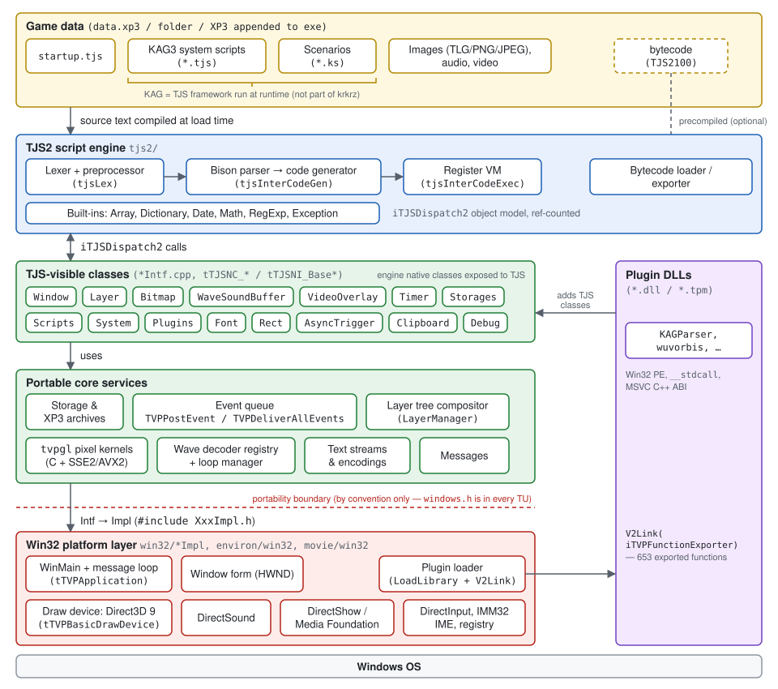
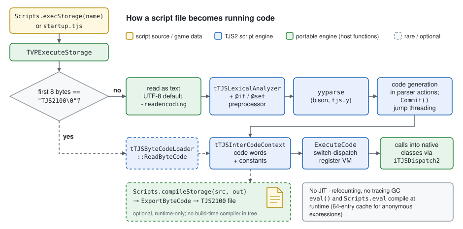
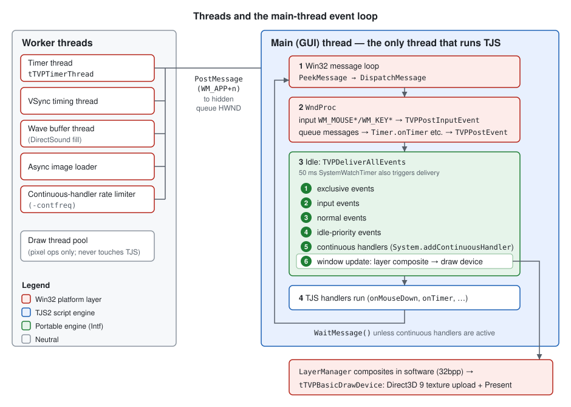

# Architecture Overview

This chapter maps the whole engine: what runs where, how a game's files turn
into behavior, and where the Windows dependency actually sits. Later chapters
specify each subsystem in detail; this one fixes the vocabulary and the
boundaries between them.

**Sources**

- `krkrz/README.md`, `krkrz/vcproj/tvpwin32.vcxproj`
- `krkrz/environ/win32/Application.cpp`, `krkrz/environ/win32/SystemControl.cpp`
- `krkrz/base/SysInitIntf.cpp`, `krkrz/base/win32/SysInitImpl.cpp`
- `krkrz/base/ScriptMgnIntf.cpp`, `krkrz/base/EventIntf.cpp`, `krkrz/base/EventIntf.h`
- `krkrz/base/StorageIntf.cpp`, `krkrz/base/win32/StorageImpl.cpp`, `krkrz/base/XP3Archive.cpp`
- `krkrz/base/win32/PluginImpl.cpp`, `krkrz/base/win32/makestub.pl`, `krkrz/base/win32/NativeEventQueue.cpp`
- `krkrz/extension/Extension.cpp`
- `krkrz/tjs2/tjs.cpp`, `tjsScriptBlock.cpp`, `tjsInterCodeGen.h`, `tjsInterCodeExec.cpp`,
  `tjsByteCodeLoader.cpp`, `tjsBinarySerializer.cpp`, `tjsScriptCache.cpp`, `tjsNative.h`,
  `tjsInterface.h`, `tjsObject.cpp`, `tjsCommHead.h`, `tjsTypes.h`
- `krkrz/visual/LayerIntf.cpp`, `krkrz/visual/LayerManager.cpp`, `krkrz/visual/WindowIntf.cpp`,
  `krkrz/visual/win32/DrawDevice.h`, `krkrz/visual/win32/BasicDrawDevice.cpp`, `krkrz/visual/tvpgl.c`,
  `krkrz/visual/gl/blend_function.cpp`
- `krkrz/sound/WaveIntf.cpp`, `krkrz/sound/win32/WaveImpl.cpp`
- `krkrz/utils/TimerImpl.cpp`

## In one paragraph

Kirikiri Z is a **TJS2 interpreter embedded in a Windows multimedia runtime**.
The executable contains a TJS2 compiler and register-based virtual machine, a
set of native classes that TJS scripts drive (`Window`, `Layer`,
`WaveSoundBuffer`, `Timer`, `Storages`, …), and Win32 backends for those
classes (Direct3D 9, DirectSound, DirectShow). A game ships as data — normally
TJS **source** text plus assets inside an XP3 archive — and the engine
compiles that source when it loads it. Everything game-specific, including the
KAG scenario system, is TJS code in the game data or native code in plugin
DLLs; none of it is in this repository.

## Common misconceptions

| Assumption | What the source shows |
|---|---|
| TJS is compiled to bytecode at build time and games ship bytecode. | Source text is compiled at load time by default. A bytecode format (`TJS2100`) exists and is auto-detected, but it can only be produced at runtime by `Scripts.compileStorage`; no build-time compiler or command-line option exists in the tree. See [Script engine](#the-tjs2-script-engine). |
| The engine is "a JVM for TJS". | The VM is only the `tjs2/` directory. Most of the engine is the native class library and the Win32 runtime under it. Unlike a JVM, the unit of distribution is source, there is no tracing GC and no JIT, and plugins are native DLLs that games load, not portable bytecode. |
| It is not cross-platform because of legacy C++. | `tjs2/` and most `*Intf.cpp` code is ordinary portable C++. Several concrete things tie it to Windows: the Win32 message loop is the event loop; Direct3D 9, DirectSound and DirectShow are the only backends; `windows.h` is in every translation unit; MSVC is the only build; and plugins use the Win32 DLL ABI. See [Portability](#portability). |
| KAG is an external build tool, like LaTeX to TeX. | The LaTeX/TeX analogy holds, but LaTeX is not a build tool either: it is a macro package that TeX interprets at run time. KAG3 is a TJS framework shipped in the game's data and interpreted at run time, and its `.ks` scenario parser (`KAGParser`) is native code. There is no KAG build step. See [Where KAG fits](#where-kag-fits). |

## Directory roles

The directory layout is described in the [Introduction](introduction.md). Here
is the same layout by role:

| Role | Directories |
|---|---|
| Language | `tjs2/` |
| TJS-visible engine classes and portable logic | `base/*Intf.*`, `visual/*Intf.*`, `sound/*Intf.*`, `utils/*Intf.*`, `msg/MsgIntf.*` |
| Pixel kernels | `visual/tvpgl.c` (generated portable C), `visual/gl/` (C++ functors plus SSE2/AVX2), `visual/IA32/` (NASM) |
| Windows backend | every `win32/` directory, plus all of `environ/` and `movie/` |
| Build-time native extensions | `extension/` (mechanism only; no extensions are registered in this tree) |

## The TJS2 script engine

### Loading a script

Every script load point (`startup.tjs`, `Scripts.execStorage`,
`Scripts.evalStorage`) ends up in `TVPExecuteStorage`
(`krkrz/base/ScriptMgnIntf.cpp:726-774`). That function:

1. Resolves the name with `TVPSearchPlacedPath` and opens the file as a binary
   stream.
2. Calls `tTJS::LoadByteCode(stream, …)` (`krkrz/tjs2/tjs.cpp:532`). This reads
   the first 8 bytes:
   - `TJS2` `100\0` (`tTJSByteCodeLoader::IsTJS2ByteCode`,
     `krkrz/tjs2/tjsByteCodeLoader.cpp:19`) means compiled bytecode, which is
     loaded and executed.
   - `KBAD100\0` is the binary serialization of `Array`/`Dictionary`
     (`tjsBinarySerializer.cpp`). It is accepted only when the caller asks for
     a result.
3. If the header is neither, reopens the file as text, using
   `TVPScriptTextEncoding` (UTF-8 by default, overridable with
   `-readencoding`). It then calls `tTJS::ExecScript`, or `EvalExpression` for
   `evalStorage`.

So an implementation **MUST** accept both source text and `TJS2100` bytecode at
every script load point, and **MUST** tell them apart by the file header, not
by the file extension.

Bytecode is produced only at runtime: `Scripts.compileStorage(src, out, …)` →
`TVPCompileStorage` (`krkrz/base/ScriptMgnIntf.cpp:776`) →
`tTJS::CompileScript` → `tTJSScriptBlock::ExportByteCode`
(`krkrz/tjs2/tjsScriptBlock.cpp:538`).

**Unverified:** most commercial titles are believed to ship `.tjs` source
(often inside encrypted XP3 archives) rather than bytecode.

### Compiling

The compiler is a single pass:

- `tTJSLexicalAnalyzer` (`tjsLex.cpp`) is hand-written and also handles the
  `@if`/`@set` preprocessor.
- The bison parser (`tjs2/syntax/tjs.y` → `tjs.tab.cpp`) emits code directly
  from its semantic actions into one `tTJSInterCodeContext` per function,
  class or property (`tjsInterCodeGen.h`).
- `Commit()` threads jumps, and that is the only optimization.

The result is an array of 32-bit code words plus a constant pool.

`eval()`, `Scripts.eval` and `Scripts.exec` also compile at runtime.
`tTJSScriptCache` keeps an LRU cache of 64 entries
(`krkrz/tjs2/tjsScriptCache.cpp`), but only for anonymous,
preprocessor-free expressions. Named scripts are never cached, and nothing is
cached on disk.

### Executing

The VM is **register-based** and uses a three-address style:

- Operands are byte offsets into a register window of `tTJSVariant`
  (`TJS_TO_VM_REG_ADDR`, `krkrz/tjs2/tjsInterCodeGen.h:34`).
- Opcodes are listed in `tTJSVMCodes` (`tjsInterCodeGen.h:46-77`). Each
  arithmetic opcode comes in four forms: plain register, property by name
  (`PD`), property by index (`PI`), and property via an object (`P`).
- `tTJSInterCodeContext::ExecuteCode` (`krkrz/tjs2/tjsInterCodeExec.cpp:1019`)
  is a `switch`-dispatch loop. Calls between functions recurse on the C++
  stack, and TJS `try`/`catch` is implemented with C++ exceptions.

There is no JIT.

### Object model and memory

Every value that is not a primitive is an `iTJSDispatch2`
(`krkrz/tjs2/tjsInterface.h`). This is a COM-like interface with
`AddRef`/`Release`, `FuncCall`, `PropGet`/`PropSet`, `CreateNew`, `Invalidate`,
`IsValid`, and so on.

Lifetime is managed by reference counting, plus an explicit
`invalidate` / finalize step (`tTJSDispatch::Release`,
`krkrz/tjs2/tjsObject.cpp:115-139`). There is no tracing collector:
`tTJS::DoGarbageCollection` only compacts internal pools. Reference cycles
therefore leak unless a script breaks them, for example with `invalidate`.
**Inferred:** some scripts may depend on the timing of finalization, so a
reimplementation that adds a tracing GC must keep the deterministic destruction
order.

### Binding native classes

An engine class is made of two C++ classes:

- `tTJSNC_Xxx : tTJSNativeClass` registers the methods and properties, using
  the `TJS_BEGIN_NATIVE_MEMBERS` / `TJS_BEGIN_NATIVE_METHOD_DECL` macros
  (`krkrz/tjs2/tjsNative.h`).
- `tTJSNI_Xxx : tTJSNativeInstance` holds the per-object state.

`TVPInitScriptEngine` (`krkrz/base/ScriptMgnIntf.cpp:404-561`) creates the
`tTJS` instance, sets the preprocessor value `kirikiriz`, runs the constants
script `TVPInitTJSScript`, and installs the engine classes on the global
object:

> `Debug`, `Font`, `Layer`, `Timer`, `AsyncTrigger`, `System`, `Storages`,
> `Plugins`, `VideoOverlay`, `Clipboard`, `Scripts`, `Rect`, `Bitmap`,
> `ImageFunction`, `BitmapLayerTreeOwner`, `WaveSoundBuffer`, `Window`

Extension classes are installed after these
(`TVPCauseAtInstallExtensionClass`, `krkrz/extension/Extension.cpp`).

## Boot sequence

The boot steps run in this order (`krkrz/environ/win32/Application.cpp:190`
`wWinMain`, then `tTVPApplication::StartApplication` at `:312-406`):

1. **Load options.** Option layers are loaded with this priority: command line
   > `<exe>.cfu` > `<exe>.cf` > the embedded option resource
   (`TVPInitProgramArgumentsAndDataPath`, `krkrz/base/win32/SysInitImpl.cpp:1651`).
2. **Create the script engine** and register the native classes
   (`TVPInitScriptEngine`).
3. **Run `msgmap.tjs`**, if it exists, to localize messages
   (`TVPInitializeBaseSystems`, `SysInitImpl.cpp:887`).
4. **Select the project data** (`TVPBeforeSystemInit`, `SysInitImpl.cpp:1024-1228`).
   The first match wins:
   - a path given on the command line;
   - `content-data\`;
   - `data.xp3`;
   - `data.exe`;
   - an XP3 appended to the executable itself;
   - `data\`;
   - otherwise, a folder-selection dialog.

   The chosen location becomes the TJS current directory. For an archive, the
   archive delimiter is appended, giving for example
   `file://./c/game/data.xp3>`.
5. **Initialize pixel kernels and CPU-dependent settings.** `TVPInitTVPGL` and
   `TVPGL_C_Init` install portable C kernels. `TVPAfterSystemInit` then
   replaces some of them with SIMD versions.
6. **Auto-load plugins.** `*.tpm` files are loaded from the exe directory,
   `system\` and `plugin\` (`TVPLoadPluigins`, sic;
   `krkrz/base/win32/PluginImpl.cpp:531`).
7. **Run the startup script.** `TVPExecuteStorage("startup.tjs")`
   (`TVPExecuteStartupScript`, `krkrz/base/ScriptMgnIntf.cpp:870`). The name
   can be overridden with `-startup`.
8. **Enter the message loop** (`tTVPApplication::Run`, `Application.cpp:534`).

`startup.tjs` is the only fixed contract between engine and game. Everything
after it — creating windows, loading KAG, showing a title screen — is up to
the game's scripts.

## Main loop, events and threading

All TJS code runs on the GUI thread.

**Worker threads.** The timer, VSync timing, DirectSound buffer filling, async
image loading and the continuous-handler rate limiter never call into TJS.
They post `WM_APP+n` messages (`krkrz/base/UserEvent.h`) to hidden queue windows
that the main thread created (`NativeEventQueue`,
`krkrz/base/win32/NativeEventQueue.cpp`). Because those windows belong to the
main thread, the handlers run there.

**Event queue.** Engine code queues script events with `TVPPostEvent` /
`TVPPostInputEvent` (`krkrz/base/EventIntf.cpp`). When the message loop is
idle, it runs `TVPDeliverAllEvents` (`EventIntf.cpp:578-650`). Each pass
delivers only events posted before the pass started, in this order:

1. exclusive events;
2. input events;
3. normal events;
4. idle-priority events;
5. continuous handlers (`System.addContinuousHandler`);
6. window updates, which composite the layer tree and present it.

**Sleeping.** The loop calls `WaitMessage()` unless continuous handlers are
active (`Application.cpp:534-583`). In addition, a 50 ms watch timer
(`tTVPSystemControl`, `krkrz/environ/win32/SystemControl.cpp`) also triggers
delivery and drives periodic compaction.

**Re-entrancy.** `TVPBreathe` (`krkrz/base/win32/EventImpl.cpp`) pumps Win32
messages in the middle of a TJS call, with event delivery disabled.

A reimplementation **MUST** keep these semantics:

- all script execution on one thread;
- event delivery only at well-defined points;
- the phase order above.

It **MAY** use any native event loop to get there.

## Storage

Scripts refer to files by *storage names*, for example
`file://./c/game/data.xp3>image/bg.tlg`. A `>` separates the archive from the
path inside it (`TVPArchiveDelimiter`, `krkrz/base/StorageIntf.cpp:40`).

Names are normalized to lowercase, so lookups are case-insensitive.

`TVPGetPlacedPath` (`StorageIntf.cpp:1153`) resolves a name in three steps:

1. Look in the current directory or archive.
2. Otherwise, look up the **bare file name** in a flat auto-path table built
   from `Storages.addAutoPath`. The table is not recursive.
3. If nothing matches, return an empty string.

XP3 is the native archive format (`krkrz/base/XP3Archive.cpp`):

- The index is zlib-compressed.
- Each file is stored as one or more segments, and segments may be shared
  between files.
- There is one global decryption hook, `TVPSetXP3ArchiveExtractionFilter`.
  Encrypted games install it from a plugin.

Susie plugins can add other archive formats (`krkrz/base/win32/SusieArchive.cpp`).

## Rendering path

The layer system is a **software compositor**:

1. A `Window` owns a primary `Layer` and its `tTVPLayerManager`.
2. Layer changes add update rectangles to the manager
   (`LayerManager::AddUpdateRegion`, `krkrz/visual/LayerManager.cpp`).
3. The manager requests a window update.
4. During the window-update phase, `tTJSNI_BaseLayer::CompleteForWindow`
   (`krkrz/visual/LayerIntf.cpp:6079`) recursively composites the dirty region
   into a 32 bpp buffer, using the `tvpgl` blend kernels.

The GPU is used only for the final step. `tTVPBasicDrawDevice`
(`krkrz/visual/win32/BasicDrawDevice.cpp`) copies the composited bitmap into a
Direct3D 9 texture and presents it, stretched to the window. In krkrz this is
the only draw device.

Every `tvpgl` kernel has a portable C implementation (`krkrz/visual/tvpgl.c`
`TVPInitTVPGL`, `krkrz/visual/gl/blend_function.cpp` `TVPGL_C_Init`). The
SSE2/AVX2/NASM versions only replace some of those function pointers after CPU
detection.

The renderer's pixel results are therefore defined by the C kernels. The
portability problem is only in the presentation step.

## Sound and video

**Sound.** `WaveSoundBuffer` works as a pipeline:

1. A decoder is chosen by file extension from a registry
   (`krkrz/sound/WaveIntf.cpp`). The core has only a RIFF WAV decoder; Ogg
   Vorbis and other formats come from plugins.
2. The decoded audio passes through a loop manager, which handles `.sli` loop
   files.
3. It then passes through optional filters, such as the phase vocoder.
4. The output goes to a DirectSound buffer (`krkrz/sound/win32/WaveImpl.cpp`).

**Video.** `VideoOverlay` is implemented entirely in `movie/win32/`, using
DirectShow and Media Foundation. It has no portable layer.

## Plugins and extensions

Games extend the engine with native DLLs (`*.dll`, `*.tpm`). Loading works like
this:

1. `Plugins.link(name)` looks the DLL up through the storage system. If it is
   inside an XP3, the DLL is first copied to a temporary file.
2. The engine calls `LoadLibrary`.
3. It then calls the DLL's exported
   `V2Link(iTVPFunctionExporter*)` (`krkrz/base/win32/PluginImpl.cpp:250-340`).

The exporter gives the plugin the engine's internal API: 653 functions, looked
up by their C++ signature strings and called through generated `__stdcall`
stubs (`krkrz/base/win32/makestub.pl`, generated `FuncStubs.cpp`). Plugins then
register their own TJS classes on the global object.

This interface is the Win32 C++ ABI itself. It passes MSVC object layouts,
16-bit `wchar_t` strings, `HWND` and `BITMAPINFO` (through `iTVPDrawDevice`),
and `IDirectSound*`.

`extension/` is the portable alternative: classes compiled into the
executable and installed at startup. No extensions are registered in this
tree.

## Where KAG fits

KAG does not appear in this repository. Searching the whole tree finds only
leftovers:

- a commented-out `#include "KAGParser.h"` (`krkrz/base/ScriptMgnIntf.cpp:32`);
- the unused global constants `tkdlNone`/`tkdlSimple`/`tkdlVerbose`
  (`ScriptMgnIntf.cpp:79`);
- commented-out stub generation for `utils/KAGParser.h`
  (`krkrz/base/win32/makestub.pl:500-501`). That file does not exist.

**Unverified** (not in this tree): KAG3 is a set of TJS scripts
(`MainWindow.tjs`, `Conductor.tjs`, …) that ship inside each game's data. At
run time they interpret `.ks` scenario files. They use the `KAGParser` class
to tokenize tags. In Kirikiri 2, `KAGParser` was built into the engine; in
krkrz it comes from a plugin. That is consistent with the leftovers above and
with the README's note that plugins were moved to separate repositories.

In the TeX analogy, krkrz corresponds to the TeX engine and KAG to LaTeX: a
library written in the engine's own language and loaded when the game runs.
There is no separate build step.

For the reimplementation, running KAG games requires:

- a correct TJS2 runtime and the engine classes;
- a native replacement for the `KAGParser` class, because the original is a
  Win32 DLL.

## Portability

The `Intf`/`Impl` split is a source-layout convention, not an enforced
boundary:

- `krkrz/tjs2/tjsCommHead.h` is included by every translation unit. It
  includes `<windows.h>` under `__WIN32__`, and it has about 30 unconditional
  MSVC `#pragma comment(lib, …)` lines.
- Each `*Intf.h` ends by including its `win32/*Impl.h`.
- 26 `Intf`-side files include headers from `win32/` directories directly.
- `iTVPDrawDevice` (`krkrz/visual/win32/DrawDevice.h`) has `HWND` and
  `BITMAPINFO` in its signatures.

| Area | Platform dependence |
|---|---|
| `tjs2/` | Mostly portable. `tjs_char` is `wchar_t` (`krkrz/tjs2/tjsTypes.h:63,130`), but the bytecode format, string handling and Oniguruma (`ONIG_ENCODING_UTF16_LE`) all assume 2-byte characters. **Inferred:** a build where `wchar_t` is 4 bytes would break all three. |
| Event loop | The Win32 message queue is the scheduler. |
| Graphics | Compositing is portable C. Presentation is Direct3D 9 only. |
| Audio | DirectSound only. |
| Video | DirectShow / Media Foundation only. |
| Input, IME, configuration | DirectInput, IMM32, registry. |
| Build | Visual Studio only (`krkrz/vcproj/tvpwin32.vcxproj`). There is no CMake or Makefile. The README mentions a planned Android version but contains no code for it. |
| Plugins | Win32 PE DLLs with an MSVC C++ ABI. This is the largest obstacle to running *existing* games elsewhere, because games bundle these DLLs. |

What this means for the Rust port:

- The language core and the compositor are specified by portable code and can
  be ported faithfully.
- The platform layer has to be re-implemented against these semantics: the
  event phases and the draw-device contract.
- Plugin-provided classes (KAGParser, audio decoders, XP3 decryption filters)
  have to be reimplemented natively. Loading the original DLLs would require
  emulating the Windows ABI.

## Open questions

- **Open question:** Is `TJS2100` bytecode ever used by shipped games, or only
  by developer tooling? This determines how much priority bytecode loading
  needs.
- **Open question:** Which plugins are effectively mandatory for KAG3-based
  games, such as `KAGParser` and `wuvorbis`? Their TJS interfaces need to be
  specified from sources outside this repository.
