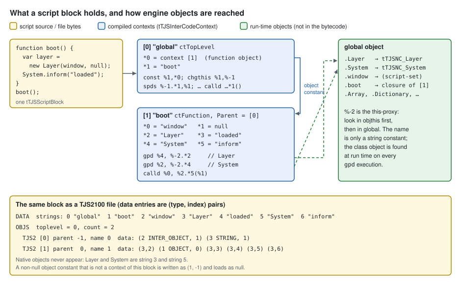
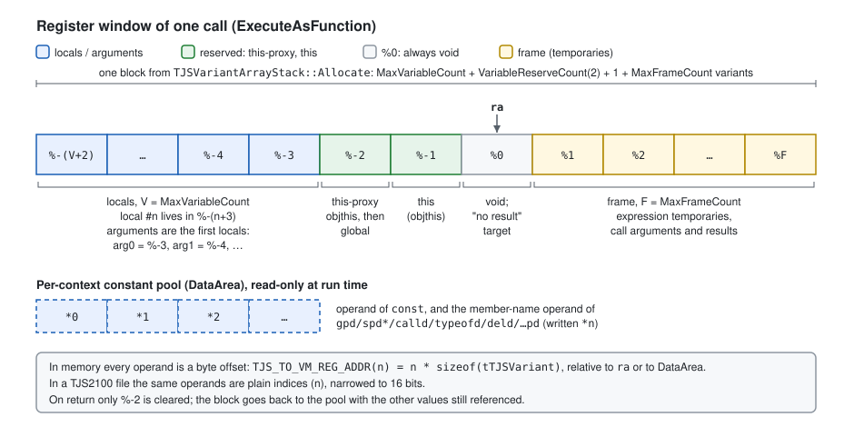

# TJS2 Interpreter

This chapter covers the part of the script engine that turns TJS2 text into
running code: the lexer, the bison parser, the single-pass code generator, the
register-based virtual machine, the `TJS2100` bytecode file format, error
reporting, and the debugging aids. The surface language is covered in
[TJS2 Language](tjs2-language.md). Values, objects, native classes and the
standard library are covered in
[TJS2 Runtime and Native Class Interface](tjs2-runtime.md). The pipeline as a
whole is summarised in
[Architecture Overview](../architecture.md#the-tjs2-script-engine).

**Sources**

- `krkrz/tjs2/tjs.cpp`, `krkrz/tjs2/tjs.h`
- `krkrz/tjs2/tjsScriptBlock.cpp`, `krkrz/tjs2/tjsScriptBlock.h`, `krkrz/tjs2/tjsScriptCache.cpp`
- `krkrz/tjs2/tjsLex.cpp`, `krkrz/tjs2/syntax/tjs.y` (generated `tjs.tab.cpp`), `krkrz/tjs2/syntax/tjspp.y`
- `krkrz/tjs2/tjsInterCodeGen.cpp`, `krkrz/tjs2/tjsInterCodeGen.h`, `krkrz/tjs2/tjsNamespace.cpp`
- `krkrz/tjs2/tjsInterCodeExec.cpp`, `krkrz/tjs2/tjsDisassemble.cpp`
- `krkrz/tjs2/tjsByteCodeLoader.cpp`, `krkrz/tjs2/tjsByteCodeLoader.h`, `krkrz/tjs2/tjsConstArrayData.cpp`, `krkrz/tjs2/tjsConstArrayData.h`
- `krkrz/tjs2/tjsError.cpp`, `krkrz/tjs2/tjsError.h`, `krkrz/tjs2/tjsErrorInc.h`, `krkrz/tjs2/tjsDebug.cpp`, `krkrz/tjs2/tjsDebug.h`, `krkrz/tjs2/tjsConfig.cpp`
- `krkrz/base/ScriptMgnIntf.cpp`, `krkrz/base/ScriptMgnIntf.h`, `krkrz/base/win32/ScriptMgnImpl.cpp`
- `krkrz/utils/DebugIntf.cpp`, `krkrz/utils/Debugger.h`
- `krkrz/msg/text/Messages.xlsx` (message texts), `krkrz/msg/win32/MsgLoad.cpp`
- `krkrz/vcproj/tvpwin32.vcxproj`, `krkrz/PreprocessorDefinitions.md`

> **About the code samples.** TJS is shown in `javascript` fences. Blocks
> marked *pseudo-TJS* are illustrations only. Disassembly listings use the
> mnemonics that `krkrz/tjs2/tjsDisassemble.cpp` prints. Unless stated
> otherwise they were assembled by hand from the code generator, not captured
> from a running engine. They are therefore **Inferred**, and the
> `// *n = …` comments are abbreviated.

## Questions answered

| Question | Short answer | Details |
|---|---|---|
| **What's the architecture of the interpreter?** | A pipeline that runs inside one call: a hand-written lexer (with the `@if`/`@set` preprocessor built in), a bison LALR(1) parser whose semantic actions generate VM code directly, and a `switch`-dispatch register VM. One script text becomes one `tTJSScriptBlock` holding a list of `tTJSInterCodeContext` objects, one per top level, function, class, property, getter or setter. Each context is a 32-bit code array plus a constant pool, and is itself a callable `iTJSDispatch2`. Calls recurse on the C++ stack, and TJS `try`/`catch` is C++ `try`/`catch`. There is no JIT, no AST kept after a statement is compiled, and no persistent cache. | [Architecture](#architecture), [The virtual machine](#the-virtual-machine) |
| **Does it have something like LSP?** | **No.** The source tree has no language server, completion, symbol index or standard debug protocol. It does have: a disassembler (`Scripts.dump` writes `<exe>.dump.txt`); stack traces (`Scripts.getTraceString`, only with `-debug=yes`); an automatic disassembly and register dump when a native exception escapes into TJS code; a leak tracker; and, only in the special "Release Enable Debugger" build, a Win32-only debuggee that talks to an external window class `TScriptDebuggerForm` over `WM_COPYDATA` and `DebugBreak()`. That external program is not in the repository. | [Debugging and tooling](#debugging-and-tooling) |
| **What happens on a syntax error: does parsing stop or continue?** | Parsing **continues**. Each error is printed as `Syntax error (syntax error) at line N` to the log. Bison's `def_list error ";"` rule then skips to the next `;` and resumes, so later errors in the same file are also reported, up to the point where the error count exceeds 20 (then `YYABORT`). A lexer error, such as an unterminated string, ends the token stream instead. When parsing ends with at least one error, **nothing in the file is executed**: the first error is thrown as `eTJSScriptError`. In the host it is logged, shown in a dialog ("Script exception raised"), and the engine terminates, unless a TJS `try`/`catch` around `Scripts.eval`/`execStorage`, or `System.exceptionHandler`, handles it. | [Error handling](#error-handling) |
| **How is TJS compiled? Any optimization? Any compile-time check?** | In one pass, statement by statement. Each expression is built as a small `tTJSExprNode` tree, emitted with `GenNodeCode` when its statement is reduced, then discarded. Optimizations are limited to: **constant folding** while the tree is built (`1+2*3` becomes `7`, `"a"+1` becomes `"a1"`); **jump threading** in `FixCode`; reuse of constants among the last 20 pool entries; string interning; and direct-call opcodes (`calld`). There is no dead-code elimination, inlining, type inference or register reuse beyond the expression stack. Compile-time checks cover only syntax, assignability (`This expression cannot be used as a lvalue`), `break`/`continue`/`case` placement, `...` outside functions and `super` without a superclass. There are no checks for undeclared or duplicate variables, assignment to `const`, argument counts, or types. | [Parser and code generation](#parser-and-code-generation), [Compile-time checks](#compile-time-checks) |
| **What does an external object look like in bytecode?** | It is never in the bytecode. Native and host objects such as `Layer` or `System` appear only as **string constants** (their names). At run time they are looked up with `gpd %r, %-2.*k` through the *this-proxy* register (`objthis` first, then the global object) or with `global`. The only object constants a `TJS2100` file can carry are references to other code contexts in the same file (type tag 2, by object index) and `null`. Any other object constant, for example a `(const)[1,2]` array, is silently written as "object, index -1" and **loads as `null`**. | [External objects in bytecode](#external-objects-in-bytecode) |

## Architecture



The stages run synchronously inside one call to a `tTJS` entry point:

1. **Text** goes to `tTJSScriptBlock::SetText`, which copies the script and
   builds a line table (`LineVector`), then calls `Parse`
   (`krkrz/tjs2/tjsScriptBlock.cpp:230-372`).
2. **`Parse`** creates a `tTJSLexicalAnalyzer` and runs `yyparse(this)`
   (`tjsScriptBlock.cpp:456-483`). The parser pulls tokens one at a time
   through `yylex` → `GetNext` (`krkrz/tjs2/tjsInterCodeGen.cpp:52-64`).
3. **Semantic actions** in `tjs.y` call methods of the *current context*
   `cc = sb->GetCurrentContext()`. Those methods append code words directly
   (`PutCode`) and constants (`PutData`).
4. When a function, class, property or the whole program ends,
   `PopContextStack` calls **`Commit()`**. `Commit` finishes the context
   (adds `srv %0; ret`, registers it with its parent, patches and threads
   jumps) (`tjsScriptBlock.cpp:445-454`, `tjsInterCodeGen.cpp:985-1074`).
5. If parsing produced no errors, the top-level context is **executed** with
   `FuncCall` (`ExecuteTopLevelScript`, `tjsScriptBlock.cpp:414-429`).

### Entry points

All entry points are on `tTJS` (`krkrz/tjs2/tjs.cpp`). Text entry points go
through the script cache object.

| Entry point | What it does |
|---|---|
| `ExecScript(script, result, context, name, lineofs)` | New `tTJSScriptBlock`, `SetText(..., isexpression=false)`, release (`tjsScriptCache.cpp:39-79`). Never cached. |
| `EvalExpression(expr, …)` | Same with `isexpression=true`. The lexer appends `;` and, if a result is wanted, emits a leading `return` token (`tjsLex.cpp:1062-1065`, `1753-1758`). **Anonymous** expressions are cached (see below). |
| `CompileScript(script, output, isresultneeded, outputdebug, isexpression, name, lineofs)` | Parse without executing, then `ExportByteCode` (`tjs.cpp:594-605`, `tjsScriptBlock.cpp:589-639`). |
| `LoadByteCode(stream, result, context, name)` | Sniffs 8 bytes. `TJS2100\0` → load and run. `KBAD100\0` with a result pointer → binary `Array`/`Dictionary` (see [Runtime](tjs2-runtime.md#binary-format)). Otherwise returns `false` (`tjs.cpp:532-566`). |
| `LoadTextDictionaryArray` | Parses with a `ConstParse` block. Instead of executing, it extracts the single constant of a `return <const>` program (`CopyConstData`, `tjsInterCodeGen.cpp:3989-4000`). |
| `Dump()` | Disassembles every live script block to the console (`tjs.cpp:365-469`). |
| `SetConsoleOutput`, `SetPPValue`, `DoGarbageCollection`, `GetGlobal`, `Shutdown` | Console sink, preprocessor variables, pool compaction, global object, teardown. |

The engine glue in `krkrz/base/ScriptMgnIntf.cpp` calls these:

- `TVPExecuteStorage` tries `LoadByteCode` first, then reads the file as text
  and calls `ExecScript` or `EvalExpression` (`:726-774`).
- `TVPCompileStorage` backs `Scripts.compileStorage` (`:776-803`, `:1268-1293`).
- `Scripts.exec`/`Scripts.eval` call `ExecScript`/`EvalExpression` directly
  (`:1295-1341`).

**Script cache.** `tTJSScriptCache` (`krkrz/tjs2/tjsScriptCache.cpp`) is an
LRU of 64 entries (`TJS_SCRIPT_CACHE_MAX`). It is used only by
`EvalExpression`, only when the name is NULL or empty, and only stores a block
if `IsReusable()`: exactly one context, a top level, and no `@`-preprocessor use
(`tjsScriptBlock.h:78-79`). The key is the text plus the expression mode and
whether a result is wanted. A cache hit re-runs the already compiled top level
(`ExecuteTopLevelScript`). An implementation **MAY** cache more aggressively,
since a cache hit has no visible effect beyond speed.

### Script blocks and their lifetime

A `tTJSScriptBlock` owns the source copy, the line table, and the list of all
contexts created while parsing it (`InterCodeContextList`), in creation order.

- Every non-top-level context AddRefs the block (`tjsInterCodeGen.cpp:269-272`).
- After the top level has run, a block with more than one context releases its
  `TopLevelContext` (`tjsScriptBlock.cpp:360-371`).

So a block (and its source text, needed for error line numbers) lives exactly
as long as some function, class or property object compiled from it is still
referenced, for example as a member of the global object.

### Contexts

`tTJSInterCodeContext` (`krkrz/tjs2/tjsInterCodeGen.h:130-659`) derives from
`tTJSCustomObject`, so a compiled function *is* an `iTJSDispatch2` object with
its own member table. The context type decides the calling behaviour
(`tjsInterCodeExec.cpp:3071-3254`) and two compile parameters
(`tjsInterCodeGen.cpp:174-188`, `256-266`):

| `tTJSContextType` | Created by (`tjs.y`) | `VariableReserveCount` | `FuncCall(NULL, …)` / `CreateNew` |
|---|---|---|---|
| `ctTopLevel` (0) | program start, name `"global"` | 2 | runs body; `objthis` defaults to the global object |
| `ctFunction` (1) | `function name(…) {…}` | 2 | runs body with the caller's args and `objthis` |
| `ctExprFunction` (2) | `function (…) {…}` expression, name `"(anonymous)"` | 2 | as function |
| `ctProperty` (3) | `property name {…}` | 0 | `FuncCall` → `TJS_E_INVALIDTYPE`. `PropGet`/`PropSet` with a NULL name call the getter/setter context |
| `ctPropertySetter` (4) | `setter(v) {…}`, name `"(setter)"` | 2 | as function, 1 arg |
| `ctPropertyGetter` (5) | `getter {…}`, name `"(getter)"` | 2 | as function |
| `ctClass` (6) | `class Name … {…}` | 2 | `CreateNew`: new `tTJSCustomObject`, run the class body on it, then call member `Name` (the constructor) |
| `ctSuperClassGetter` (7) | one per class with `extends` | 2 | evaluates the `extends` expression again; used when a member lookup on the class misses |

Inside a class, nested functions, properties and classes are registered at
compile time as members of the class context object
(`RegisterFunction`, `tjsInterCodeGen.cpp:905-979`). The class body begins
with `addci` and `regmember`. `regmember` copies every non-static member onto
the new instance and rebinds closures to it (`RegisterObjectMember`,
`tjsInterCodeExec.cpp:3009-3052`).

Functions declared at the top level are registered differently: code
`const %1,*f; chgthis %1,%-1; spds %-1.*name,%1` is **inserted at the start**
of the top-level code (`FixCode`, `tjsInterCodeGen.cpp:732-787`). This is why
top-level functions can be called before their definition in the file.

## Lexer

`tTJSLexicalAnalyzer` (`krkrz/tjs2/tjsLex.cpp`) is hand-written. The parser
pulls tokens one at a time. Bison's single-token lookahead is the only
lookahead.

- **Pre-processing:** on the first `GetNext`, `PreProcess` turns CR LF into
  LF plus a skip marker (`TJS_SKIP_CODE`), and turns a lone CR into LF
  (`:1675-1698`). Source positions are character offsets into this buffer.
- **Synthesized tokens:** a deque (`RetValDeque`) lets one scan return several
  tokens. Embeddable expression strings `@"…&expr;…${expr}…"` are rewritten into
  `( "…" + string(expr) + … )` token sequences (`:1821-1897`). A "dicfunc"
  hack for `[`/`%[` expressions exists but is compiled with
  `tjsEnableDicFuncQuickHack == false` (`:28-29`).
- **Parser feedback:**
  - After `.` the parser calls `SetNextIsBareWord()`, so `obj.if` is a member
    name, not a keyword (`tjs.y` `priority_expr`; `tjsLex.cpp:1956-1963`).
  - After `/` or `/=` in operand position the parser calls `SetStartOfRegExp()`.
    The lexer then rewinds to the slash and scans a regexp literal (`:1315-1329`).
- **Literals:** `true`, `false`, `null`, `NaN` and `Infinity` are returned as
  `T_CONSTVAL` tokens carrying a value (`:1608-1635`). Number literals are
  parsed in the lexer.
- **Preprocessor:** `@set(…)`, `@if(…)`, `@elif`, `@else` and `@endif` are
  handled inline by `ProcessPPStatement` (`:1190-1300`). Expressions are
  evaluated by the separate bison grammar `tjspp.y`. `@set (name = value)`
  writes the engine-wide `tTJS` preprocessor table
  (`tjspp.y:109`, `tTJS::SetPPValue`). Skipped `@if` regions are never tokenized.

How the language-level syntax behaves is covered in
[TJS2 Language](tjs2-language.md).

## Parser and code generation

`krkrz/tjs2/syntax/tjs.y` is a `%pure_parser` with `%expect 2` (two known
shift/reduce conflicts). Statements are compiled as soon as they are reduced:

- **Expressions** are built bottom-up as `tTJSExprNode` trees by
  `MakeNP0..MakeNP3` (`tjsInterCodeGen.cpp:3680-3874`). A statement action then
  calls `CreateExprCode`, `InitLocalVariable`, `ReturnFromFunc`, … which run
  `GenNodeCode` over the tree once. The nodes are freed at `Commit`
  (`ClearNodesToDelete`).
- **Control flow** is emitted by paired actions such as
  `EnterWhileCode`/`CreateWhileExprCode`/`ExitWhileCode`. A nesting stack
  (`NestVector`) holds pending jump patch lists for `break`/`continue`/exit.
- **Scopes:** `EnterBlock`/`ExitBlock` push and pop the compile-time
  `tTJSLocalNamespace` (`tjsNamespace.cpp`).
  - A `var` at namespace level 0 (top level outside any block), or below
    level 2 in a class body, becomes a member of `this` (`spds %-1.*name`).
  - Any other `var` gets a register slot (`AddLocalVariable`,
    `tjsInterCodeGen.cpp:2653-2705`).
- **Nested definitions** push a new context (`sb->PushContextStack`). The
  enclosing context continues after the matching `PopContextStack`.

### Registers and frames



The code generator manages registers with a simple stack discipline:

- Local variable #n (its index in the namespace) lives in register
  `%-(n + VariableReserveCount + 1)`, which is `%-(n+3)`. Arguments are the
  first locals.
- `%-1` is `this`, `%-2` is the *this-proxy* (see
  [name resolution](#property-access-and-name-resolution)), and `%0` is always
  void.
- Temporaries are allocated upward from `FrameBase` (1) during one
  `GenNodeCode` call and given back with `ClearFrame`.
  - `MaxFrameCount` and `MaxVariableCount` (`Namespace.GetMaxCount()`) are
    recorded per context and size the register window at call time.
  - Inner blocks reuse slots after they exit, so locals of sibling blocks may
    share a register.

In memory each operand is a **byte offset**: `TJS_TO_VM_REG_ADDR(n)` is
`n * sizeof(tTJSVariant)`, and jump operands are `TJS_TO_VM_CODE_ADDR(n)`,
`n * 4`, relative to the jump instruction (`tjsInterCodeGen.h:33-39`).

**Quirk:** `ClearFrame` and `ClearLocalVariable` emit nothing: their `cl`/`ccl`
code is under `#if 0` (`tjsInterCodeGen.cpp:2598-2649`). Temporaries and locals
therefore keep their values, and the objects they reference, until the
register is overwritten or the call returns. Even after the return the values
stay in the pooled array (see [the variant array stack](#the-variant-array-stack)).
Observable finalization timing depends on this. A reimplementation that wants
the same destruction order **SHOULD** keep values alive at least as long, and
**SHOULD NOT** clear them earlier.

### Commit and FixCode

`Commit` (`tjsInterCodeGen.cpp:985-1074`) does the following, in order:

1. Appends `srv %0; ret`, except for property and superclass-getter contexts.
2. Calls `RegisterFunction` to attach the context to its parent.
3. Runs `FixCode` (`:714-903`):
   - inserts `regmember` (classes) and the top-level function registration
     code at `FunctionRegisterCodePoint`, fixing up jumps that cross the
     insertion point
   - sorts the source-position table
   - **threads jumps**: a jump whose target is `jmp`, or the same conditional
     jump, is redirected to the final target; `jf` → `jnf` (and the reverse)
     is redirected past the second jump
   - converts jump distances to byte offsets
4. Freezes the constant pool into `DataArea`.
5. Shrinks the code and source-position arrays to size.

### Optimizations

| Optimization | Where | Behaviour |
|---|---|---|
| Constant folding | `MakeNP1`, `MakeNP2` (`tjsInterCodeGen.cpp:3692-3858`), unless `TJS_NO_CONSTANT_FOLDING` (not defined in any `tvpwin32.vcxproj` configuration) | When **all** operands are literal `T_CONSTVAL` nodes, the operation is evaluated at parse time with the run-time `tTJSVariant` operators. Unary: `! ~ # $ + -`, `int`, `real`, `string`, `octet`. Binary: `, || && | ^ & != == !== === < > <= >= >> << >>> + - % / \ *`. Not folded: `?:`, `if`, `instanceof`, `typeof`, assignments. |
| Jump threading | `FixCode` | as above |
| Constant-pool reuse | `PutData` (`:645-694`) | Before appending, compares against the **last 20** entries with `DiscernCompareStrictReal` and reuses a match. Strings are interned through `TJSMapGlobalStringMap`. |
| Direct calls | `GenNodeCode` `T_LPARENTHESIS` (`:1744-1843`) | `o.m(…)`, `o[k](…)` and calls to non-local names compile to `calld`/`calli` (one dispatch through `FuncCall(name)`) instead of "get, then call". |

Folding works on the tree as parsed. `60*60*24` folds to `86400`. `x*60*60`
does not fold, because it parses as `(x*60)*60`.

```javascript
function f() { var s = 60 * 60 * 24; }
// f's code (Inferred):
// 00000000 const %1, *0      // *0 = (int)86400
// 00000003 cp %-3, %1
// 00000006 srv %0
// 00000008 ret
```

**Quirk:** folding runs the run-time operators while parsing. A literal
integer division or modulo by zero (`1 \ 0`, `1 % 0`) throws
`eTJSVariantError("Division by zero")` (`TJSThrowDivideByZero`,
`krkrz/tjs2/tjsVariant.cpp:182-185`, `tjsVariant.h:1059-1079`) out of
`yyparse`. The whole compile fails with a plain error that carries no line
number, even if that code would never run. A compatible implementation
**SHOULD** reproduce this rejection.

There is no dead-code elimination, inlining, register coalescing, loop
optimization or type specialization. The comment at
`tjsInterCodeGen.cpp:29-36` notes that native code generation was abandoned.

## Compile-time checks

Everything the compiler rejects goes through `_yyerror` (see
[Error handling](#error-handling)). Message texts below are the English
column of `krkrz/msg/text/Messages.xlsx`.

| Checked at compile time | Where | Message |
|---|---|---|
| Grammar | bison | `Syntax error (syntax error)` |
| Assignment, `++`, `--`, `delete` or compound assignment on a non-lvalue (constant, `this`, `global`, call result, …) | `TJSCannotModifyLHS` in `GenNodeCode` (`tjsInterCodeGen.cpp:1159-2350`) | `This expression cannot be used as a lvalue` |
| Value of `<->` or of a postfix `if` used as an expression | `TJSCannotGetResult` (`:1172`, `:1227`) | `Cannot get the value of this expression` |
| `break`/`continue` outside `while`/`do`/`for`/`switch` (`continue` outside a loop) | `DoBreak`, `DoContinue` (`:3212-3315`) | `Cannot place "break" or "continue" here` |
| `case`/`default` not directly in a `switch` block | `ProcessCaseCode` (`:3081-3101`) | `Cannot place "case" here` |
| `...` (pass-through arguments) outside a function | `AddOmitArg` (`:2565-2573`) | `"..." is used out of functions` |
| `super` outside a class method, or in a class without `extends` | `T_SUPER` (`:2260-2281`) | `Super class does not exist or cannot specify the super class` |
| Lexer: bad number, unterminated string/regexp/octet/comment, invalid character, malformed `@` directive | `tjsLex.cpp` | `Cannot be parsed as a number`, `Un-terminated string/regexp/octet literal`, `Un-terminated comment`, `Invalid character '%1'`, `Error in conditional compiling expression` |
| Literal integer `\ 0` or `% 0` | constant folding (see above) | `Division by zero` (no line) |

**Not** checked:

- **Undeclared names.** Any name that is not a local becomes a member access
  on the this-proxy register `%-2` (`T_SYMBOL`, `:2144-2167`). A missing name
  fails only at run time, with ``Member "x" does not exist``.
- **Duplicate `var`** in one scope. `tTJSLocalSymbolList::Add` silently reuses
  the existing slot (`tjsNamespace.cpp:57-76`). Re-declaring a function or
  class is also allowed.
- **Assignment to `const`.** The grammar comment says so explicitly:
  "current version does not actually disallow re-assigning new value"
  (`tjs.y`, `variable_def_inner`).
- **Type annotations** (`var x : int`). They are parsed and ignored
  (`variable_type`).
- **Argument counts.** Missing arguments become void and extra ones are
  ignored at run time (`ExecuteAsFunction`, `tjsInterCodeExec.cpp:842-868`).
- **`return` at the top level.** It is allowed: the message
  `TJSMisplacedReturn` exists but no code uses it.
- **Unreachable code and unused variables.**

Two compile-time **warnings** exist. They are printed to the log as
`Warning: <msg> at <name> line N` (`OutputWarning`, `:564-581`) and do not
count as errors:

- `=` used where a condition is expected (`if (a = b)`, `TJSSubstitutionInBooleanContext`, `:1263-1267`).
- The post-`!` eval operator outside top level, only when
  `-evalcontext=global` is set (`:1661-1667`).

A reimplementation **MUST NOT** reject programs that the original accepts.
It **MAY** add warnings or lints of its own.

## Error handling

### Compile errors

All compile-time errors are funnelled into `_yyerror(msg, sb, pos)`
(`tjsInterCodeGen.cpp:66-110`). It:

1. Rewrites bison's `syntax error` into the localized `TJSSyntaxError`
   template, giving `Syntax error (syntax error)`. `YYERROR_VERBOSE` is not
   defined anywhere, so bison never says what it expected.
2. Takes the position from the lexer's current position, which is just past
   the lookahead token, unless an explicit position was passed.
3. Records the first message and position (`SetFirstError`) and increments
   `CompileErrorCount`.
4. Prints `<message> at line N` (1-based, `LineOffset` applied, **no file
   name**) to the console, which the host routes to `TVPAddLog`
   (`krkrz/utils/DebugIntf.cpp:832-843`).

Errors do **not** stop the parse:

- **Recovery:** `def_list : def_list error ";"` (`tjs.y:231-233`) discards
  input up to the next `;` at statement level, calls `yyerrok`, and parsing
  continues. Each further error is reported again.
- **Limit:** in that recovery action, if `CompileErrorCount > 20`,
  `YYABORT` ends the parse. At most about 21 errors are reported per compile.
- **Semantic errors** (lvalue, `break` placement, …) only call `_yyerror` and
  return. Code generation simply goes on.
- **Lexer errors** are thrown inside the lexer as `eTJSCompileError` or
  `eTJSError`. `GetNext` catches them, calls `_yyerror`, and **returns token
  0 (end of input)** (`tjsLex.cpp:1745-1749`, `1905-1919`). Scanning stops
  there. **Inferred:** if the parser was in the middle of a statement, bison
  then also reports a `syntax error` at the false end of input and aborts,
  because recovery cannot find a `;`.
- **Exceptions from codegen helpers** (the divide-by-zero fold above,
  out-of-memory) are not caught by the parser. They leave `yyparse` at once.

After `yyparse` returns, `Parse` throws if any error was counted
(`tjsScriptBlock.cpp:479-482`):

```cpp
if(CompileErrorCount)
    TJS_eTJSScriptError(FirstError, this, FirstErrorPos);
```

The thrown type is **`eTJSScriptError`**. `eTJSCompileError` is used only
inside the lexer and preprocessor, and never escapes. The exception carries
the block and source position, so `GetSourceLine()` and the
`-exceptionexe` editor jump work, but `GetMessage()` is only the first
message, without a location.

**What has already run:** nothing. `SetText` executes the top level only
after `Parse` returns normally (`tjsScriptBlock.cpp:280-337`), so a syntax
error on the last line prevents the first line from running. There is one
exception: `@set` directives are evaluated by the lexer while scanning and
change the engine-wide preprocessor table even if the compile later fails.
Nested function and class objects created during the failed compile are
released (`SetText`'s `catch(...)`, `:346-358`).

**Example** (`startup.tjs`; the log lines follow from the code paths above and
are **Inferred**, not captured):

```javascript
Debug.message("first line");   // never runs
var a = 1 +;                   // line 2
var b = ;                      // line 3
```

```text
Syntax error (syntax error) at line 2
Syntax error (syntax error) at line 3
Script exception raised
Syntax error (syntax error)
trace : startup
```

The last three lines come from the host: `TVP_CATCH_AND_SHOW_SCRIPT_EXCEPTION`
adds the trace `startup`, then `TVPShowScriptException` logs and shows a
dialog, and the engine terminates (see [below](#how-the-host-reports-errors)).
With `-debug=yes`, `TJSReportExceptionSource` additionally logs
`Syntax error (syntax error) at startup.tjs(2)` when the exception is thrown
(`tjsError.cpp:134-143`). **Unverified:** which language the shipped build
uses for messages. They come from Win32 string resources (`MsgLoad.cpp`); the
Japanese text of `TJSSyntaxError` is `文法エラーです(%1)`.

A compile error raised while TJS code is running, for example from
`Scripts.eval`, `Scripts.exec`, `Scripts.execStorage` or the `!` operator, is
an ordinary exception and can be caught:

```javascript
try {
    Scripts.eval("1 +");            // expression mode appends ";"
} catch (e) {
    Debug.message(e.message);       // "Syntax error (syntax error)"   (Inferred)
}
```

### Runtime errors

- **`throw`** in TJS → `VM_THROW` → `eTJSScriptException`, carrying the
  thrown value. Its message is `script exception : <value.message>`, or
  `script exception` (`ThrowScriptException`, `tjsInterCodeExec.cpp:985-1017`).
- **Native failures** are `eTJSError`, for example `Member "x" does not exist`
  from a failing `PropGet`, or type conversion errors. They are converted where
  they cross `ExecuteCode` (`:1507-1530`):
  - the VM **always** prints `==== An exception occured at <file>(<line>)[<context>], VM ip = N ====`,
    a disassembly of the current source line and a register dump to the
    console (`DisplayExceptionGeneratedCode`, `:942-983`)
  - it then rethrows as `eTJSScriptError` with the current position
- **Stack trace:** each `ExecuteCode` frame that an `eTJSScriptError` passes
  through appends `<file>(<line>)[(<context type>) <name>]`, joined by
  ` <-- `, up to 1500 characters (`eTJSScriptError::AddTrace`,
  `tjsError.cpp:95-124`).
- **`try`/`catch`:** the `try` body runs in a nested `ExecuteCode` call
  (`VM_ENTRY` → `ExecuteCodeInTryBlock`, `:1550-1583`). Any C++ exception is
  converted into a TJS value with `TJS_CONVERT_TO_TJS_EXCEPTION_OBJECT`
  (`tjsError.h:115-163`):
  - a thrown value is passed unchanged
  - `eTJSScriptError` becomes `new Exception(message)` with `.trace` set
  - other `eTJS` and `std::exception` become `new Exception(message)`
  - unknown exceptions become void
  - `eTJSSilent` is never caught

  Execution then continues at the catch address.

### How the host reports errors

Host call sites (startup, event handlers, …) wrap script calls in
`TVP_CATCH_AND_SHOW_SCRIPT_EXCEPTION(origin)` (`krkrz/base/ScriptMgnIntf.h:94-119`):

1. Appends `origin` to the trace.
2. Calls `System.exceptionHandler(exceptionObject)` if it is set. A true
   return value means "handled" (`TVPProcessUnhandledException`,
   `ScriptMgnIntf.cpp:929-1076`).
3. Otherwise calls `TVPShowScriptException` (`:1107-1185`):
   - disables system events
   - logs `Script exception raised` + message, and `trace : …`
   - shows a modal dialog with the same text
   - in builds with `TVP_ENABLE_EXECUTE_AT_EXCEPTION` (Debug/Release
     configurations): if `-exceptionexe=<exe>` and `-exceptionarg=<args>` are
     given, launches the editor with `%filepath%` and `%line%` substituted
   - in `_DEBUG` builds under an attached debugger, prints a Visual Studio
     `file(line): error :` line and calls `DebugBreak()`
   - calls **`TVPTerminateSync(1)`**: an unhandled script error terminates the
     program

A reimplementation **MUST** keep the "compile fully, then run" contract and
**MUST** report compile and runtime errors as catchable TJS exceptions with
the same message text. It **SHOULD** collect multiple syntax errors per file
the way the original does. It **MAY** report better messages in the log, but
`e.message` seen by scripts **SHOULD** match.

## The virtual machine

### Calls

`ExecuteAsFunction(objthis, args, numargs, result, start_ip)`
(`tjsInterCodeExec.cpp:776-940`) sets up one call:

1. Allocates `MaxVariableCount + VariableReserveCount + 1 + MaxFrameCount`
   variants from the variant array stack. `ra` points at `%0`.
2. Sets `%-2` to a stack-allocated `tTJSObjectProxy(objthis, global)`, or to
   the global object if `objthis` is NULL. Sets `%-1 = objthis` and
   `%0 = void`.
3. Copies arguments into `%-3, %-4, …`. Missing ones are cleared. A collapse
   parameter (`function f(a, rest*)`) receives a new `Array` of the remaining
   arguments.
4. Pushes a stack-tracer record (debug mode only).
5. Runs `ExecuteCode`.

Calls into other TJS functions go through `iTJSDispatch2::FuncCall` →
`tTJSInterCodeContext::FuncCall` → `ExecuteAsFunction`, recursing on the C++
stack. There is no call-depth limit in `tjs2/`. **Inferred:** deep recursion
ends in a native stack overflow.

### The dispatch loop

`ExecuteCode` (`:1019-1548`) is a `while(true) switch(*code)` loop over
32-bit words. It keeps:

- `ra` (registers), `da` (constants) and a single boolean **condition flag**.
  The flag is set by `tt`/`tf`/`ceq`/`cdeq`/`clt`/`cgt`/`nf` and consumed by
  `jf`/`jnf`/`setf`/`setnf`.
- `codesave`, the start of the current instruction, used for error positions.

`ret` and `extry` return the next instruction index to the caller. For a
function that is the end of the call. Inside a `try` it hands control back to
the `entry` handler, which continues at that index. An unknown opcode throws
`Invalid VM code`.

### Opcode reference

Opcodes are the `tTJSVMCodes` enum (`tjsInterCodeGen.h:46-77`). Numbering
starts at 0 in declaration order. Each opcode is followed by its operands.

- `%r` is a register, `*k` is a constant-pool index, and `%o.*k` / `%o.%k` is
  "member named by constant k / by register k of object `%o`".
- **Every arithmetic and logical opcode in the "4 forms" rows is four
  consecutive opcodes** (`TJS_NORMAL_AND_PROPERTY_ACCESSER`):
  - `op %d, %s` — `%d op= %s`
  - `oppd %r, %o.*k, %s` — `o.k op= s`, result to `%r`
  - `oppi %r, %o.%k, %s` — `o[k] op= s`, result to `%r`
  - `opp %r, %o, %s` — operate on the property object in `%o`, result to `%r`

| # | Mnemonic | Operands | Meaning |
|---|---|---|---|
| 0 | `nop` | — | none (pads superclass-getter code) |
| 1 | `const` | `%d, *k` | `%d = constant k` |
| 2 | `cp` | `%d, %s` | copy |
| 3 | `cl` | `%d` | clear to void |
| 4 | `ccl` | `%d, count` | clear a range (never emitted: `#if 0`) |
| 5–6 | `tt`, `tf` | `%r` | flag = truthiness / its negation |
| 7–10 | `ceq`, `cdeq`, `clt`, `cgt` | `%a, %b` | flag = `==`, `===`, `<`, `>` |
| 11–12 | `setf`, `setnf` | `%d` | `%d` = flag / !flag |
| 13 | `lnot` | `%r` | logical not in place |
| 14 | `nf` | — | flag = !flag |
| 15–17 | `jf`, `jnf`, `jmp` | `rel` | jump if flag / if !flag / always; relative |
| 18–21 | `inc` (4 forms) | `%r` · `%r, %o.*k` · `%r, %o.%k` · `%r, %o` | `++` |
| 22–25 | `dec` (4 forms) | as `inc` | `--` |
| 26–81 | `lor land bor bxor band sar sal sr add sub mod div idiv mul` (4 forms each) | see above | `\|\|= &&= \|= ^= &= >>= <<= >>>= += -= %= /= \= *=` |
| 82 | `bnot` | `%r` | `~` |
| 83–85 | `typeof`, `typeofd`, `typeofi` | `%r` · `%d, %o.*k` · `%d, %o.%k` | `typeof`; member forms yield `"undefined"` when the member is missing |
| 86–87 | `eval`, `eexp` | `%r` | post-`!`: compile and run the string, with / without result |
| 88 | `chkins` | `%r, %class` | `instanceof` |
| 89–92 | `asc`, `chr`, `num`, `chs` | `%r` | `#`, `$`, unary `+`, unary `-` |
| 93–94 | `inv`, `chkinv` | `%r` | `invalidate`, `isvalid` |
| 95–98 | `int`, `real`, `str`, `octet` | `%r` | conversions |
| 99 | `call` | `%res, %f, argspec` | `f(args)` |
| 100 | `calld` | `%res, %o, *k, argspec` | `o.k(args)` |
| 101 | `calli` | `%res, %o, %k, argspec` | `o[k](args)` |
| 102 | `new` | `%res, %class, argspec` | `new class(args)` |
| 103, 110 | `gpd`, `gpds` | `%d, %o.*k` | get member (`s` = ignore property handlers) |
| 104–106, 111 | `spd`, `spde`, `spdeh`, `spds` | `%o.*k, %s` | set member: plain / ensure / ensure+hidden (never emitted) / ensure+ignore-prop |
| 107, 112 | `gpi`, `gpis` | `%d, %o.%k` | get indexed |
| 108, 109, 113 | `spi`, `spie`, `spis` | `%o.%k, %s` | set indexed |
| 114–115 | `setp`, `getp` | `%o, %s` · `%d, %o` | write/read through a property object (unary `*`/`&`) |
| 116–117 | `deld`, `deli` | `%d, %o.*k` · `%d, %o.%k` | `delete` |
| 118 | `srv` | `%r` | set return value |
| 119 | `ret` | — | return |
| 120 | `entry` | `rel_catch, %exreg` | run the following code as a `try` body |
| 121 | `extry` | — | leave a `try` body |
| 122 | `throw` | `%r` | throw value |
| 123 | `chgthis` | `%f, %this` | rebind a closure's `this` (`incontextof`, method registration) |
| 124 | `global` | `%d` | `%d = global object` |
| 125 | `addci` | `%obj, %name` | add class name to instance info (class bodies) |
| 126 | `regmember` | — | copy class members onto the new instance |
| 127 | `debugger` | — | `debugger;` statement |

`argspec` (`GenerateFuncCallArgCode`, `tjsInterCodeGen.cpp:3558-3584`;
`TJS_BEGIN_FUNC_CALL_ARGS`, `tjsInterCodeExec.cpp:2239-2343`) takes one of
three forms:

- `n, %a1 … %an` — plain argument list
- `-1` — pass the caller's own arguments unchanged (`f(...)`)
- `-2, n, (type, %reg) × n` — when an argument uses expansion. `type` is
  `fatNormal` (0), `fatExpand` (1, `array*`) or `fatUnnamedExpand`
  (2, bare `*`)

A result register of `%0` means "discard".

`%0` serves both as "discard the result" and as the void constant (`T_VOID`
returns register 0, and `srv %0` is the implicit return value). Handlers that
can receive a discard destination check `code[1]` before writing (for example
`CallFunction*` and `DeleteMemberDirect`, `tjsInterCodeExec.cpp:2025-2051`).
`typeofd`/`typeofi` write without checking (`TypeOfMemberDirect`), but the
compiler always gives them a frame register (`T_TYPEOF` passes
`TJS_RT_NEEDED`, `tjsInterCodeGen.cpp:1695-1700`). A reimplementation
**MUST** keep `%0` void for the whole call.

### Property access and name resolution

- **Member read:** `gpd %d, %o.*k`.
  - If `%o` holds a string or octet, built-in pseudo-members are served
    (`length`, numeric index; `GetStringProperty`, `:46-100`).
  - Otherwise `PropGet(name)` is called on the object, with `objthis` = the
    closure's `objthis`, or `%-1` if the closure has none (`GetPropertyDirect`,
    `:1593-1622`).
  - A failure code becomes an exception via `TJSThrowFrom_tjs_error`.
- **Unqualified names** that are not locals compile to member accesses on
  `%-2`, the this-proxy (`T_THIS_PROXY`, `tjsInterCodeGen.cpp:2305-2310`).
  `tTJSObjectProxy` (`tjsInterCodeExec.cpp:201-532`) tries `objthis` first and,
  on `TJS_E_MEMBERNOTFOUND`, the global object.
  - This is how `Layer`, `System`, `Debug` and every other engine class are
    found: by **name, at run time, on every execution**.
  - Assignment to an unqualified non-local name uses `spd` (no
    member-ensure flag) on the proxy (`:1910-1918`).
- **`global`** (`VM_GLOBAL`) is used for the `global` keyword, for a leading
  `.name` outside `with`, and to build literals:
  - `[…]` → `new (global.Array)()`, then `spis` per element
  - `%[…]` → `new (global.Dictionary)()`
  - `/re/` → `new (global.RegExp)()._compile(pattern)`
  - (`tjsInterCodeGen.cpp:2358-2516`)

  **Quirk:** array, dictionary and regexp literals use whatever
  `global.Array`, `global.Dictionary` and `global.RegExp` are at that moment.
  A script that replaces them changes what literals create.

### Calls and `new`

`call`/`new` resolve the callee from a register. `calld`/`calli` pass the
member name to `FuncCall` on the object, which saves a separate member read
(`CallFunction*`, `tjsInterCodeExec.cpp:2357-2506`):

- If the target value is a string or octet, `calld` goes to built-in string
  methods (`charAt`, `indexOf`, `substring`, `sprintf`, `split`, …;
  `ProcessStringFunction`, `:2523-2870`). See
  [Runtime](tjs2-runtime.md#string-and-octet-built-ins).
- The callee's `this` is the closure's `objthis` if set, otherwise the
  caller's `%-1`.
- `new` calls `CreateNew`. For a TJS class this creates a fresh
  `tTJSCustomObject`, runs the class body on it (`addci`, `regmember`, member
  initializers), then calls the constructor member named like the class
  (`tTJSInterCodeContext::CreateNew`, `:3211-3254`). For a native class it
  calls the native `CreateNew` (see [Runtime](tjs2-runtime.md#binding-native-classes)).
- **Class member lookup:** when a lookup on a class context misses
  (`TJS_E_MEMBERNOTFOUND`), each `extends` expression is **re-evaluated** by
  the superclass-getter context, from the last superclass to the first, and
  the lookup retried on the result (`TJS_DO_SUPERCLASS_PROXY_BEGIN`,
  `:3054-3069`).

### Exceptions and `try`

Code for `try { A } catch(e) { B }` (`EnterTryCode`, `EnterCatchCode`,
`ExitTryCode`, `tjsInterCodeGen.cpp:3372-3453`):

```text
entry  L_catch, %fb      ; %fb = FrameBase: receives the exception object
  …A…
extry                    ; leaves the nested ExecuteCode normally
jmp    L_end
L_catch:
  (e becomes a local initialised from %fb)
  …B…
L_end:
```

`break`, `continue` and `return` inside a `try` emit `extry` before their jump
or `ret`, once per enclosing `try` (`DoBreak`, `ReturnFromFunc`). A
reimplementation that does not nest interpreter frames **MUST** still give
these the same semantics.

### The variant array stack

`tTJSVariantArrayStack` (`tjsInterCodeExec.cpp:537-767`) is a process-wide
pool of 1024-variant chunks:

- `Allocate(n)` bumps a pointer in the current chunk, or starts a new chunk.
  Frames of 1024 or more variants use `new[]` directly.
- `Deallocate` only moves the pointer back. **It does not clear the values.**
- Unused slots are cleared only by `Compact`. Compaction runs:
  - on `tTJS::DoGarbageCollection` (via `TJSVariantArrayStackCompactNow`)
  - when the global `TJSCompactVariantArrayMagic` counter changes
    (`TJSVariantArrayStackCompact`, checked at the next `Deallocate`)

**Quirk:** together with the missing `cl` emission above, this means objects
referenced by locals or temporaries of a finished call stay referenced until
the same slot is reused by a later call or a compaction happens. Only `%-2` is
cleared on return (`:909`, `:924`). This affects *when* `finalize` runs (see
[Runtime](tjs2-runtime.md#lifetime)). **Open question:** do real games depend
on this delayed release?

## Bytecode file format

`TJS2100` files are produced only by `Scripts.compileStorage(storage, output,
isresult=false, outputdebug=false, isexpression=false)`. This calls
`TVPCompileStorage` → `tTJS::CompileScript` → `tTJSScriptBlock::Compile`, which
parses with `tTJSInterCodeContext::IsBytecodeCompile = true` and calls
`ExportByteCode` (`tjsScriptBlock.cpp:538-639`).

- `isresult` and `isexpression` affect parsing only. They are not stored in the
  file.
- `outputdebug` adds source-position tables.
- Empty source returns before writing anything, leaving a 0-byte file.

Loading is automatic: every `execStorage`/`evalStorage` tries
`tTJS::LoadByteCode` before falling back to text (see
[Architecture](../architecture.md#loading-a-script)).

All integers are **little-endian**. Sections are zero-padded to 4-byte
boundaries.

### File and chunks

| Offset | Size | Field |
|---|---|---|
| 0 | 8 | `'T' 'J' 'S' '2' '1' '0' '0' 0` |
| 8 | 4 | total file size. The loader rejects the file unless it equals the buffer length (`tjsByteCodeLoader.cpp:43-44`) |
| 12 | 4 | `"DATA"` |
| 16 | 4 | DATA size **including** this 8-byte header |
| 20 | … | constant pools (below) |
| 12 + DATA size | 4 | `"OBJS"` |
| +4 | 4 | OBJS size, including its header. Ignored by the loader |
| +8 | 4 | index of the top-level context, or -1 |
| +12 | 4 | number of contexts *N* |
| … | | *N* × (`"TJS2"`, 4-byte record size **excluding** the 8-byte header, record) in `InterCodeContextList` order |

**DATA pools** (`tjsConstArrayData::ExportBuffer`, `tjsConstArrayData.cpp:201-324`;
`ReadDataArea`, `tjsByteCodeLoader.cpp:65-146`). There are seven pools, in
this order. Each starts with an `int32` count, and each is deduplicated across
the whole file:

| # | Pool | Element encoding |
|---|---|---|
| 1 | byte | `int8` each; whole pool padded to 4 |
| 2 | short | `int16` each; padded to 4 |
| 3 | int | `int32` |
| 4 | long | `int64` |
| 5 | double | IEEE-754 bits as 8 bytes |
| 6 | string | `int32` length in UTF-16 units, the units, pad to 4. No terminator |
| 7 | octet | `int32` length, bytes, pad to 4 |

**Context record** (`tTJSInterCodeContext::ExportByteCode`,
`tjsInterCodeGen.cpp:3881-3987`; `ReadObjects`, `tjsByteCodeLoader.cpp:148-357`).
All fields are `int32` unless noted:

| Field | Notes |
|---|---|
| parent | object index or -1 |
| name | string-pool index |
| context type | `tTJSContextType`, 0–7 |
| `MaxVariableCount`, `VariableReserveCount`, `MaxFrameCount` | register window size |
| `FuncDeclArgCount`, `FuncDeclUnnamedArgArrayBase`, `FuncDeclCollapseBase` | argument handling |
| property setter, getter, superclass getter | object indices or -1 |
| source-position count *S*, then *S* code positions, then *S* source positions | only with `outputdebug`; see quirks |
| code word count *C*, then *C* × **int16** | padded with one `int16` if *C* is odd |
| data count *D*, then *D* × (`int16` type, `int16` index) | constant pool of this context |
| superclass-getter count, then code positions | `SuperClassGetterPointer` |
| property count, then (name string index, object index) pairs | nested definitions to re-register on the parent; filled only because `IsBytecodeCompile` is set (`RegisterFunction`, `:966-972`) |

**Code words.** Before writing, `tTJSScriptBlock::TranslateCodeAddress`
(`tjsScriptBlock.cpp:647-935`) rewrites operands in place:

- register and constant operands become indices (÷ `sizeof(tTJSVariant)`)
- jump and `entry` operands become relative word counts (÷ 4)
- opcodes, argument counts and `fat*` tags are unchanged

The loader reverses this with its own copy of the operand table
(`tjsByteCodeLoader.cpp:363-651`). The file therefore does not depend on the
size of `tTJSVariant`.

**Data-entry types** (`tjsConstArrayData.h:44-54`, `tjsConstArrayData.cpp:128-200`):

| Tag | Name | Index refers to | Loads as |
|---|---|---|---|
| 0 | VOID | — (0) | void |
| 1 | OBJECT | 0 for a null closure, **-1 for anything else** | `null` (index ignored) |
| 2 | INTER_OBJECT | object index of a context in this file | that context object (no `objthis`) |
| 3 | STRING | string pool | string |
| 4 | OCTET | octet pool | octet |
| 5 | REAL | double pool | real |
| 6 / 7 / 8 / 9 | BYTE / SHORT / INTEGER / LONG | the respective pool, chosen by value range | integer |
| 10 | INTER_GENERATOR | (reader only, never written) | as 2 |
| 255 | UNKNOWN (`(tjs_uint8)-1`) | -1 | void |

**Loading** happens in this order:

1. Build every context with the bytecode constructor.
2. Link parent, setter, getter and superclass getter.
3. Replay the property pairs as `parent->PropSet(MEMBERENSURE|IGNOREPROP, …)`.
4. Patch type-2 data slots to the context objects.
5. Hand everything to a new `tTJSScriptBlock(owner, name, 0)` and run the top
   level (`ReadObjects`; `tTJSScriptCache::LoadByteCode`, `tjsScriptCache.cpp:221-241`).

The source text is not stored. A loaded block has an empty line table, so
**every error position in loaded bytecode reports line 1** (`SrcPosToLine`,
`tjsScriptBlock.cpp:163-176`), and `GetLine` returns the placeholder
`"Bytecode."`.

### Bytecode quirks

These were found by reading the code and have not been run.

- **16-bit narrowing.** Code words and data (type, index) pairs are written
  as `int16` without a range check (`Add2ByteToVector`). A context with any
  operand outside the `int16` range (register or constant index, jump
  distance, argument count), or a pool with more than 32767 entries, silently
  produces a corrupt file.
- **Debug positions.** With `outputdebug` the source-position count is written
  as `SourcePosArraySize * 8`, and the writer reads that many entries, past
  the end of the array (`tjsInterCodeGen.cpp:3904-3938`). The file is
  self-consistent but contains garbage positions.
- **Width assumptions.** The int/long split uses `LONG_MIN`/`LONG_MAX`, which
  is correct on LLP64 (Windows) only. Strings are written from `wchar_t` as 16
  bits.
- **Bad header crash.** A header-level failure makes `ReadByteCode` return
  NULL. The cache then throws `TJSByteCodeBroken` with a NULL block, and
  `eTJSScriptError`'s block holder calls `AddRef` on NULL
  (`tjsScriptCache.cpp:231-233`, `tjsError.cpp:60-64`). **Inferred:** crash.
- **Destructive export.** Export rewrites the context's code in place. This is
  harmless because a compiled-for-export block is never run.

A reimplementation **MUST** load `TJS2100` files written by the original,
without debug positions at least, if it wants to run games that ship them
(see the open question in [Architecture](../architecture.md#open-questions)). It
**SHOULD** reject files whose operands do not decode to a valid instruction
stream, rather than crash. It **SHOULD NOT** reproduce the debug-position
overread when writing.

## External objects in bytecode

A `TJS2100` file contains **no** native or host objects, and no pointers to
them. The [diagram above](#architecture) shows the whole picture for this
script:

```javascript
function boot() {
    var layer = new Layer(window, null);
    System.inform("loaded");
}
boot();
```

The script compiles to two contexts: `[0] "global"` (top level) and
`[1] "boot"` (function). Hand-assembled from `GenNodeCode`, `AddLocalVariable`
and `FixCode` (**Inferred**; a real `Scripts.dump` also interleaves
`#(line) source` lines, prints the pointer-valued object comments differently,
and prefixes each context with `(function) boot 0x…`):

```text
(top level script) global
00000000 const %1, *0            // *0 = context [1] "boot" (function object)
00000003 chgthis %1, %-1         // bind it to this (= global at top level)
00000006 spds %-1.*1, %1         // *1 = (string)"boot"  → global.boot = …
00000010 cl %1
00000012 calld %0, %-2.*1()      // boot(); result discarded
00000017 srv %0
00000019 ret

(function) boot
00000000 gpd %2, %-2.*0          // *0 = (string)"window"   via this-proxy
00000004 const %3, *1            // *1 = null
00000007 gpd %4, %-2.*2          // *2 = (string)"Layer"    via this-proxy → global.Layer
00000011 new %1, %4(%2, %3)
00000017 cp %-3, %1              // local #0 "layer"
00000020 const %1, *3            // *3 = (string)"loaded"
00000024 gpd %2, %-2.*4          // *4 = (string)"System"
00000028 calld %0, %2.*5(%1)     // *5 = (string)"inform"
00000034 srv %0
00000036 ret
```

Points to note:

- **`Layer` and `System` are strings.** The code reads them as members of the
  this-proxy `%-2`. When `boot` runs with no `objthis` member of that name, the
  proxy falls through to the global object, where `TVPInitScriptEngine`
  installed the native class objects (see
  [Runtime](tjs2-runtime.md#registering-classes-on-the-global-object)). The
  same file therefore runs against whatever `Layer` is in scope at that moment,
  including a script-defined subclass stored under that name.
- **The order of `new`** is: arguments first (`%2`, `%3`), then the
  constructor (`%4`), then `new %1, %4(...)` (`T_NEW`,
  `tjsInterCodeGen.cpp:1784-1831`). This is evaluation order a script can
  observe if an argument expression has side effects.
- **References between contexts** are object constants in the parent's pool.
  When the function `boot` is committed, its context object is appended to the
  top level's `DataArea` (`RegisterFunction`, `:936-948`). In the file this
  becomes data entry `(2 INTER_OBJECT, 1)`, meaning "context #1 of this file".
  The record of `boot` also stores `parent = 0`. Property getters and setters,
  and superclass getters, are referenced by object index in the record header.
  Nested members of classes and functions travel as (name, object) property
  pairs.
- **`this`, `global` and the this-proxy** are never constants. They are the
  reserved registers `%-1` and `%-2` and the `global` opcode.
- **Object constants other than contexts.** `null` is stored as
  `(1 OBJECT, 0)`. A compile-time object such as `(const)[1, 2]` or
  `(const)%["a", 1]` is a real `Array`/`Dictionary` constant in memory
  (`const_inline_array`, `tjs.y`). On export it is written as `(1, -1)` and
  **loads as `null`**, with no error or warning. Ordinary `[1, 2]` literals are
  unaffected, because they compile to code that builds the array at run time.
  A compatible writer **SHOULD** either reject such constants or extend the
  format. A compatible loader **MUST** treat `(1, any)` as `null`.

The raw words of `boot` as stored in the file (indices, `int16`):

```text
103,2,-2,0  1,3,1  103,4,-2,2  102,1,4,2,2,3  2,-3,1
1,1,3  103,2,-2,4  100,0,2,5,1,1  118,0  119
data: (3,2) (1,0) (3,3) (3,4) (3,5) (3,6)
```

## Debugging and tooling

### Is there an LSP?

No. A search of `krkrz/` for language-server, completion, JSON-RPC and
debug-adapter terms finds nothing related to TJS. The source tree has no
symbol index, no completion engine and no editor protocol. The only
name-to-location bookkeeping is the debugger's local-variable table, compiled
in only with `ENABLE_DEBUGGER` (`TJSDebuggerAddLocalVariable`,
`tjsInterCodeGen.cpp:2671-2699`). **Unverified:** any third-party editor
support for TJS lives outside this repository and has not been examined.

### What exists

| Facility | How to use | Behaviour |
|---|---|---|
| Disassembler | `Scripts.dump()` | `TVPDumpScriptEngine` → `tTJS::Dump` → per block `Dump` → `Disassemble`. It writes a context summary and the disassembly of **every live script block** to `<exe>.dump.txt` (UTF-16LE with BOM) and logs `Dumped to …` (`ScriptMgnIntf.cpp:845-861`, `DebugIntf.cpp:851-893`). Output lines are `%08d mnemonic operands\t// comment`, with source lines as `#(line) text` (`tjsDisassemble.cpp:566-615`). |
| Exception dump | automatic | A native error that escapes into running TJS code prints the disassembly of the faulting source line and all registers (`DisplayExceptionGeneratedCode`). This happens even without debug mode. |
| Stack trace | `Scripts.getTraceString(limit)` | Returns `file(line)[(type) name] <-- …` from `tTJSStackTracer`. That tracer only exists with `-debug=yes`; otherwise the result is an empty string (`tjs.cpp:122-127`, `tjsDebug.cpp:737-743`). `try` frames are skipped. |
| Exception traces | always | `e.trace` of caught exceptions, and `trace :` in the error log (see [Runtime errors](#runtime-errors)). |
| Debug mode | `-debug=yes` | Sets `TJSEnableDebugMode` (`ScriptMgnIntf.cpp:432-449`). Effects: the object hash map (leak tracking, unfreed-object report at exit via a `-@processohmlog` child process, `ScriptMgnImpl.cpp:114-225`); the stack tracer; every thrown script error logged with its position; and the "running code on deleting object" warning (`TJSWarnOnExecutionOnDeletingObject`). |
| Other options | `-evalcontext=global`, `-unaryaster=compat` | Change the semantics of post-`!` and unary `*` (see [Language](tjs2-language.md)). The first also enables a compile warning. |
| Log | `Debug.message`, `Debug.notice`, … | See [Runtime](tjs2-runtime.md#the-debug-class). All compiler messages go to the same log. |
| `debugger;` statement | in script | Emits `VM_DEBUGGER`. Without `ENABLE_DEBUGGER` it executes `TJSNativeDebuggerBreak()` (`int3`/`__debugbreak()` on Win32, `tjsConfig.cpp:337-357`). **Inferred:** without a native debugger attached this raises an unhandled breakpoint exception. |
| Editor jump | `-exceptionexe=… -exceptionarg="… %filepath% %line%"` | Launches an external program at the error line (Debug/Release builds with `TVP_ENABLE_EXECUTE_AT_EXCEPTION`). |

### The optional script debugger (Win32 only)

The "Release Enable Debugger" configurations of
`krkrz/vcproj/tvpwin32.vcxproj` define `ENABLE_DEBUGGER`. It is active only if
**all** of the following hold: that build, `-debug=yes`, and an attached
native debugger (`IsDebuggerPresent()`). Then:

- **Hooks.** The VM calls `TJSDebuggerHook` on every source-line change, call,
  return, `throw` and `debugger;` (`tjsInterCodeExec.cpp:886-895`, `1046-1054`,
  `1419-1477`). The compiler records local and class variable register
  offsets (`tjsInterCodeGen.cpp:2671-2699`).
- **Transport** (`tjsDebug.cpp:746-1388`, enums in `krkrz/utils/Debugger.h`):
  - the engine finds a window of class `TScriptDebuggerForm`
  - it sends `DBGEV_GEE_*` events (log, break position, stack trace, local and
    class values, settings request) with `WM_COPYDATA`
  - it then loops on `::DebugBreak()`. While the process is stopped, the
    external debugger writes `DBGEV_GER_*` commands (run, break, step, trace,
    return, breakpoints by file and line) into a 1 MiB in-process buffer,
    whose address the engine sent beforehand
- **Gaps:** stop-on-exception is not implemented (`DBGHOOK_PREV_EXCEPT` is
  ignored). **Inferred:** the buffer address is passed as `int`, which breaks
  on x64.
- **Unverified:** which program implements `TScriptDebuggerForm`. It is not in
  this repository.

A cross-platform reimplementation **MAY** drop this debuggee entirely. If it
offers script debugging, it **SHOULD** use a standard protocol (for example
DAP) instead of emulating the `WM_COPYDATA`/`DebugBreak` handshake. It
**SHOULD** keep `Scripts.dump`, `Scripts.getTraceString` and the `-debug`
behaviours, because scripts can call or observe them.

## Open questions

- **Open question:** Do shipped games rely on delayed release of locals and
  temporaries ([variant array stack](#the-variant-array-stack)), for example
  in `finalize` ordering?
- **Open question:** Do any shipped `TJS2100` files contain `(const)` array or
  dictionary constants, which load as `null`? Are any files large enough to
  hit the 16-bit operand limit?
- **Open question:** Which message language does a stock build use at run
  time? Scripts that parse `e.message` would depend on it.
- **Unverified:** the identity and protocol details of the external
  `TScriptDebuggerForm` debugger.
