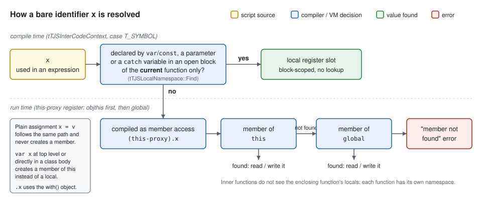
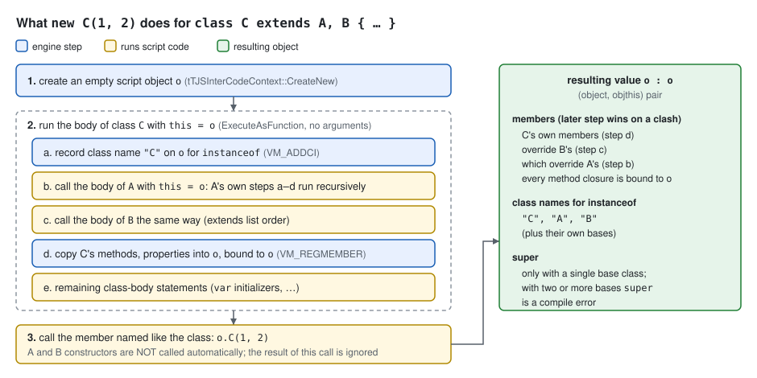

# TJS2 Language

This chapter describes TJS2 as a script author sees it: the values a script
handles, how operators convert between them, the syntax of statements,
functions, classes and properties, and the `@set`/`@if` preprocessor. The
syntax looks like JavaScript, and the semantics differ from it in many places.
The [TJS2 Interpreter](tjs2-interpreter.md) chapter covers how the source is
lexed, compiled and executed. The
[TJS2 Runtime and Native Class Interface](tjs2-runtime.md) chapter covers how
values and objects are represented and the standard library (`Array`,
`Dictionary`, `RegExp`, string methods, …).

Everything here is derived from the TJS2 2.4.28 sources in the tree
(`TJSVersionMajor/Minor/Release`, `krkrz/tjs2/tjs.cpp:43-47`).

**Sources**

- `krkrz/tjs2/syntax/tjs.y` (grammar), `krkrz/tjs2/syntax/tjspp.y`
  (preprocessor expressions)
- `krkrz/tjs2/tjsLex.cpp` (lexer, string/number/octet/regexp literals,
  preprocessor directives)
- `krkrz/tjs2/tjsCompileControl.cpp` (preprocessor expression tokenizer)
- `krkrz/tjs2/tjsInterCodeGen.cpp` (code generation: scoping, classes,
  operators)
- `krkrz/tjs2/tjsInterCodeExec.cpp` (VM: `typeof`, `instanceof`, `#`, `$`,
  class instantiation, `this` selection)
- `krkrz/tjs2/tjsVariant.h`, `krkrz/tjs2/tjsVariant.cpp`,
  `krkrz/tjs2/tjsVariantString.cpp` (value types and conversions)
- `krkrz/tjs2/tjsObject.cpp`, `krkrz/tjs2/tjsObject.h` (member access,
  `instanceof` defaults)
- `krkrz/tjs2/tjsNamespace.cpp` (local variable scopes)
- `krkrz/tjs2/tjs.cpp` (option flags, preprocessor values, built-in globals)
- `krkrz/base/ScriptMgnIntf.cpp` (`TVPInitScriptEngine`: command-line language
  options, `kirikiriz` preprocessor value)
- `krkrz/PreprocessorDefinitions.md`

> **About the code samples.** Results written in comments (`// → 1229`) were
> derived by reading the conversion code cited next to them; they were not
> obtained by running the engine. Samples marked *pseudo-TJS* only illustrate
> a point and use made-up names.

## Questions answered

| Question | Short answer | Details |
|---|---|---|
| Is TJS2 loosely or strictly typed? | **Dynamically and loosely typed.** Variables have no type: `var x : int` parses, but the annotation is ignored. Every value carries one of six runtime types (void, Integer, Real, String, Octet, Object), and operators convert operands implicitly. A few conversions throw instead, mainly an object or an octet used as a number. | [Values and types](#values-and-types), [Type conversion](#type-conversion), [Operators](#operators) |
| What do `"1234" + 5` and `"1234" - 5` give? | `"1234" + 5` → `"12345"` (String): `+` concatenates when either side is a string. `"1234" - 5` → `1229` (Integer): `-` always converts both sides to numbers. | [Worked examples](#worked-examples) |
| How similar is TJS2 to ECMAScript? | The surface syntax is close to ES3-era JavaScript. The semantics differ deeply: class-based objects with no prototypes, method closures bound at `new`, 64-bit integers, no `undefined`, `&&`/`||` that return `0`/`1`, numeric truthiness of strings, block-scoped `var`, no capture of outer locals, no `finally`, no automatic semicolon insertion. | [Comparison with ECMAScript](#comparison-with-ecmascript) |
| Is there a macro like in C? | **No.** TJS2 has only `@set(name = expr)` and `@if(expr) … @endif`. These are integer flags with conditional compilation. There is no text substitution, no function-like macro, no `#include`, and no `@else`/`@elif`. KAG's `[macro]` is a different feature: it lives in KAG3 game scripts, not in this engine. | [Preprocessor](#preprocessor) |
| What is the syntax? | A C-like, brace-delimited language with `var`/`const`, `function`, `class … extends …`, `property { getter … setter … }`, and the statements `if`/`while`/`do`/`for`/`switch`/`with`/`try`/`throw`. It adds literals `%[…]` (dictionary), `<% … %>` (octet), `@"…&expr;…"` (embedded expressions) and `/re/flags`, and operators such as `\`, `<->`, `#`, `$`, `incontextof`, `isvalid` and `invalidate`. | [Lexical structure](#lexical-structure), [Operator precedence](#operator-precedence), [Statements](#statements), [Grammar summary](#grammar-summary) |

### Q1. Loose typing, `"1234" + 5` and `"1234" - 5`

TJS2 is dynamically typed. A variable is a `tTJSVariant` slot that can hold
any of six types (`tTJSVariantType`, `krkrz/tjs2/tjsVariant.h:109-117`). The
`variable_type` production lets a declaration carry `: int`, `: real`,
`: string`, `: octet`, `: void` or `: Name`, but the grammar comment says
"It is not currently effect. Ignore types." and no action uses it
(`krkrz/tjs2/syntax/tjs.y:359-367`).

The conversions are loose, and they follow fixed rules taken from
`tjsVariant.cpp`:

```javascript
"1234" + 5      // → "12345"  (String)   either side String → concatenate
5 + "1234"      // → "51234"  (String)
"1234" - 5      // → 1229     (Integer)  "1234" parses to Integer 1234
"12.5" - 5      // → 7.5      (Real)
"abc" - 5       // → -5       (Integer)  unparsable string counts as 0
" 12" - 0       // → 0        (Integer)  leading blank: parse fails (Quirk)
"0x1F" - 0      // → 31       (Integer)  number literal syntax is accepted
void + 1        // → 1        (Integer)  void + number returns the number
void + void     // → 0.0      (Real)     (Quirk)
"1234" == 1234  // → true     1234 is converted to "1234", then strings compared
"1234" === 1234 // → false    different types
1 + null        // throws: an object cannot be converted to a number
```

`+` (`tTJSVariant::operator +=`, `krkrz/tjs2/tjsVariant.cpp:1095-1179`) checks
for a string first. `-` (`operator -=` → `InternalSub`,
`tjsVariant.h:1167-1175`, `tjsVariant.cpp:1077-1093`) converts both operands
with `AsNumber`. A string is parsed by `TJSParseNumber`, and a string that
does not parse becomes Integer 0 (`tTJSVariantString::ToNumber`,
`krkrz/tjs2/tjsVariantString.cpp:532-540`). Silent conversion is the rule.
The exceptions are listed in [What throws](#what-throws).

### Q2. How close to ECMAScript

TJS2 shares the C/JavaScript statement and expression syntax and most
operator spellings, including `===`, `>>>`, `typeof`, `instanceof`, `delete`
and regexp literals. The object model and many evaluation rules are its own.
The full itemized comparison is in
[Comparison with ECMAScript](#comparison-with-ecmascript). The differences
most likely to surprise someone who knows JavaScript:

```javascript
var a = "abc" || "x";     // → 1 (Integer): || and && yield 0/1, not an operand
if ("abc") ...            // false: a string is truthy only if it parses to a non-zero number
if ("0.0") ...            // false
var o = new Foo();        // `new Foo` without () is a syntax error
var f = o.method; f();    // `this` is still o: methods are bound at `new`
x = 1;                    // error "member not found" unless x already exists
5 / 2                     // → 2.5;   5 \ 2 → 2 (integer division operator)
typeof 1                  // → "Integer";  typeof 1.0 → "Real";  typeof void → "void"
```

### Q3. Is there a C-like macro?

No. The TJS2 lexer recognizes three directives (`tTJSLexicalAnalyzer::
ProcessPPStatement`, `krkrz/tjs2/tjsLex.cpp:1190-1297`):

```javascript
@set(DEBUG = 1, LEVEL = DEBUG * 2)   // assign 32-bit integer flags
@if(DEBUG && kirikiriz)              // compile the following text only if non-zero
    Debug.message("debug build");
@endif
```

A directive can only test and set integers. It cannot replace an identifier
with text, take arguments, or include another file. There is no `@else`,
`@elif` or `@define`: an unknown directive is an "invalid character `@`"
error. The values are global to the engine instance and persist across
files. Two are predefined: `version` = `0x0204001C` and `kirikiriz` = `1`.
The details and quirks are in [Preprocessor](#preprocessor).

`krkrz/PreprocessorDefinitions.md` is **not** about this preprocessor. It
lists C++ `#define`s for building the engine (`TVP_TOUCH_DISABLE`,
`ENABLE_DEBUGGER`, `TJS_NO_REGEXP`, …). They decide how the engine binary is
compiled and are invisible to scripts.

**Unverified** (not in this tree): KAG3 scenario files (`.ks`) have a
`[macro name=foo] … [endmacro]` tag. It defines a new scenario tag as a
sequence of other tags, with `%param`-style argument substitution. It is
implemented by the KAG3 TJS scripts shipped with each game, not by the TJS2
engine. See [Where KAG fits](../architecture.md#where-kag-fits).

### Q4. The syntax

The syntax is specified in the sections below:

- [Lexical structure](#lexical-structure): comments, identifiers, the exact
  keyword list, and all literal forms.
- [Operator precedence](#operator-precedence): the 18 levels, derived from
  the grammar levels of `tjs.y`.
- [Declarations and scope](#declarations-and-scope),
  [Statements](#statements), [Functions](#functions), [Classes](#classes) and
  [Properties](#properties).
- [Grammar summary](#grammar-summary): a condensed EBNF transcribed from
  `tjs.y`.

A representative fragment:

```javascript
// pseudo-TJS
class Counter extends Base
{
    var count = 0;                       // instance member, initialized per `new`
    var names = %[ first: "a", "second" => "b" ];

    function Counter(start = 0) {       // constructor: same name as the class
        super.Base();                    // base constructor is not called automatically
        count = start;
    }

    function add(n, rest*) {            // rest* collects remaining arguments into an Array
        count += n;
        for (var i = 0; i < rest.count; i++) count += rest[i];
        return count;
    }

    property doubled {
        getter { return count * 2; }
        setter(v) { count = v \ 2; }
    }
}

var c = new Counter(10);
c.add(1, 2, 3);
Debug.message(@"count=&c.count; doubled=${c.doubled}");  // "count=16 doubled=32"
```

## Values and types

A value has exactly one of these types (`tTJSVariantType`,
`krkrz/tjs2/tjsVariant.h:109-117`):

| Type | `typeof` | Literals | Notes |
|---|---|---|---|
| void | `"void"` | `void` | The single "no value". Missing arguments and uninitialized variables hold it. There is no separate `undefined`. |
| Integer | `"Integer"` | `123`, `0x7f`, `0b101`, `017`, `true`, `false` | Signed 64-bit (`tjs_int64`). `true`/`false` are Integer 1/0 (`tTJSVariant(bool)`, `tjsVariant.h:616-620`). |
| Real | `"Real"` | `1.5`, `.5`, `1e3`, `0x1.8p1`, `NaN`, `Infinity` | IEEE double. |
| String | `"String"` | `"…"`, `'…'`, `@"…"` | Immutable sequence of `tjs_char`: `wchar_t`, which is 16-bit UTF-16 on Windows (`krkrz/tjs2/tjsTypes.h:63,130`). |
| Octet | `"Octet"` | `<% 01 02 ff %>` | Immutable byte string. |
| Object | `"Object"` | `null`, `[…]`, `%[…]`, `function…`, class names, `new …` | A pair (object, context). `null` is an Object whose object pointer is null (`tjsLex.cpp:1613-1615`). |

`typeof` produces exactly these strings (`tTJSInterCodeContext::TypeOf`,
`krkrz/tjs2/tjsInterCodeExec.cpp:2899-2935`). It produces one more value: when
the operand is a member access (`a.b`, `a[b]`, `.b`) and the member does not
exist, the result is `"undefined"` instead of an error (`TypeOfMemberDirect`,
`tjsInterCodeExec.cpp:2130-2137`; codegen `tjsInterCodeGen.cpp:1683-1720`).
`typeof` of an undeclared *bare* identifier compiles to a normal read, so
**Inferred:** it throws "member not found"; use `typeof global.name` or
`typeof this.name` to probe.

The object half of an Object value is an `iTJSDispatch2`. The context half
(`ObjThis`) is the `this` that a function or property runs with. See
[`this` and closures](#this-and-closures), and the representation in
[Runtime: closures](tjs2-runtime.md#closures).

### `instanceof`

`x instanceof "Name"` takes the class **name as a string**. The right operand
is converted with `AsString`, so `x instanceof Layer` compares against
`"(object 0x…:0x…)"` and is `false` (`tTJSInterCodeContext::InstanceOf`,
`tjsInterCodeExec.cpp:2984-3007`). The answer comes from
`TJSDefaultIsInstanceOf` (`krkrz/tjs2/tjsObject.cpp:1839-1882`) and the
`IsInstanceOf` overrides:

| Left operand | `true` for |
|---|---|
| void | nothing (always `false`) |
| any non-void value, including `null` | `"Object"` |
| Integer, Real | `"Number"` |
| String | `"String"` |
| Octet | `"Octet"` |
| script object | each class name recorded at construction, for the class and all its bases (`tTJSCustomObject::IsInstanceOf`, `tjsObject.cpp:1885-1908`) |
| function / property / class object | `"Function"` / `"Property"` / `"Class"` (`tjsInterCodeExec.cpp:3256-3286`) |

> **Quirk — `null instanceof "Object"` is `true`.** The `"Object"` test runs
> before the null-pointer check (`tjsObject.cpp:1849`). A reimplementation
> **MUST** keep this order.

### Truthiness

Conditions (`if`, `while`, `?:`, `!`, `&&`, `||`) use `tTJSVariant::operator
bool` (`tjsVariant.h:898-909`):

| Type | false when |
|---|---|
| void | always |
| Object | the object pointer is null (`null`); any real object is true |
| String | `AsInteger() == 0`, i.e. the string **parses** to zero or does not parse |
| Octet | empty (`<% %>`) |
| Integer | `== 0` |
| Real | `== 0.0` (`NaN` is true) |

```javascript
if ("")      // false
if ("abc")   // false  (does not parse as a number)
if ("0")     // false
if ("1")     // true
if ("true")  // true   ("true" parses as Integer 1, see below)
if (" 1")    // false  (leading blank: parse fails)
```

A reimplementation **MUST** use this string rule. The JavaScript rule
("non-empty is true") is wrong for TJS2.

## Type conversion

All operators are built from five conversions on `tTJSVariant`
(`krkrz/tjs2/tjsVariant.h:760-930`):

| From | to number (`AsNumber`) | to Integer (`AsInteger`) | to Real (`AsReal`) | to String (`AsString`) |
|---|---|---|---|---|
| void | Integer 0 | 0 | 0.0 | empty string |
| Integer | itself | itself | exact double | decimal digits |
| Real | itself | C cast (truncate toward 0) | itself | see below |
| String | parse (Integer or Real; 0 on failure) | parse, then truncate | parse, then widen | itself |
| Octet | **throws** | **throws** | **throws** | **throws** |
| Object | **throws** | **throws** | **throws** | `"(object 0x<obj>:0x<objthis>)"` |

### String → number (`TJSParseNumber`)

A string is parsed with the same routine the lexer uses for numeric literals
(`TJSParseNumber`, `krkrz/tjs2/tjsLex.cpp:731-758`). It is **prefix**
parsing: trailing characters are ignored.

| String | Value | Why |
|---|---|---|
| `"1234"` | Integer 1234 | decimal integer |
| `"12.5"`, `"1e3"`, `"5."` | Real 12.5, 1000.0, 5.0 | `.` or exponent makes it Real (`TJSExtractNumber`, `:392-445`) |
| `"0x1F"`, `"0b101"`, `"017"` | 31, 5, 15 | hex, binary, leading-zero octal (`TJSParseNumber2`, `:665-712`) |
| `"-5"`, `"+ 5"` | -5, 5 | one leading sign; blanks are allowed **after** the sign |
| `"12abc"` | 12 | trailing garbage ignored |
| `"abc"`, `""` | 0 (Integer) | parse failure → `dest = 0` (`tjsVariantString.cpp:532-540`) |
| `" 12"` | 0 | leading blanks are **not** skipped |
| `"true"`, `"false"` | 1, 0 | the parser accepts these words (`tjsLex.cpp:636-645`) |
| `"NaN"`, `"Infinity"` | NaN, +∞ | likewise (`:646-661`) |
| `"08"` | 0 | octal digits stop at `8` |

> **Quirk — leading blanks and the word "true".** `" 12" - 0` is `0`, while
> `"true" - 0` is `1`. Both follow from reusing the literal parser.
> Compatibility likely requires reproducing both, because they also decide
> truthiness.

### Number → string

- Integer: plain decimal (`TJSIntegerToString`, `tjsVariant.cpp:217-221`).
- Real: `printf("%.15lg")`, so `1.0` → `"1"`, `0.1` → `"0.1"`,
  `1/3` → `"0.333333333333333"`, `1e21` → `"1e+21"`
  (`TJSRealToString`, `tjsVariant.cpp:248-257`). Special values come first
  (`TJSSpecialRealToString`, `:223-246`): `NaN` → `"NaN"`, +∞ → `"+Infinity"`,
  −∞ → `"-Infinity"`, `0.0` → `"+0.0"`, `-0.0` → `"-0.0"`.

> **Quirk — zero prints with a sign.** `"" + 0.0` is `"+0.0"`, but `"" + 0`
> is `"0"` and `"" + 1.0` is `"1"`. A reimplementation **MUST** reproduce the
> special-value strings exactly. Games build file names and messages from
> numbers.

The pointer text for objects (`"(object 0x%p:0x%p)"`, `TJSObjectToString`,
`tjsVariant.cpp:190-215`) is platform-specific. Scripts can only compare it
for identity, and a reimplementation **MAY** choose any format with the
`(object …:…)` shape.

### Explicit casts

`int x`, `real x`, `string x` and the C-style `(int)x`, `(real)x`,
`(string)x` are prefix operators (`tjs.y:681-686`). They compile to
`VM_INT`/`VM_REAL`/`VM_STR`, which call `ToInteger`/`ToReal`/`ToString`
(`tjsInterCodeExec.cpp:1270-1283`, `tjsVariant.cpp:408-480`):

```javascript
int "12abc"    // → 12
int 3.99       // → 3;    int -3.99 → -3
int void       // → 0;    int null  → throws
real "1e3"     // → 1000.0 (Real)
string 1.0     // → "1";  string void → ""
string <%01%>  // throws: an octet cannot become a string
```

There is no `octet` cast syntax. `octet` is accepted only as a type
annotation, although the code generator has a case for it
(`tjsInterCodeGen.cpp:1636,1673`).

## Operators

### Arithmetic, bitwise and logical operators

The VM applies each binary operator with an in-place method on the left
operand (`TJS_DEF_VM_P`, `krkrz/tjs2/tjsInterCodeExec.cpp:1194-1227`).
Constant folding uses the same methods at compile time
(`tjsInterCodeGen.cpp:3705-3846`), so folded and unfolded code give the same
results. In the table, *num* is `AsNumber`, *int* is `AsInteger` and *real*
is `AsReal`.

| Operator | Result | Rule (source) |
|---|---|---|
| `a + b` | String if either is String (an Octet on the other side throws); Octet if both Octet; Integer if both Integer; the number unchanged if one is void and the other Integer/Real; otherwise Real (an Object or Octet operand throws) | `operator +=`, `tjsVariant.cpp:1095-1179` |
| `a - b`, `a * b` | Integer if both *num* results are Integer, else Real | `InternalSub` `:1077-1093`, `InternalMul` `:1009-1025` |
| `a / b` | always Real (`real(a) / real(b)`); `x/0` gives ±∞ or NaN and does not throw | `operator /=`, `:989-997` |
| `a \ b` | Integer `int(a) / int(b)`, truncating; divisor 0 **throws** "divide by zero" | `idivequal`, `:999-1007` |
| `a % b` | Integer `int(a) % int(b)` (C remainder, sign of `a`); divisor 0 **throws** | `operator %=`, `:979-987` |
| `a & b`, `a \| b`, `a ^ b` | Integer, on `int(a)`, `int(b)` | `:895-953` |
| `a << b`, `a >> b` | Integer; `>>` is arithmetic (sign-extending) on 64 bits | `:955-977` |
| `a >>> b` | Integer; logical shift of `int(a)` as unsigned 64-bit | `rbitshiftequal`, `:963-969` |
| `-a` | Integer or Real (negated *num*) | `changesign`/`InternalChangeSign`, `:1059-1075` |
| `+a` | *num*: `+"0x10"` → 16, `+void` → 0 | `tonumber`, `:1043-1057` |
| `~a` | Integer `~int(a)` | `bitnot`, `:1035-1041` |
| `!a` | Integer 0/1 | `logicalnot`, `:1027-1033` |
| `a && b`, `a \|\| b` | **Integer 0/1**, short-circuit | codegen `tjsInterCodeGen.cpp:1412-1466` (`VM_SETF` stores the flag) |
| `++a`, `a--`, … | a String is parsed to a number first; void becomes 1 / −1; Object or Octet throws | `increment`/`decrement`, `:903-937` |
| `#a` | Integer: first UTF-16 code unit of `string(a)`, or 0 if empty | `CharacterCodeOf`, `tjsInterCodeExec.cpp:2962-2974` |
| `$a` | String of one character with code `int(a)` | `CharacterCodeFrom`, `:2976-2982` |

Compound assignments (`+=`, `\=`, `>>>=`, `||=`, `&&=`, …) use the same
methods and store the result into the left operand
(`tjsInterCodeGen.cpp:1278-1316`). Therefore `a ||= b` stores 0 or 1, not
`b`.

### Comparison operators

| Operator | Rule (source) |
|---|---|
| `<`, `>` | Both String: compare code units (`TJS_strcmp`). Both Integer: integer compare. Otherwise compare `real(a)` with `real(b)`, so Object/Octet **throws**. (`GreaterThan`/`LittlerThan`, `tjsVariant.cpp:827-877`. The names are inverted: `GreaterThan` implements `<`.) |
| `<=`, `>=` | Compiled as `!(a > b)` and `!(a < b)` (`tjsInterCodeGen.cpp:1571-1572`). |
| `==`, `!=` | `NormalCompare` (`tjsVariant.cpp:659-770`), in order: (1) same type → value equality; Objects compare only the object pointer and ignore the context. (2) Either is String → compare `AsString` of both. (3) One is void → true iff the other is Integer 0, Real 0, or the empty string. (4) Otherwise compare as Real; NaN is never equal, and ±∞ equal only themselves. A conversion error inside returns `false` and does **not** throw. |
| `===`, `!==` | `DiscernCompare` (`:772-812`): different types → false. Objects must match both the object and the context pointer. Strings and Octets compare contents. Reals compare as in `==`. |
| `switch`/`case` | `case` labels compare with `==` (`VM_CEQ`, `ProcessCaseCode`, `tjsInterCodeGen.cpp:3120-3133`). |

```javascript
1 == 1.0          // true   (both converted to Real)
"1" == 1.0        // true   (1.0 → "1")
"1.0" == 1        // false  ("1.0" vs "1")
0 == void         // true
"" == void        // true
null == void      // false  (Object vs void: rule 3 does not cover Object)
null == 0         // false  (AsReal(null) throws inside ==, caught → false)
"10" < "9"        // true   (string comparison)
"10" < 9          // false  (numeric)
NaN <= 1          // true   (Quirk: !(NaN > 1))
```

> **Quirk — `<=`/`>=` with NaN are true.** Because `<=` is `!(a > b)`, any
> comparison with NaN through `<=` or `>=` yields `true`. A reimplementation
> **MUST** compile them the same way.

### Worked examples

| Expression | Result | Type |
|---|---|---|
| `"1234" + 5` | `"12345"` | String |
| `5 + "1234"` | `"51234"` | String |
| `"1234" - 5` | `1229` | Integer |
| `"1234" * "2"` | `2468` | Integer |
| `"2.5" * 2` | `5.0` | Real (prints as `"5"`) |
| `"abc" - 5` | `-5` | Integer |
| `"abc" + 5` | `"abc5"` | String |
| `void + 1` | `1` | Integer |
| `void + void` | `0.0` | Real |
| `void - void` | `0` | Integer |
| `void + "a"` | `"a"` | String |
| `1 + 2.0` | `3.0` | Real |
| `1 + true` | `2` | Integer |
| `7 / 2` | `3.5` | Real |
| `7 \ 2`, `-7 \ 2` | `3`, `-3` | Integer |
| `-7 % 2`, `7.9 % 2` | `-1`, `1` | Integer |
| `1 << 40` | `1099511627776` | Integer |
| `-1 >>> 60`, `-16 >> 2` | `15`, `-4` | Integer |
| `<%01%> + <%02%>` | `<% 01 02 %>` | Octet |
| `"1234" == 1234` | `1` (true) | Integer |
| `"1234" === 1234` | `0` (false) | Integer |
| `"a" && 1` | `0` | Integer |
| `#"A"`, `$65` | `65`, `"A"` | Integer, String |

> **Quirk — `void + void` is Real.** `operator +=` returns early only when
> exactly one side is void and the other is a number. With two voids it falls
> through to the Real addition (`tjsVariant.cpp:1151-1178`), while `-` and
> `*` yield Integer 0.

### What throws

Silent conversion is the default. The following cases raise a TJS exception,
which `try`/`catch` can catch:

- An Object (including `null`) or an Octet used where a number is needed:
  arithmetic, bitwise operators, `<`/`>`/`<=`/`>=`, unary `+`/`-`, `++`/`--`,
  `int`, `real`. Message: `TJSVariantConvertError`
  (`TJSThrowVariantConvertError`, `tjsVariant.cpp:142-175`).
- An Octet used as a string (`+` with a String operand, `string` cast).
- `\` or `%` by zero (`TJSThrowDivideByZero`, `tjsVariant.cpp:182-185`).
  `/` by zero does not throw.
- Member access through `null` (`TJSThrowNullAccess`,
  `tjsVariant.h:228-424`).
- Reading a member or bare identifier that does not exist, and **assigning**
  to a bare identifier that does not exist ("member not found"; see
  [Declarations and scope](#declarations-and-scope)).
- A string index outside `0 … length` (`TJSRangeError`). `s[s.length]` is
  `""` (`GetStringProperty`, `tjsInterCodeExec.cpp:46-100`).

`==`/`!=` never throw for type reasons, and neither does `typeof` on a
missing member.

> **Quirk — undefined C++ behavior leaks into the language.** Integer
> overflow (`+`, `-`, `*`, `++`), shift counts outside 0–63, `int` of a Real
> outside the int64 range or of NaN, and `INT64_MIN \ -1` are undefined
> behavior in the C++ source. **Inferred:** on the reference x86/x64 builds,
> arithmetic wraps, shift counts are masked to 6 bits, out-of-range `int`
> yields `0x8000000000000000`, and `INT64_MIN \ -1` crashes. A reimplementation
> **SHOULD** use wrapping arithmetic and masked shift counts. It **MUST NOT**
> crash on `INT64_MIN \ -1`.

### Special operators

| Operator | Meaning | Source |
|---|---|---|
| `a <-> b` | Swap two lvalues. Allowed only as a statement; using its value is a compile error (`TJSCannotGetResult`). | `tjsInterCodeGen.cpp:1224-1256` |
| `f incontextof obj` | Returns `f` with its context replaced by `obj` (`VM_CHGTHIS`). Right-associative. | `:1195-1216`, `tjs.y:689-693` |
| `delete a.b` / `delete a[b]` / `delete x` | Remove a member. On a local variable it only removes the name from the compile-time scope. | `tjs.y:672`, `tjsInterCodeGen.cpp:2110-2128` |
| `invalidate o` | Invalidate (finalize) the object; for a non-object the result is `false`. | `VM_INV`, `tjsInterCodeExec.cpp:1254-1260` |
| `isvalid o` / `o isvalid` | `true` if the object has not been invalidated; non-objects give `true`. | `VM_CHKINV`, `:1262-1268`; `tjs.y:670-671` |
| `expr!` (postfix) | Compile and evaluate the string `expr` as an expression with the current `this` as context. With `-evalcontext=global` it runs in the global context instead. | `VM_EVAL`, `tjsInterCodeExec.cpp:1305-1317`, `Eval` `:2937-2960`; `krkrz/base/ScriptMgnIntf.cpp:411-420` |
| `&a.b` | Read or write the member **itself**, bypassing the property getter/setter (`stIgnorePropGet`/`stIgnorePropSet`). | `tjsInterCodeGen.cpp:2170-2182` |
| `*a` | Treat the value of `a` as a property object and invoke its getter/setter (`VM_GETP`/`VM_SETP`). | `:2183-2257` |
| `new F(args)` | Create an instance. The argument list is mandatory: `new F` is a syntax error (`"new" func_call_expr`). | `tjs.y:668,739-741` |

> **Quirk — `&` and `*` swap under `-unaryaster=compat`.** Before TJS2 2.4.15,
> unary `*` meant "ignore property". The command-line option
> `-unaryaster=compat` sets `TJSUnaryAsteriskIgnoresPropAccess` and restores
> that meaning (`krkrz/tjs2/tjs.cpp:78-81`, `ScriptMgnIntf.cpp:422-430`). A
> reimplementation **SHOULD** support the option.

## Operator precedence

`tjs.y` declares **no** `%left`/`%right` precedence for the main grammar.
Precedence and associativity come from the layering of the nonterminals
(`krkrz/tjs2/syntax/tjs.y:548-711`). The levels, from loosest to tightest:

| Level | Operators | Associativity | Nonterminal |
|---|---|---|---|
| 1 | `expr if cond` (conditional statement-expression) | right | `expr` |
| 2 | `,` | left | `comma_expr` |
| 3 | `=` `<->` `+=` `-=` `*=` `/=` `\=` `%=` `&=` `\|=` `^=` `&&=` `\|\|=` `<<=` `>>=` `>>>=` | right | `assign_expr` |
| 4 | `? :` | right | `cond_expr` |
| 5 | `\|\|` | left | `logical_or_expr` |
| 6 | `&&` | left | `logical_and_expr` |
| 7 | `\|` | left | `inclusive_or_expr` |
| 8 | `^` | left | `exclusive_or_expr` |
| 9 | `&` | left | `and_expr` |
| 10 | `==` `!=` `===` `!==` | left | `identical_expr` |
| 11 | `<` `>` `<=` `>=` | left | `compare_expr` |
| 12 | `>>` `<<` `>>>` | left | `shift_expr` |
| 13 | `+` `-` | left | `add_sub_expr` |
| 14 | `*` `/` `%` `\` | left | `mul_div_expr` |
| 15 | prefix `!` `~` `++` `--` `+` `-` `#` `$` `&` `*` `new` `delete` `typeof` `invalidate` `isvalid` `int` `real` `string` `(int)` `(real)` `(string)`; and `a instanceof b`, `a isvalid` | prefix: right | `unary_expr` |
| 16 | `incontextof` | right | `incontextof_expr` |
| 17 | `a(…)` `a[…]` `a.name` `a++` `a--` `a!` (eval) | left | `priority_expr` |
| 18 | literals, identifiers, `this`, `super`, `global`, `void`, `function …`, `[…]`, `%[…]`, `(const)[…]`, `/re/`, `(expr)`, `.name` (with-object member) | — | `factor_expr` |

Consequences that differ from JavaScript:

- `instanceof` sits at the unary level, with an `incontextof_expr` on the
  left and a `unary_expr` on the right (`tjs.y:680`). Therefore
  `!a instanceof "X"` means `!(a instanceof "X")`.
- `?:` has a `cond_expr` in its middle (`tjs.y:587-589`), so `c ? a = 1 : b`
  is a syntax error.
- `expr if cond` is the loosest form and is valid only where no value is
  needed (`tjsInterCodeGen.cpp:1168-1193`): `x = 1 if y > 0;`.

## Lexical structure

### Source text

- The whole script is read as one wide string. CR LF and lone CR are unified
  into LF before lexing (`tTJSLexicalAnalyzer::PreProcess`,
  `krkrz/tjs2/tjsLex.cpp:1675-1698`).
- A leading `#!` is turned into `//`, so a shebang line is a comment
  (`tjsLex.cpp:1070-1075`).
- Whitespace is any character below U+0100 for which `isspace` is true
  (`TJS_iswspace`, `:40-43`). Newlines carry no meaning: there is **no**
  automatic semicolon insertion.

### Comments

- `// …` runs to the end of the line.
- `/* … */` **nests**: every `/*` inside must be closed (`TJSSkipComment`,
  `tjsLex.cpp:163-212`). Nesting is counted even inside string literals in the
  comment. An unterminated comment is an error (`TJSUnclosedComment`).

### Identifiers

An identifier starts with an ASCII letter, `_`, or any character ≥ U+0100,
and continues with those characters and ASCII digits (`tjsLex.cpp:1552-1564`;
`TJS_iswalpha` treats every character ≥ U+0100 as a letter, `:50-53`). Thus
Japanese identifiers are valid. `$` and `#` are not identifier characters, and
neither are U+0080–U+00FF under the C locale (`isalpha`). A keyword immediately after `.` is read as a
plain name (`SetNextIsBareWord`, `tjs.y:700-710`, `tjsLex.cpp:1594`), so
`obj.class` and `obj.int` are valid member names.

### Keywords

The reserved-word table (`TJSInitReservedWordsHashTable`,
`krkrz/tjs2/tjsLex.cpp:973-1038`) contains exactly these 55 words:

| Group | Words |
|---|---|
| Declarations and statements | `break` `case` `catch` `class` `const` `continue` `debugger` `default` `do` `else` `extends` `for` `function` `getter` `if` `property` `return` `setter` `switch` `throw` `try` `var` `while` `with` |
| Expression keywords | `delete` `global` `incontextof` `instanceof` `int` `invalidate` `isvalid` `new` `octet` `real` `string` `super` `this` `typeof` `void` |
| Literal keywords (lexer turns them into constants, `:1608-1635`) | `true` (Integer 1) `false` (Integer 0) `null` (null Object) `NaN` `Infinity` |
| Reserved, no grammar rule uses them | `enum` `export` `finally` `goto` `import` `in` `private` `protected` `public` `static` `synchronized` |

`with`, `NaN` and `Infinity` are reserved unless the engine is built with
`TJS_WITH_IS_NOT_RESERVED_WORD` / `TJS_NaN_and_Infinity_ARE_NOT_RESERVED_WORD`.
Neither is defined in the tree: the `with` switch is commented out in
`krkrz/tjs2/tjsConfig.h:43`. `octet` is used only in type
annotations. A reimplementation **MUST** reject the unused reserved words as
identifiers, because the original does.

### Numeric literals

Parsed by `TJSParseNumber2` (`krkrz/tjs2/tjsLex.cpp:632-728`):

| Form | Example | Value |
|---|---|---|
| decimal integer | `1234` | Integer. Overflow wraps silently (`TJSParseDecimalInteger`, `:618-630`). |
| decimal real | `1.5`, `.5`, `5.`, `1e3`, `1E-3` | Real, via `strtod`. Blanks are allowed between `e` and the sign/digits (`:412-430`). |
| hexadecimal | `0x1F`, `0XfF` | Integer |
| binary | `0b1010` | Integer |
| octal | `017` | Integer 15. Any literal starting with `0` and a digit is octal. |
| hex/binary/octal real | `0x1.8p1`, `0b1.1p0`, `0x1p-2` | Real 3.0, 1.5, 0.25. `p` is a binary exponent (`TJSParseNonDecimalReal`, `:447-579`). |
| named | `NaN`, `Infinity` | Real |

There is no negative literal: `-5` is unary minus applied to `5`.

> **Quirk — leading-zero literals.** `01.5` is the **octal** real 1.625, and
> `09` lexes as `0` followed by `9`, which is a syntax error
> (`tjsLex.cpp:709-711`).

### String literals

`"…"` and `'…'` are equivalent (`TJSParseString`, `tjsLex.cpp:375-384`).
Escapes (`TJSInternalParseString`, `:248-373`; `TJSUnescapeBackSlash`,
`:141-156`):

| Escape | Meaning |
|---|---|
| `\a` `\b` `\f` `\n` `\r` `\t` `\v` | 0x07 0x08 0x0C 0x0A 0x0D 0x09 0x0B |
| `\xH…` | hex code unit, up to `2 * sizeof(tjs_char)` digits (4 with 16-bit `wchar_t`) |
| `\0o…` | octal code unit: `\0` followed by any number of octal digits |
| `\` + any other character | that character (`\\`, `\"`, `\'`, `\&`, `\$`) |

There is no `\u` escape. A literal may span lines, because raw newlines are
kept. Adjacent literals with the **same** delimiter, separated only by
whitespace, are joined: `"ab" "cd"` is `"abcd"` (`:316-323`).

### Embeddable-expression strings

`@"…"` or `@'…'` (whitespace is allowed after `@`) interpolates expressions
(`tjsLex.cpp:1496-1512`, `GetNext` `:1821-1897`):

- `&expr;` inserts `expr`, which ends at the first `;` at the same bracket
  nesting level;
- `${expr}` inserts `expr`, which ends at the matching `}`;
- a `$` not followed by `{` is literal. Use `\&` for a literal `&`.

The lexer rewrites the literal into tokens:
`@"a&x;b${y}"` becomes `("a" + string(x) + "b" + string(y))`. Hence `void`
inserts nothing, and an Octet value throws.

```javascript
var name = "Alice", n = 3;
@"Hello, &name;! You have ${n + 1} items."  // → "Hello, Alice! You have 4 items."
@"a & b"                                     // error: "& b" is read as an embedded expression
```

### Octet literals

`<% hex-bytes %>` (`TJSParseOctet`, `tjsLex.cpp:766-859`). Hex digits
accumulate in pairs. A `,` ends a pending single digit. All other characters,
including blanks, are ignored, and comments are allowed inside.

> **Quirk — blanks do not separate nibbles.** `<% 0 1 %>` is the single byte
> `0x01`. `<% 1, 2 %>` is two bytes. `<% %>` is an empty octet, which is
> falsy.

### Regular-expression literals

`/pattern/flags` is recognized only where an operand is expected. The parser
sees `/` or `/=` in `factor_expr` and asks the lexer to rescan from that
position (`tjs.y:729-734`, `tjsLex.cpp:1315-1329`). The pattern is kept
verbatim, including backslashes. Lowercase letters after the closing `/` are
flags (`TJSParseRegExp`, `:866-931`). `g` (global) and `i` (ignore case) have
an effect, `l` is accepted and ignored, and other letters are ignored
(`TJSRegExpFlagToValue`, `krkrz/tjs2/tjsRegExp.cpp:31-50`). Each evaluation
creates `new global.RegExp()` and calls `_compile("//flags/pattern")`
(`tjsInterCodeGen.cpp:2480-2516`). The engine is Oniguruma; see
[Runtime: RegExp](tjs2-runtime.md#regexp).

### Array and dictionary literals

```javascript
[1, "two", 3.0]            // new global.Array, elements appended in order
[1, , 3]                   // empty element → void
[]                         // empty array
%[ "a" => 1, b: 2, 3, 4 ]  // Dictionary {a:1, b:2, 3:4}; a trailing comma is allowed
(const) [1, -2, "x", void, (const) %["k", 1]]   // constant, built at compile time
```

- `[…]` and `%[…]` look up `global.Array`/`global.Dictionary` at run time,
  each time they are evaluated (`tjsInterCodeGen.cpp:2358-2478`).
- Dictionary items are `key, value` pairs or `name: value`. `name` must be a
  plain identifier, not a keyword (`tjs.y:798-804`).
- `=>` is **not** an arrow: the lexer returns it as a comma
  (`tjsLex.cpp:1367-1368`, comment "just a replacement for comma, like
  perl"). `f(a => b)` is `f(a, b)`.
- `(const)[…]` and `(const)%[…]` accept only literal constants (optionally
  signed), `void`, and nested `(const)` literals. They create **one** object
  at compile time, which every evaluation shares (`tjs.y:815-877`).

> **Quirk — a trailing comma adds an element to an array.** `[1, 2,]` has
> three elements, the last one void, because an empty `array_elm` is
> allowed (`tjs.y:774-777`). Only `[]` is special-cased to zero elements
> (`tjsInterCodeGen.cpp:2389-2392`). In dictionaries a trailing comma is
> dropped (`dic_dummy_elm_opt`).

### Punctuators

All multi-character operators are matched longest-first by `GetToken`
(`tjsLex.cpp:1337-1484`): `>>>=` `>>>` `>>=` `>>` `>=` `<<=` `<->` `<=` `<<`
`<%` `===` `==` `=>` `!==` `!=` `&&=` `&&` `&=` `||=` `||` `|=` `...` `++`
`+=` `-=` `--` `*=` `/=` `\=` `%=` `^=`, plus single characters
`> < = ! & | . + - * / \ % ^ [ ] ( ) ~ ? : , ; { } # $`.

## Declarations and scope



### `var` and `const`

`var a, b = 1, c : int = 2;` declares variables. `const` is identical: the
grammar comment says the current version "does not actually disallow
re-assigning" (`tjs.y:338-343`).

Where the variable lives depends on the compile-time nesting depth
(`AddLocalVariable`, `krkrz/tjs2/tjsInterCodeGen.cpp:2653-2705`):

| Declared … | Becomes |
|---|---|
| inside any `{ }` block of a function, or in a `for (var …)` clause | a **block-scoped** local register; it disappears at the closing `}` (`EnterBlock`/`ExitBlock`, `:3526-3556`; `EnterForCode`, `:2907-2919`) |
| at the top level of a script, outside any block | a member of `this`, which is the global object for normal script execution (`VM_SPDS`) |
| directly in a class body | a member of the instance; the initializer runs at each `new` (`base = 2` for `ctClass`) |
| in a nested block inside a class body | a local of the class body |

A local is visible from its declaration to the end of its block. There is
**no hoisting**: a name used before its `var` in the same block compiles as
a member access. Inner functions do **not** see the enclosing function's
locals, because each function context has its own `tTJSLocalNamespace` and
`Find` searches only that context's levels
(`krkrz/tjs2/tjsNamespace.cpp:178-196`).

### Resolving a bare identifier

The compiler looks the name up in the current function's open blocks
(`case T_SYMBOL`, `tjsInterCodeGen.cpp:2027-2168`). If the name is not found,
the identifier is compiled as a member access on the **this-proxy**. At run
time that object tries `objthis`, then the global object
(`tTJSObjectProxy`, `tjsInterCodeExec.cpp:204-509`; set up at `:794`).

- **Reading** a name that exists in neither place throws "member not found".
- **Assigning** to a bare identifier uses `VM_SPD` without
  `TJS_MEMBERENSURE` (`tjsInterCodeGen.cpp:1914-1917`). Assignment therefore
  **never creates** a member: `x = 1;` without a prior `var x` (or an existing
  member `x` on `this` or global) throws.
- Assigning to an explicit member (`obj.x = 1`, `this.x = 1`,
  `global.x = 1`) uses `VM_SPDE` and creates the member if needed.

A reimplementation **MUST** keep this lookup order and the
no-implicit-creation rule. A script that relies on sloppy-mode globals fails
on the original.

### Hoisting of functions, classes and properties

`function`, `class` and `property` definitions at the top level of a script
are registered on `this` **before** any top-level statement runs. The code
generator inserts the registration code at the start of the script
(`NonLocalFunctionDeclVector`, `FixCode`, `tjsInterCodeGen.cpp:734-787`;
collected at `:938-949`). Functions and properties are bound to that `this`
(`VM_CHGTHIS`). Classes are stored unbound. A top-level function can
therefore be called from code above its definition. This holds even if the
definition is inside a top-level `{ }` block, because only the parent
*context*, not the block, decides.

A `function` declared inside another function becomes a local variable of the
outer function (`InitLocalFunction`, `:2718-2730`) and a member of the outer
function object (`:966-977`). Its local-variable registration happens where
the declaration appears.

## Statements

The statement forms come from `statement` in `tjs.y:243-264`. Every simple
statement ends with `;`.

| Statement | Notes |
|---|---|
| `;` | empty statement |
| `expr;` | expression statement |
| `expr if cond;` | runs `expr` only if `cond` is true (`T_IF`) |
| `if (c) s` / `if (c) s else s` | dangling `else` binds to the nearest `if` |
| `while (c) s`, `do s while (c);` | |
| `for (init; cond; step) s` | `init` may be `var …`; every clause is optional; the `for` opens its own scope |
| `break;`, `continue;` | no labels (no grammar rule takes one) |
| `switch (e) { case x: … default: … }` | `case` values are arbitrary expressions, compared with `==` in source order. Execution falls through like C. Each `case` body is its own block scope. `case` outside a switch body is `TJSMisplacedCase` (`ProcessCaseCode`, `tjsInterCodeGen.cpp:3081-3152`). |
| `with (e) s` | **Only** the leading-dot form `.name` refers to `e`. Bare identifiers are unaffected. Outside any `with`, `.name` means `global.name` (`T_WITHDOT_PROXY` falls through to `T_GLOBAL`, `:2327-2356`). |
| `try s catch s`, `try s catch () s`, `try s catch (e) s` | `catch` is mandatory. There is no `finally`. `e` is block-scoped to the catch body (`EnterCatchCode`, `:3389-3421`). |
| `throw expr;` | any value can be thrown |
| `return;` / `return expr;` | at the top level, `return` ends the script (`ReturnFromFunc`, `:3323-3370`) |
| `debugger;` | emits `VM_DEBUGGER`; see [Interpreter: debugging](tjs2-interpreter.md#debugging-and-tooling) |
| `var …;`, `const …;`, `function`, `class`, `property` | declarations; the last three need no `;` |
| `{ … }` | block; opens a scope |

Errors raised by the engine (conversion errors, "member not found", errors
from native methods) are converted into script-visible `Exception` objects
when they reach a `try` block (`TJS_CONVERT_TO_TJS_EXCEPTION_OBJECT` in
`ExecuteCodeInTryBlock`, `tjsInterCodeExec.cpp:1550-1583`). The members of
`Exception` are described in [Runtime: Exception](tjs2-runtime.md#exception).
Propagation is described in
[Interpreter: error handling](tjs2-interpreter.md#error-handling).

```javascript
try {
    var n = int "abc" + null;     // throws: null cannot become a number
} catch (e) {
    Debug.message(e.message);
}
```

## Functions

```javascript
function f(a, b = 10, rest*) { … }   // default and collapse ("rest") parameters
function g(*) { h(*); }              // unnamed collapse array, re-expanded in a call
function k { … }                     // the parameter list may be omitted entirely
function t(x : int) : string { … }   // annotations are parsed and ignored
var e = function(x) { return x * 2; };   // function expression
```

- **Default values** apply when the argument is `void`, whether it was
  omitted or passed explicitly as `void`. The test is `===` against void
  (`AddFunctionDeclArg`, `tjsInterCodeGen.cpp:3586-3616`).
- **Collapse parameter** `name*` must be last. It receives the remaining
  arguments as an `Array`. A bare `*` receives them into an unnamed array
  that can only be re-expanded with `f(*)` (`AddFunctionDeclArgCollapse`,
  `:3618-3634`).
- **Call-site expansion**: `f(arr*)` spreads an array, `f(*)` spreads the
  unnamed collapse array, and `f(...)` passes the caller's own arguments
  through unchanged (`tjs.y:744-755`). `...` is allowed only inside a
  function (`TJSCannotOmit`, `tjsInterCodeGen.cpp:2567-2571`).
- Missing arguments are `void`. Extra arguments are ignored unless a collapse
  parameter takes them.
- A function without `return expr` returns `void`.
- There is no `arguments` object.
- Functions are **not closures over variables**. A function expression
  cannot read the enclosing function's locals (see
  [Declarations and scope](#declarations-and-scope)). Scripts pass state
  through `this` or members instead.

## `this` and closures

An Object value is a pair (*object*, *context*). In TJS terminology a
**closure** is this pair. It does not mean captured variables.

When a function or property is invoked, its `this` is the closure's context
if one is set. Otherwise it is the object through which it was reached
(`TJS_SELECT_OBJTHIS`, `krkrz/tjs2/tjsObject.h:81-82`; `CallFunction`,
`tjsInterCodeExec.cpp:2365-2379`). For a plain call `f()` of an unbound
function, that is the caller's `this`.

| How the function value was obtained | Context | `this` when called |
|---|---|---|
| method of an instance created by `new` | the instance, set when `new` copied it in (`RegisterObjectMember`, `tjsInterCodeExec.cpp:3009-3052`) | always that instance, even after `var f = obj.m;` |
| top-level `function`/`property` | the script's `this` (global) | global |
| function expression `function(){…}` | none | the object it is called on, or the caller's `this` for `f()` |
| `f incontextof o` | `o` | `o` |
| method reached through a **class object**, e.g. `Base.m()` or `super.m()` | none | the caller's `this` |
| `new X()` result | the instance itself (`tTJSVariant(dsp, dsp)`, `:2384`) | — |

```javascript
class A { var v = 1; function get() { return v; } }
var a = new A(), b = new A();
b.v = 2;
var f = a.get;
f();                        // → 1   (still bound to a)
(a.get incontextof b)();    // → 2
```

> **Quirk — `==` ignores the context, `===` does not.** Every instance gets
> the same function object with its own context (`RegisterObjectMember`
> copies the value and only changes the context). Therefore `a.get == b.get`
> is `true` and `a.get === b.get` is `false` (`NormalCompare` vs
> `DiscernCompare`, `tjsVariant.cpp:693-697,778-780`).

`global` is the global object. `this` at the top level of a script is the
object the script runs with, normally `global`.

## Classes

```javascript
class Base {
    var name;
    function Base(n) { name = n; }
    function hello() { return "I am " + name; }
    function finalize() { /* called on invalidate / last release */ }
}

class Derived extends Base {
    function Derived(n) { super.Base(n); }
    function hello() { return super.hello() + "!"; }  // override + call base
}

var d = new Derived("x");
d.hello();                          // → "I am x!"
d instanceof "Base";                // → true
```



- **No prototypes.** A class is a function-like object whose body runs once
  per `new` with `this` = the new object. That body copies every method and
  property into the instance, bound to it (`VM_REGMEMBER`). An instance owns
  its members, and changing the class object later does not affect existing
  instances.
- **Instantiation order** (`tTJSInterCodeContext::CreateNew`,
  `tjsInterCodeExec.cpp:3211-3238`; class prologue,
  `tjsInterCodeGen.cpp:275-295`; `CreateExtendsExprCode`, `:3474-3507`):
  1. record the class name (`VM_ADDCI`);
  2. evaluate each `extends` expression and call that class body on the new
     object, in list order;
  3. register the class's own members, overriding same-named members from
     the bases;
  4. run the rest of the class body;
  5. call the member whose name equals the class name, the constructor, with
     the `new` arguments. Its return value, and even an error code for a
     missing constructor, are ignored.
- **Base constructors are not called automatically.** Call them explicitly
  (`super.Base(…)`).
- **Multiple inheritance**: `class C extends A, B { … }`. A later base
  overrides an earlier one on a name clash, and the class's own members
  override both. `super` is available **only** with exactly one base: the
  first `extends` item is held as `SuperClassExpr` only in the single-base
  rule (`tjs.y:484-489`). With two or more bases, `super` is a compile error
  (`TJSCannotGetSuper`, `tjsInterCodeGen.cpp:2260-2281`). **Inferred:** the
  idiom with multiple bases is `A.A(…)`/`A.m(…)`, which runs with the
  caller's `this` because a class object carries no context.
- `super` compiles to the `extends` expression, evaluated in the global
  context (`AsGlobalContextMode`). `super.m()` therefore calls the base's `m`
  with the current `this`.
- The `extends` expression is evaluated again at every instantiation.
  **Inferred:** rebinding a global class name later changes the base of
  subsequently created instances.
- There is no `static` member syntax (`static` is reserved but unused).
  Members of the class object itself are reachable as `ClassName.member`.
- Finalization (`finalize`), `invalidate`, and the `missing` hook are
  runtime topics; see
  [Runtime: classes and instances](tjs2-runtime.md#classes-and-instances) and
  [Runtime: lifetime](tjs2-runtime.md#lifetime).

## Properties

```javascript
property width {
    getter { return _w; }            // "getter()" with empty parentheses is also accepted
    setter(v) { _w = int v; }
}
```

A property may have a getter, a setter, or both, in either order
(`tjs.y:433-472`). Reading a property without a getter, or writing one
without a setter, fails with "access denied" (`TJS_E_ACCESSDENYED`,
`tjsInterCodeExec.cpp:3133-3172`). Inside a class, properties are copied into
and bound to each instance like methods. At the top level they are members of
global. `super` inside a getter or setter refers to the enclosing class's
base (`tjsInterCodeGen.cpp:2266-2273`).

Use `&obj.width` to get or replace the property object itself, and `*p` to
invoke the getter/setter of a property object held in `p` (see
[Special operators](#special-operators)).

## Preprocessor

The preprocessor is part of the lexer and runs while tokens are read
(`tTJSLexicalAnalyzer::GetToken`, `case '@'`, `krkrz/tjs2/tjsLex.cpp:1496-1530`).
It is **conditional compilation over integer flags** and nothing else.

### Directives

| Directive | Effect |
|---|---|
| `@set(expr)` | Evaluates `expr`, typically assignments `name = value` separated by commas. The result is discarded (`ProcessPPStatement`, `:1198-1235`). |
| `@if(expr)` | If `expr` is 0, skips the source text to the matching `@endif`. Otherwise it continues lexing and increments the nesting level (`:1237-1280`). |
| `@endif` | Closes the innermost active `@if` (`:1283-1293`). |

The keyword must directly follow `@`. Matching is by prefix (`TJS_strncmp`),
the parentheses are mandatory, and the expression extends to the matching
`)`. Any other `@word`, for example `@else`, `@elif`, `@define` or
`@include`, falls through to the "invalid character" error (`:1525-1557`).
A directive can appear anywhere a token can, not only at the start of a line.
Inside a string literal it is plain text.

### Expressions and values

- Grammar `krkrz/tjs2/syntax/tjspp.y:88-132`; tokenizer
  `tTJSPPExprParser::GetNext`, `krkrz/tjs2/tjsCompileControl.cpp:98-216`.
- Values are **32-bit signed integers** (`tjs_int32`). Numbers use
  `TJSParseNumber` (hex and octal work) and are truncated to 32 bits.
- Operators, loosest first: `,` · `||` · `&&` · `|` · `^` · `&` · `=` ·
  `!=` `==` · `<` `>` `<=` `>=` · `+` `-` · `%` `/` `*` · prefix `!` `+` `-`,
  and parentheses (`%left`/`%right` declarations, `tjspp.y:88-99`). There is
  no `~`, no shift and no `?:`.
- `name = expr` stores the value (`tTJS::SetPPValue`, `krkrz/tjs2/tjs.cpp:504-507`).
- An unknown name evaluates to **0** (`tTJS::GetPPValue`, `tjs.cpp:509-514`).
  `true` is just an unknown name here, so it is 0.
- `/ 0` aborts the parse, which is reported as a preprocessor error
  (`TJSPPError`). **Inferred:** `% 0` is unchecked and crashes the original
  (C++ integer division by zero).
- Values live in one map per engine instance (`tTJS::PPValues`), not per
  file. A `@set` in one script stays visible to every script and `eval`
  compiled later in the same process.
- Predefined values:

  | Name | Value | Set by |
  |---|---|---|
  | `version` | `0x0204001C` (TJS2 2.4.28) | `tTJS::tTJS`, `tjs.cpp:137-138` |
  | `kirikiriz` | `1` | `TVPInitScriptEngine`, `krkrz/base/ScriptMgnIntf.cpp:472-473` |

  No other `SetPPValue` call exists in the tree.

Ordinary script code cannot read these values. They exist only for `@if`.

### Skipping

When `@if` is false, `SkipUntil_endif` (`tjsLex.cpp:1102-1188`) scans raw
characters. It skips comments and counts nested `@if`/`@endif`. It steps over
the parenthesized argument of a nested `@if` or `@set` without evaluating it.
A missing `@endif` at the end of the file, or a surplus `@endif`, is a
`TJSPPError` (`:1286-1288`, `:1899-1903`).

> **Quirk — skipped text is not tokenized.** String literals are not
> recognized while skipping, so `"@endif"` inside a string in a disabled
> region ends the region. An unbalanced `/*` in a string also starts a
> comment. A reimplementation **MUST** skip with the same character-level
> scanner.

### Interaction with the rest of the engine

- Using `@set` or `@if` marks the script block (`NotifyUsingPreProcessor`).
  Such expressions are excluded from the `eval` cache; see
  [Architecture: Compiling](../architecture.md#compiling).
- The lexer appends `;` in expression mode, but preprocessing works the same
  in `eval`.

### Compared with C macros

| C preprocessor | TJS2 |
|---|---|
| `#define NAME text` (object-like macro) | No. `@set(NAME = 1)` stores an integer that only `@if` can read. |
| `#define F(x) …` (function-like macro) | No. |
| `#include` | No. Use `Scripts.execStorage` at run time; see [Runtime: Scripts](tjs2-runtime.md#the-scripts-class). |
| `#if` / `#ifdef` / `#endif` | `@if(expr)` / `@if(NAME)` (unknown = 0) / `@endif` |
| `#else`, `#elif` | No. Use a second `@if(!expr)`. |
| Runs before parsing, line-oriented | Runs inside the lexer, token-oriented, anywhere in a line |

```javascript
@set(LOG = 1)
function trace(msg) {
@if(LOG)
    Debug.message("[trace] " + msg);
@endif
}
@if(!kirikiriz)
    throw new Exception("this script requires Kirikiri Z");
@endif
```

## Comparison with ECMAScript

"Same" means the same spelling with essentially the same meaning. "Differs"
means a different meaning or a missing feature.

| Feature | TJS2 | vs ECMAScript |
|---|---|---|
| Statements `if`/`else`/`while`/`do`/`for`/`switch`/`break`/`continue`/`return`/`throw` | yes | same, except: no labels, `case` uses `==`, every `case` body is a scope |
| Semicolons | mandatory | differs: no ASI |
| `try`/`catch` | `catch` mandatory; `catch`, `catch()`, `catch(e)` | differs: no `finally` (`finally` reserved but unused) |
| `var`/`const` | block-scoped; top-level and class-body `var` create members; `const` is not enforced | differs: no function scope, no hoisting of `var`, no `let` |
| `function` declarations | top-level ones are registered before the script runs | similar to hoisting |
| Closures | an (object, context) pair; no capture of outer locals | differs fundamentally |
| `this` | methods bound to their instance at `new`; `incontextof` rebinds | differs: no loss of `this` when extracting a method |
| Objects and classes | `class C extends A, B { var …; function C(){…} }`; members copied per instance; multiple inheritance | differs: no prototypes, no `prototype` property, constructor is the same-named method, base constructors are not implicit |
| `super` | `super.m()`, `super.Base()`; single base only | differs (`super()` call form does not exist) |
| Getters/setters | `property p { getter {…} setter(v) {…} }` | different syntax; no `get p()` |
| `static`, `enum`, `import`, `export`, `private`, `public`, `protected`, `goto`, `synchronized`, `in` | reserved, no grammar | differs: no modules, no access control, no `for…in`/`for…of`, no `in` operator |
| Values | void, Integer (int64), Real, String (UTF-16), Octet, Object | differs: no `undefined`, no boolean type (`true`/`false` are 1/0), 64-bit integer type, byte strings |
| `null` | an Object with a null pointer; `typeof null` → `"Object"` | similar to JS's `typeof null === "object"` |
| `void` | a literal value and `typeof` result | differs (JS `void` is an operator) |
| `typeof` | `"void"`, `"Integer"`, `"Real"`, `"String"`, `"Octet"`, `"Object"`, `"undefined"` (missing member) | differs |
| `instanceof` | right operand is a **class name string**: `x instanceof "Layer"` | differs |
| `+` | string if either side is a string | same rule |
| `-` `*` `/` `%` | `/` is always Real; `%` is integer; `\` is integer division | differs (`\` is new; `%` truncates operands to integers) |
| `&&`, `\|\|`, `!` | yield Integer 0/1 | differs (JS yields an operand) |
| Truthiness of strings | by numeric value | differs |
| `==` / `===` | `==` converts: string comparison wins over numeric | similar idea, different rules |
| `>>>`, `>>`, `<<`, `&`, `\|`, `^`, `~` | on 64-bit integers | differs (JS uses 32-bit) |
| `delete`, `new`, `typeof`, `with` | present | `new` needs `()`; `with` affects only `.name` |
| Comma, `?:`, compound assignment | present, plus `\=`, `&&=`, `\|\|=` | similar |
| New operators | `<->` swap, `#` char code, `$` char from code, `incontextof`, `isvalid`, `invalidate`, `&` ignore-property, `*` property access, postfix `!` eval, `int`/`real`/`string` casts, `expr if cond` | not in JS |
| Literals | numbers incl. `0b`, `0x…p`, octal `017`; `'…'`/`"…"`; `@"…&e;…${e}…"`; `<%…%>`; `/re/gi`; `[…]`; `%[k, v, name: v]`; `(const)[…]` | differs: no template literals, no object literal `{}`, no `\u` escapes; `=>` is a comma |
| Comments | `//`, nestable `/* */` | differs (nesting) |
| Built-in globals | `Array`, `Dictionary`, `Date`, `Math` (+`Math.RandomGenerator`), `Exception`, `RegExp` (`krkrz/tjs2/tjs.cpp:154-194`), plus engine classes | differs: no `Object`, `String`, `Number`, `Function`, `JSON` constructors |
| Strings | `.length`, indexing `s[i]`, methods `charAt`, `indexOf`, `substring`, `sprintf`, `split`, … | similar; see [Runtime: string built-ins](tjs2-runtime.md#string-and-octet-built-ins) |
| Preprocessor | `@set`/`@if`/`@endif` | not in JS (similar to JScript's `@cc_on` family, but there is no `@cc_on` and no `@else`) |

## Grammar summary

A condensed transcription of `krkrz/tjs2/syntax/tjs.y`. Terminals are quoted.
`IDENT` is `T_SYMBOL`. `CONST` is any literal token (`T_CONSTVAL`: number,
string, octet, `true`, `false`, `null`, `NaN`, `Infinity`). `NAME` is an
identifier or keyword after `.`.

```text
program        = { stmt_or_block } ;
stmt_or_block  = statement | block ;
block          = "{" { stmt_or_block } "}" ;

statement      = ";" | expr ";"
               | "if" "(" expr ")" stmt_or_block [ "else" stmt_or_block ]
               | "while" "(" expr ")" stmt_or_block
               | "do" stmt_or_block "while" "(" expr ")" ";"
               | "for" "(" [ var_decl | expr ] ";" [ expr ] ";" [ expr ] ")" stmt_or_block
               | "break" ";" | "continue" ";" | "debugger" ";"
               | var_decl ";" | func_def | property_def | class_def
               | "return" [ expr ] ";"
               | "switch" "(" expr ")" block
               | "with" "(" expr ")" stmt_or_block
               | "case" expr ":" | "default" ":"
               | "try" stmt_or_block "catch" [ "(" [ IDENT ] ")" ] stmt_or_block
               | "throw" expr ";" ;

var_decl       = ( "var" | "const" ) var_item { "," var_item } ;
var_item       = IDENT [ type ] [ "=" assign_expr ] ;
type           = ":" ( IDENT | "void" | "int" | "real" | "string" | "octet" ) ;

func_def       = "function" IDENT [ params ] [ type ] block ;
func_expr      = "function" [ params ] [ type ] block ;
params         = "(" ")"
               | "(" collapse ")"
               | "(" param { "," param } ")"
               | "(" param { "," param } "," collapse ")" ;
param          = IDENT [ type ] [ "=" assign_expr ] ;
collapse       = "*" | IDENT [ type ] "*" ;

property_def   = "property" IDENT "{" ( setter [ getter ] | getter [ setter ] ) "}" ;
setter         = "setter" "(" IDENT [ type ] ")" block ;
getter         = "getter" [ "(" ")" ] [ type ] block ;

class_def      = "class" IDENT [ "extends" assign_expr { "," assign_expr } ] block ;

expr           = comma_expr [ "if" expr ] ;
comma_expr     = assign_expr { "," assign_expr } ;
assign_expr    = cond_expr [ assign_op assign_expr ] ;
assign_op      = "=" | "<->" | "&=" | "|=" | "^=" | "-=" | "+=" | "%=" | "/="
               | "\=" | "*=" | "||=" | "&&=" | ">>=" | "<<=" | ">>>=" ;
cond_expr      = lor_expr [ "?" cond_expr ":" cond_expr ] ;
lor_expr       = land_expr { "||" land_expr } ;
land_expr      = bor_expr { "&&" bor_expr } ;
bor_expr       = bxor_expr { "|" bxor_expr } ;
bxor_expr      = band_expr { "^" band_expr } ;
band_expr      = eq_expr { "&" eq_expr } ;
eq_expr        = rel_expr { ( "==" | "!=" | "===" | "!==" ) rel_expr } ;
rel_expr       = shift_expr { ( "<" | ">" | "<=" | ">=" ) shift_expr } ;
shift_expr     = add_expr { ( ">>" | "<<" | ">>>" ) add_expr } ;
add_expr       = mul_expr { ( "+" | "-" ) mul_expr } ;
mul_expr       = unary { ( "*" | "/" | "%" | "\" ) unary } ;

unary          = ctx_expr
               | ( "!" | "~" | "--" | "++" | "invalidate" | "isvalid" | "delete"
                 | "typeof" | "#" | "$" | "+" | "-" | "&" | "*"
                 | "int" | "real" | "string" ) unary
               | "(" ( "int" | "real" | "string" ) ")" unary
               | "new" call_expr
               | ctx_expr "isvalid"
               | ctx_expr "instanceof" unary ;
ctx_expr       = postfix [ "incontextof" ctx_expr ] ;
postfix        = primary
               | "(" expr ")"
               | postfix "[" expr "]"
               | postfix "." NAME
               | call_expr
               | postfix ( "++" | "--" | "!" )
               | "." NAME ;                              (* with-object member *)
call_expr      = postfix "(" args ")" ;
args           = "..." | arg { "," arg } ;
arg            = (* empty *) | "*" | mul_expr "*" | assign_expr ;

primary        = CONST | IDENT | "this" | "super" | "global" | "void"
               | func_expr | array_lit | dict_lit | const_array | const_dict
               | REGEXP ;                                (* after "/" or "/=" *)
array_lit      = "[" [ assign_expr ] { "," [ assign_expr ] } "]" ;
dict_lit       = "%" "[" [ dict_item { "," dict_item } ] [ "," ] "]" ;
dict_item      = assign_expr "," assign_expr | IDENT ":" assign_expr ;
const_array    = "(" "const" ")" "[" [ const_val { "," const_val } ] "]" ;
const_dict     = "(" "const" ")" "%" "[" [ const_pair { "," const_pair } ] "]" ;
const_pair     = CONST "," const_val ;
const_val      = [ "+" | "-" ] CONST | "void" | const_array | const_dict ;
```

The grammar is LALR(1) with two expected conflicts (`%expect 2`,
`tjs.y:58`). **Inferred:** one of them is the dangling `else`. Parser
behavior, error recovery (parsing aborts once more than 20 errors have been
reported, `tjs.y:231-233`) and code
generation are described in
[Interpreter: parser and code generation](tjs2-interpreter.md#parser-and-code-generation).

## Requirements for a reimplementation

A reimplementation **MUST**:

- accept exactly the token set, keyword list, literal forms and precedence
  levels above, including the quirks: nested comments, `=>` as a comma, octal
  leading zeros, octet nibble pairing, the trailing comma in arrays, and
  same-delimiter string concatenation;
- implement the conversion and operator tables above, including the 64-bit
  Integer type, `&&`/`||` returning 0/1, numeric truthiness of strings,
  prefix-only `TJSParseNumber` parsing, the `%.15lg` and `+0.0` formatting,
  `<=`/`>=` as negated `>`/`<`, and `==` catching conversion errors;
- resolve bare identifiers as locals of the current function, then `this`,
  then global, and never create a member on assignment to a bare identifier;
- give `var` block scope, make top-level and class-body `var` members, and
  register top-level functions, classes and properties before the top-level
  code runs;
- instantiate classes by running the class bodies in `extends` order, then
  binding the class's own members, then calling the same-named constructor;
- implement `@set`/`@if`/`@endif` with 32-bit integer values, global per
  engine instance, with `version` and `kirikiriz` predefined, and a
  character-level skipper.

A reimplementation **SHOULD** support the `-unaryaster=compat` and
`-evalcontext=global` options.

## Open questions

- **Open question:** `typeof undeclaredName` (bare identifier) is expected to
  throw, because only member-access operands get the `"undefined"` path. This
  was derived from the code generator and not exercised.
- **Open question:** Do shipped games depend on the undefined-behavior cases
  (integer overflow, shift counts ≥ 64, `int` of out-of-range Reals)? The
  wrapping and masking behavior assumed above is x86-specific.
- **Open question:** `new X(…).m` parses as `new (X(…).m)(…)` if the grammar
  reduces as read. That reading has not been verified against the generated
  `tjs.tab.cpp`. Scripts should write `(new X(…)).m`.
