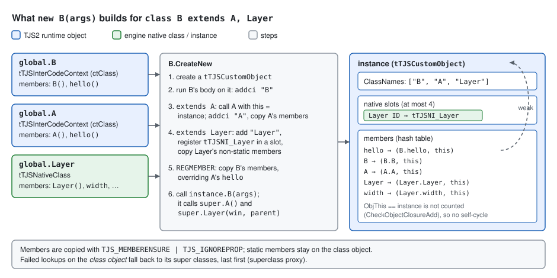
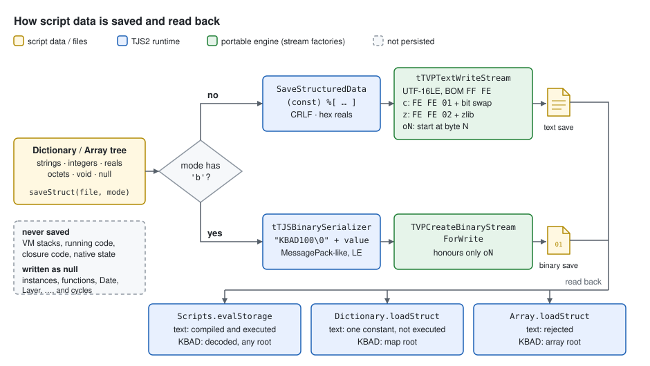

# TJS2 Runtime and Native Class Interface

This chapter specifies what TJS2 values and objects *are* at run time, how
native C++ classes plug into the script world, what the built-in library
contains, and how scripts persist data. The surface syntax lives in
[TJS2 Language](tjs2-language.md). The compiler, the VM and the bytecode format
live in [TJS2 Interpreter](tjs2-interpreter.md). This chapter links to both
instead of repeating them.

The runtime has three layers. `tTJSVariant` is a tagged value. Every
non-primitive value is an `iTJSDispatch2` object, reached through a closure
(object, `this`) pair. Classes, functions, properties, arrays, dictionaries
and engine objects such as `Layer` all implement that one COM-like
interface. Persistence is deliberately simple: scripts write trees of
`Array`/`Dictionary` data to files. There is no way to snapshot the
interpreter itself.

**Sources**

- `krkrz/tjs2/tjs.cpp`, `krkrz/tjs2/tjs.h`
- `krkrz/tjs2/tjsVariant.h`, `krkrz/tjs2/tjsVariant.cpp`, `krkrz/tjs2/tjsVariantString.h`,
  `krkrz/tjs2/tjsVariantString.cpp`, `krkrz/tjs2/tjsString.cpp`, `krkrz/tjs2/tjsGlobalStringMap.cpp`,
  `krkrz/tjs2/tjsHashSearch.h`, `krkrz/tjs2/tjsTypes.h`, `krkrz/tjs2/tjsUtils.cpp`
- `krkrz/tjs2/tjsInterface.h`, `krkrz/tjs2/tjsObject.h`, `krkrz/tjs2/tjsObject.cpp`,
  `krkrz/tjs2/tjsObjectExtendable.h`, `krkrz/tjs2/tjsNative.h`, `krkrz/tjs2/tjsNative.cpp`
- `krkrz/tjs2/tjsInterCodeExec.cpp` (string/octet built-ins, class instantiation),
  `krkrz/tjs2/tjsInterCodeGen.cpp` (class prologue, `extends`)
- `krkrz/tjs2/tjsArray.cpp`, `krkrz/tjs2/tjsDictionary.cpp`, `krkrz/tjs2/tjsMath.cpp`,
  `krkrz/tjs2/tjsRandomGenerator.cpp`, `krkrz/tjs2/tjsDate.cpp`, `krkrz/tjs2/tjsRegExp.cpp`,
  `krkrz/tjs2/tjsException.cpp`, `krkrz/tjs2/tjsError.cpp`, `krkrz/tjs2/tjsOctPack.cpp`
- `krkrz/tjs2/tjsBinarySerializer.h`, `krkrz/tjs2/tjsBinarySerializer.cpp`,
  `krkrz/tjs2/tjsScriptBlock.cpp`, `krkrz/tjs2/tjsLex.cpp`, `krkrz/tjs2/syntax/tjs.y`
- `krkrz/base/ScriptMgnIntf.cpp`, `krkrz/base/TextStream.cpp`, `krkrz/base/BinaryStream.cpp`,
  `krkrz/base/StorageIntf.cpp`, `krkrz/utils/DebugIntf.cpp`
- `krkrz/environ/win32/SystemControl.cpp`, `krkrz/vcproj/tvpwin32.vcxproj`,
  `krkrz/PreprocessorDefinitions.md`

> **About the code samples.** Samples marked *pseudo-TJS* illustrate the
> model. Samples without that mark show results traced through the source.
> They have not been run against a built engine. Results are given in
> comments, and where a result was derived by hand the text says
> **Inferred**.

## Questions answered

| Question | Short answer | Details |
|---|---|---|
| **8. What is included in the "standard library" of TJS?** | The TJS core installs **six names on the global object and one nested class**: `Array`, `Dictionary`, `Date`, `Math` (with `Math.RandomGenerator`), `Exception` and `RegExp` (`tTJS::tTJS`, `krkrz/tjs2/tjs.cpp:106-203`). It installs **no global functions**: there is no `parseInt`, `print`, `String`, `Number`, `Object` or `JSON`. Casts and `typeof`-style helpers are *operators* (`int`, `real`, `string`, `typeof`, `instanceof`, `incontextof`, `isvalid`, `invalidate`, `delete`, `#`, `$`, postfix `!` for eval). Strings have 13 built-in methods plus `length` and indexing. Octets have `unpack` plus `length` and indexing. These are dispatched by the VM, not by an object. Numbers have no methods. Kirikiri Z then adds 17 engine classes, two nested classes, extension classes and a block of global constants. Of these, `Scripts` and `Debug` are the script-facing facilities. | [The standard library](#the-standard-library), [String and octet built-ins](#string-and-octet-built-ins), [Engine-provided classes](#engine-provided-classes) |
| **10. How does "save" work? Is a game-state object saved, or the interpreter state? How is it serialized?** | **Only plain data is saved, never interpreter state.** Nothing in the tree can capture stacks, running code or closures: no continuations, no `Scripts.save`, and `tTJSVariant::Persist` has no callers. Scripts build a tree of `Dictionary`/`Array` containing strings, integers, reals, octets, `void` and `null`. They write it with `saveStruct(file, mode)`. Without `b` in the mode, the result is **TJS source text**, a constant expression such as `(const) %[ "k" => 1 ]`, stored as UTF-16LE with a BOM, optionally bit-scrambled (`c`) or zlib-compressed (`z`). With `b`, the result is a MessagePack-like binary with an 8-byte `KBAD100\0` header. Any other object (class instances, `Date`, `Layer`, functions) is written as `null`, and cycles are cut to `null`. The data is read back with `Scripts.evalStorage(file)`, which handles both formats, or with `Dictionary.loadStruct` / `Array.loadStruct`. KAG's save and load are TJS code in the game data that builds such dictionaries (**Unverified**: KAG is not in this repository). | [Persistence](#persistence), [Worked example](#worked-example), [Compatibility requirements](#compatibility-requirements) |

Example for question 8. Every line is a call into the built-in library:

```javascript
var a = [3, 1, 2];
a.sort();                         // a is now [1, 2, 3]
a.join(",");                      // "1,2,3"
"abcdef".substring(1, 3);         // "bcd"   (second argument is a COUNT)
"a,b,,c".split(",").count;        // 4
"%05d|%s".sprintf(42, "x");       // "00042|x"
Math.max(1, 5.5, 3);              // 5.5 (always a real)
Math.abs(-3);                     // 3.0 (real, not integer)
var re = new RegExp("(\\d+)-(\\d+)");
re.match("10-20")[2];             // "20"
var d = %[ k: 1 ];
(Dictionary.assign incontextof d)(%[ j: 2 ]);   // Dictionary methods need incontextof
```

Example for question 10. A save/load round trip as KAG-style script code
would write it:

```javascript
var save = %[ "scene" => "ch1.ks", "line" => 120, "flags" => %[ met_alice: 1 ] ];
(Dictionary.saveStruct incontextof save)(System.dataPath + "save0.txt");
// later, possibly in another process:
var loaded = Scripts.evalStorage(System.dataPath + "save0.txt");
loaded.flags.met_alice;           // 1
```

## Values

A `tTJSVariant` is a `tTJSVariant_S`: a union plus a type tag, laid out with
`#pragma pack(push, 4)` (4-byte alignment; `krkrz/tjs2/tjsVariant.h:109-157`).

| `tTJSVariantType` | Payload | Script view |
|---|---|---|
| `tvtVoid` | none | `void` |
| `tvtObject` | `tTJSVariantClosure_S { Object, ObjThis }` | any object; `Object == NULL` is `null` |
| `tvtString` | `tTJSVariantString *` (`NULL` = empty string) | string |
| `tvtOctet` | `tTJSVariantOctet *` (`Length`, `RefCount`, `Data`) | octet (byte string) |
| `tvtInteger` | `tTVInteger` = `tjs_int64` (`krkrz/tjs2/tjsTypes.h:165`) | 64-bit signed integer |
| `tvtReal` | `tTVReal` = `double` (`tjsTypes.h:166`) | IEEE 754 double |

There is no boolean type. The lexer turns `true` and `false` into the
integers 1 and 0 (`krkrz/tjs2/tjsLex.cpp:636-645`, `:1610-1618`). `null` is an
object variant whose `Object` is `NULL` (`tjsLex.cpp:1613-1614`). Conversion
and operator semantics are in
[TJS2 Language](tjs2-language.md#type-conversion). Value formatting that
matters for persistence is given here:

- Integer to string uses plain decimal (`TJSIntegerToString`,
  `krkrz/tjs2/tjsVariant.cpp:217-221`).
- Real to string uses `"%.15lg"`. The special values become `NaN`,
  `+Infinity`, `-Infinity`, `+0.0` and `-0.0` (`TJSSpecialRealToString` and
  `TJSRealToString`, `tjsVariant.cpp:223-257`). The conversion is **lossy**:
  `(string)0.1` is `"0.1"`, and 17-digit values are rounded.

A reimplementation **MUST** keep integer and real as distinct types: `typeof`,
`Math.abs` results and the persistence formats all expose the difference.

## Strings

`tTJSVariantString` is a reference-counted, NUL-terminated buffer of
`tjs_char` (`krkrz/tjs2/tjsVariantString.h:62-70`):

- `tjs_char` is `wchar_t`, which is a UTF-16 code unit on the Windows build
  (`krkrz/tjs2/tjsTypes.h:63`, `:130`).
- Strings of up to 21 units are stored inline in `ShortString`; longer ones
  in `LongString` (`TJS_VS_SHORT_LEN`, `:29`).
- `Length` caches the length, and `Hint` caches the member-name hash.
- The empty string is a `NULL` pointer: `TJSAllocVariantString` returns
  `NULL` for `""` (`krkrz/tjs2/tjsVariantString.cpp:597-614`).

**Interning.** `TJSMapGlobalStringMap` (`krkrz/tjs2/tjsGlobalStringMap.cpp:37-122`)
is a 5000-entry LRU hash cache. It returns an existing `ttstr` that shares
the same heap string, and it stores the string's hash into `Hint`. Native
member names (`tTJSNativeClass::RegisterNCM`, `krkrz/tjs2/tjsNative.cpp:256`),
class names and strings decoded by the binary loader
(`ReadStringVarint`, `krkrz/tjs2/tjsBinarySerializer.h:422-433`) all go
through it. It is an optimization only. Strings compare by content
everywhere, so a reimplementation **MAY** intern differently or not at all.

**Hash.** Member lookup uses a one-at-a-time (Jenkins) hash over the UTF-16
code units, with 0 remapped to `0xFFFFFFFF` (`tTJSHashFunc<tjs_char *>::Make`,
`krkrz/tjs2/tjsHashSearch.h:78-98`). The hash is observable only through
dictionary enumeration order (see [Script objects](#script-objects)).

A reimplementation **MUST** treat a string as a sequence of 16-bit code
units. `length`, indexing, `substring` and the binary save format all count
UTF-16 units, and unpaired surrogates have to survive. **Inferred:** because
most paths use `TJS_strlen`, an embedded U+0000 truncates a string, so
scripts cannot rely on NUL inside strings.

## The object interface

Every object implements `iTJSDispatch2` (`krkrz/tjs2/tjsInterface.h:103-333`).
Each operation takes a member name (`NULL` means "the object itself") and an
in/out **hint**. The hint is the member-name hash: the callee fills it in on
the first lookup and uses it later to skip rehashing (`tTJSCustomObject::Find`,
`krkrz/tjs2/tjsObject.cpp:1089-1180`). Every operation also receives an
explicit `objthis`.

| Method | Purpose |
|---|---|
| `AddRef` / `Release` | reference counting |
| `FuncCall` / `FuncCallByNum` | call a member, or the object itself when the name is `NULL` |
| `PropGet` / `PropGetByNum` / `PropSet` / `PropSetByNum` / `PropSetByVS` | read or write a member |
| `GetCount` / `GetCountByNum` | count (used by arrays) |
| `EnumMembers` | invoke a callback `(name, flags, value)` for each member |
| `DeleteMember` / `DeleteMemberByNum` | `delete` operator |
| `Invalidate` / `InvalidateByNum` / `IsValid` / `IsValidByNum` | `invalidate` / `isvalid` operators |
| `CreateNew` / `CreateNewByNum` | `new` operator |
| `IsInstanceOf` / `IsInstanceOfByNum` | `instanceof` operator |
| `Operation` / `OperationByNum` | compound assignment on a member (`TJS_OP_*`, `tjsInterface.h:67-87`) |
| `NativeInstanceSupport` | register or fetch a native instance by class ID |
| `ClassInstanceInfo` | class-name list, `finalize`/`missing` method names, super instance |

`*ByNum` defaults to formatting the number as a decimal name
(`krkrz/tjs2/tjsObject.cpp:141-270`).

Call flags (`tjsInterface.h:25-56`):

| Flag | Value | Meaning |
|---|---|---|
| `TJS_MEMBERENSURE` | `0x200` | create the member if it is missing (used by every assignment) |
| `TJS_MEMBERMUSTEXIST` | `0x400` | fail instead of returning `void`/auto-creating (arrays, dictionaries) |
| `TJS_IGNOREPROP` | `0x800` | treat a property object as a plain value; do not call its getter or setter |
| `TJS_HIDDENMEMBER` | `0x1000` | member is hidden; enumeration-based copies and saves skip it |
| `TJS_STATICMEMBER` | `0x10000` | class member that is **not** copied into instances |
| `TJS_ENUM_NO_VALUE` | `0x100000` | `EnumMembers` passes only name and flags |
| `TJS_NIS_REGISTER` / `TJS_NIS_GETINSTANCE` | 1 / 2 | `NativeInstanceSupport` sub-operation |
| `TJS_CII_ADD` / `_GET` / `_SET_FINALIZE` / `_SET_MISSING` / `_SET_SUPRECLASS` / `_GET_SUPRECLASS` | 1 / 0 / 2 / 3 / 4 / 5 | `ClassInstanceInfo` sub-operation |

**Properties.** A member whose value is an object is accessed through that
object's default `PropGet` or `PropSet` (name `NULL`), unless
`TJS_IGNOREPROP` is set. If the object returns `TJS_E_NOTIMPL`,
`TJS_E_INVALIDTYPE` or `TJS_E_INVALIDOBJECT`, the member value itself is
returned (`TJSDefaultPropGet`, `tjsObject.cpp:1347-1389`). This is how property
objects, both native `tTJSNativeClassProperty` and script `property`
contexts, intercept access while ordinary function members read as values.

## Script objects

`tTJSCustomObject` (`krkrz/tjs2/tjsObject.h:391-638`) is the concrete object
behind the global object, plain class instances, arrays and dictionaries:

- **Members** live in a chained hash table of `tTJSSymbolData { Name, Hash,
  SymFlags, Flags, Value, Next }`. The table size is `1 << hashbits`: 3 bits
  (8 buckets) by default (`TJS_NAMESPACE_DEFAULT_HASH_BITS`) and 7 for the
  global object (`tjs.cpp:101`). Symbol flags are `TJS_SYMBOL_USING`,
  `_INIT`, `_HIDDEN` and `_STATIC` (`tjsObject.h:379-382`).
- **Insertion.** A new name takes its bucket head if the head is free.
  Otherwise it is linked *right after* the head (`Add`,
  `tjsObject.cpp:570-630`). A lookup that finds an entry deeper than the
  third chain position moves it to the front of the chain (`Find`, `:1112-1118`).
- **Enumeration** walks buckets 0…N−1. Within each bucket it visits the chain
  entries first and the bucket head last (`InternalEnumMembers`,
  `:1207-1240`).
- **Rehash.** `RebuildHash(count)` resizes the table
  (`:748-848`). It runs from `Dictionary.assign*`, from the binary loader,
  and lazily on the next `PropGet` after the global rehash counter changes
  (`:1396-1399`). On Win32 that counter is bumped every 1.5 s while no
  continuous handler runs (`TJSDoRehash`,
  `krkrz/environ/win32/SystemControl.cpp:176-180`).

The consequence is that **dictionary key order depends on the hash, on
insertion order, on lookups, and on when a rehash happened.** Script code
can observe it through `Dictionary.saveStruct` output and
`Array.assign(dict)`, but cannot control it.

> **Quirk — enumeration order is unstable.** The same dictionary may
> enumerate in a different order before and after an idle rehash, or after
> a few lookups. A reimplementation **MAY** use any stable order (for
> example, insertion order). No script can rely on the original's order,
> because it changes over time.

**Up to 4 native instances** can be attached to one object
(`TJS_MAX_NATIVE_CLASS`, `tjsObject.h:384`). Each is stored in a slot keyed
by class ID (`NativeInstanceSupport`, `tjsObject.cpp:2071-2105`). This is
what allows `class MyLayer extends Layer` and, **Inferred**, a script class
that extends two native classes.

**`missing`.** If `ClassInstanceInfo(TJS_CII_SET_MISSING, "missing")` has
been called, which is what `Scripts.setCallMissing(obj)` does, a failed
lookup calls `obj.missing(isSet, name, valueProp)`. The third argument is a
temporary property object, and the method returns true if it handled the
access (`CallGetMissing` / `CallSetMissing`, `tjsObject.cpp:477-568`).

## Closures

An object value is always a pair `(Object, ObjThis)`
(`tTJSVariantClosure`, `krkrz/tjs2/tjsVariant.h:182-219`). Copying or
releasing the variant adds or drops a reference on **both** pointers. When
a function is invoked through the pair, `ObjThis` is the `this`, falling
back to the caller-supplied `objthis` when `ObjThis` is `NULL`
(`TJS_SELECT_OBJTHIS`; `CallFunctionDirect`,
`krkrz/tjs2/tjsInterCodeExec.cpp:2431-2438`). `incontextof` builds a new
pair. `ChangeClosureObjThis` rebinds one (`tjsVariant.h:519`).

Methods copied into an instance get `ObjThis = instance`, so every instance
would hold a strong reference to itself. `tTJSCustomObject` cancels this:
when it stores a closure whose `ObjThis` is the object itself, it calls
`Release()` once, and it calls `AddRef()` when such a value is removed
(`CheckObjectClosureAdd` / `CheckObjectClosureRemove`,
`krkrz/tjs2/tjsObject.h:511-529`). A reimplementation **MUST** treat
self-bound method closures stored in their own object as weak, or an
equivalent mechanism. Otherwise every instance leaks.

## Classes and instances



A script `class` compiles to a `tTJSInterCodeContext` of type `ctClass`. The
class body is code:

1. **Prologue.** The body starts with `addci this, "<ClassName>"` (append the
   class name to the instance's class list). `REGMEMBER` (copy the class's
   members into `this`) is inserted at the position after the last `extends`
   call (`tTJSInterCodeContext` constructor,
   `krkrz/tjs2/tjsInterCodeGen.cpp:275-295`; `FixCode`, `:714-730`).
2. **`extends X, Y`.** Each super class expression is evaluated, rebound to
   `this` with `chgthis`, and *called* with no arguments
   (`CreateExtendsExprCode`, `tjsInterCodeGen.cpp:3474-3507`). Calling a
   class object with a `NULL` member name runs that class's body on the same
   instance (`tTJSInterCodeContext::FuncCall`, case `ctClass`,
   `tjsInterCodeExec.cpp:3096-3097`). So multiple inheritance means "run each
   super class body in order, then copy my own members over the result".
   Member lookups on the *class object* that fail fall back to the super
   classes, last first (`TJS_DO_SUPERCLASS_PROXY_BEGIN`,
   `tjsInterCodeExec.cpp:3054-3069`).
3. **Copying members** (`RegisterObjectMember`, `tjsInterCodeExec.cpp:3009-3052`).
   Every non-static member is stored into the instance with
   `TJS_MEMBERENSURE | TJS_IGNOREPROP`. Object values are rebound to the
   instance.

`new B(args)` calls `B`'s `CreateNew` (`tjsInterCodeExec.cpp:3211-3238`).
That creates a fresh `tTJSCustomObject`, runs the class body on it, and then
calls the member named after the class (the constructor) with `args`. If
there is no constructor, nothing is called. The class-name list therefore
reads descendant first: `Scripts.getClassNames(new B())` → `["B", "A"]`
(`TJS_CII_ADD`/`TJS_CII_GET`, `tjsObject.cpp:2112-2131`).

**Native classes** follow the same contract. Calling a `tTJSNativeClass` with
a `NULL` name and an instance as `objthis` (`tTJSNativeClass::FuncCall`,
`krkrz/tjs2/tjsNative.cpp:306-375`):

- adds the class name;
- creates the native instance (`CreateNativeInstance`), and registers it
  under the class ID even if it is `NULL`;
- copies every non-static member into the instance. It rebinds only
  closures whose `ObjThis` is `NULL`.

`tTJSNativeClass::CreateNew` (`tjsNative.cpp:378-431`) does the same on a new
`tTJSCustomObject`, then calls the constructor member.
`tTJSExtendableObject`/`SuperClass` supports native-to-native inheritance
(`krkrz/tjs2/tjsObjectExtendable.h`). **Inferred:** nothing in the engine
uses it, because `ExtendsClass` and `SetSuper` have no callers outside
`tjs2/`.

**`finalize`.** Invalidation calls the member named by `finalize_name`
(default `"finalize"`) if `CallFinalize` is true. It then calls
`Invalidate()` on each native instance (last slot first) and deletes all
members (`tTJSCustomObject::Finalize`, `tjsObject.cpp:451-468`).
`Array` and `Dictionary` objects set `CallFinalize = false`
(`krkrz/tjs2/tjsArray.cpp:1388-1391`, `krkrz/tjs2/tjsDictionary.cpp:706-714`).
Native classes declare an empty `finalize`
(`TJS_DECL_EMPTY_FINALIZE_METHOD`, `krkrz/tjs2/tjsNative.h:380-383`). Script
classes inherit it, so `super.finalize()` is always safe.

```javascript
class A { function A() { } function hello() { return "A"; } }
class B extends A { function B() { super.A(); } function hello() { return "B" + super.hello(); } }
var b = new B();
b.hello();                          // "BA"
Scripts.getClassNames(b);           // ["B", "A"]
b instanceof "A";                   // true
```

## Lifetime

Objects are reference counted (`tTJSDispatch::AddRef`/`Release`,
`krkrz/tjs2/tjsObject.cpp:110-139`). On the last `Release`,
`BeforeDestruction` runs `_Finalize()`. The object is deleted only if the
count is still 1 afterwards, so a `finalize` that stores `this` somewhere
resurrects the object. `invalidate obj` runs the same `_Finalize()` without
deleting (`Invalidate`, `:1697-1708`). Re-entry is blocked by
`IsInvalidating` (`:430-448`).

After invalidation, every `FuncCall`/`PropGet`/… on the object returns
`TJS_E_INVALIDOBJECT`, and `isvalid` is false (`:1319-1320`, `:1747-1754`).

There is no tracing collector (see [Architecture](../architecture.md#object-model-and-memory)).
**Inferred:** engine objects (`Layer`, `Window`, …) are usually released by
an explicit `invalidate`, which runs the native `Invalidate` and frees the
resources even while script references remain. A reimplementation
**MUST** keep deterministic, synchronous finalization on the last release
and on `invalidate`. A deferred GC would change when `finalize` runs and
when native resources disappear.

The VM also keeps references alive longer than lexical scope suggests. See
[TJS2 Interpreter](tjs2-interpreter.md#the-virtual-machine) for why
temporaries are not cleared on function return.

## Binding native classes

A native class is a `tTJSNativeClass` subclass. Its constructor registers
members with the macros of `krkrz/tjs2/tjsNative.h:332-471`. The per-object
state is a `tTJSNativeInstance` subclass (`tjsNative.h:43-51`), which
implements `Construct`, `Invalidate` and `Destruct`.

| Macro | Effect |
|---|---|
| `TJS_BEGIN_NATIVE_MEMBERS(Cls)` … `TJS_END_NATIVE_MEMBERS` | registers the class name to get a class ID (`TJSRegisterNativeClass`) and stores it in `ClassID` |
| `TJS_BEGIN_NATIVE_CONSTRUCTOR_DECL(var, NIType, Cls)` … `TJS_END_NATIVE_CONSTRUCTOR_DECL(Cls)` | constructor member named `Cls`; first calls `var->Construct(numparams, param, objthis)` |
| `TJS_BEGIN_NATIVE_CONSTRUCTOR_DECL_NO_INSTANCE(Cls)` | constructor without a native instance (`Math`, `Exception`, `Scripts`, `Debug`) |
| `TJS_END_NATIVE_STATIC_CONSTRUCTOR_DECL(Cls)` | constructor flagged `TJS_STATICMEMBER` (`Dictionary`) |
| `TJS_BEGIN_NATIVE_METHOD_DECL(m)` … `TJS_END_NATIVE_METHOD_DECL(m)` | instance method, copied into each instance |
| `…_END_NATIVE_STATIC_METHOD_DECL(m)` | static method, not copied (`TJS_STATICMEMBER`) |
| `…_END_NATIVE_HIDDEN_METHOD_DECL(m)` | hidden method (`TJS_HIDDENMEMBER`) |
| `TJS_BEGIN_NATIVE_PROP_DECL(p)` with `TJS_BEGIN_NATIVE_PROP_GETTER` / `TJS_DENY_NATIVE_PROP_SETTER` … | property; a denied accessor returns `TJS_E_ACCESSDENYED` |
| `…_END_NATIVE_STATIC_PROP_DECL(p)` | static property |
| `…_DECL_OUTER(cls, name)` | register on another class object, used for platform-specific members added by `win32/*Impl.cpp` |
| `TJS_GET_NATIVE_INSTANCE(var, NIType)` | fetch the native instance from `objthis` by class ID; fails with `TJS_E_NATIVECLASSCRASH` |
| `TJS_PARAM_EXIST(n)` | `numparams > n && param[n]` is not `void` |

Every registration goes through `RegisterNCM`, which does a
`PropSetByVS(TJS_MEMBERENSURE | TJS_IGNOREPROP | flags, name, …)` on the class
object (`krkrz/tjs2/tjsNative.cpp:252-289`). Methods are
`tTJSNativeClassMethod` objects: they `Clear()` the result and call the C
callback, and they reject a `NULL` `objthis` (`tjsNative.cpp:85-105`).
Properties are `tTJSNativeClassProperty` objects (`:179-223`). A failing
`tjs_error` returned by a callback becomes a script exception in the VM
(`TJSThrowFrom_tjs_error`, `tjsInterCodeExec.cpp:2450-2452`).

A minimal native class, assembled from the macros (**Inferred:** not
compiled in this form):

```cpp
class tTJSNI_Counter : public tTJSNativeInstance {
public:
    tjs_int Value = 0;
    tjs_error TJS_INTF_METHOD Construct(tjs_int numparams, tTJSVariant **param,
                                        iTJSDispatch2 *tjs_obj) {
        if (numparams >= 1) Value = (tjs_int)*param[0];
        return TJS_S_OK;
    }
};

class tTJSNC_Counter : public tTJSNativeClass {
public:
    static tjs_uint32 ClassID;               // set by TJS_BEGIN_NATIVE_MEMBERS
    tTJSNC_Counter() : tTJSNativeClass(TJS_W("Counter")) {
        TJS_BEGIN_NATIVE_MEMBERS(Counter)
        TJS_DECL_EMPTY_FINALIZE_METHOD
        TJS_BEGIN_NATIVE_CONSTRUCTOR_DECL(_this, tTJSNI_Counter, Counter)
        { return TJS_S_OK; }                 // Construct() already ran
        TJS_END_NATIVE_CONSTRUCTOR_DECL(Counter)

        TJS_BEGIN_NATIVE_METHOD_DECL(increment)
        {
            TJS_GET_NATIVE_INSTANCE(_this, tTJSNI_Counter);
            _this->Value++;
            if (result) *result = (tTVInteger)_this->Value;
            return TJS_S_OK;
        }
        TJS_END_NATIVE_METHOD_DECL(increment)

        TJS_BEGIN_NATIVE_PROP_DECL(value)
        {
            TJS_BEGIN_NATIVE_PROP_GETTER
            {
                TJS_GET_NATIVE_INSTANCE(_this, tTJSNI_Counter);
                *result = (tTVInteger)_this->Value;
                return TJS_S_OK;
            }
            TJS_END_NATIVE_PROP_GETTER
            TJS_DENY_NATIVE_PROP_SETTER
        }
        TJS_END_NATIVE_PROP_DECL(value)
        TJS_END_NATIVE_MEMBERS
    }
protected:
    tTJSNativeInstance *CreateNativeInstance() { return new tTJSNI_Counter(); }
};
tjs_uint32 tTJSNC_Counter::ClassID = (tjs_uint32)-1;
```

```javascript
var c = new Counter(10);
c.increment();   // 11
c.value;         // 11
c.value = 3;     // throws: TJS_E_ACCESSDENYED from TJS_DENY_NATIVE_PROP_SETTER
class Fancy extends Counter { function Fancy() { super.Counter(100); } }
new Fancy().value;   // 100
```

A reimplementation **MUST** keep the observable parts of this contract:

- non-static class members appear as **members of every instance**, so they
  can be overridden, deleted and enumerated;
- static members do not appear on instances;
- a TJS class may extend a native class, and up to four native classes per
  object, with the constructor run through `super.Cls(...)`;
- calling a native method on an object without the native instance fails.

It **MAY** implement the copying lazily, as long as those behaviors hold.

## Registering classes on the global object

The TJS core constructs the global object as a `tTJSCustomObject` with 7 hash
bits. It then stores each class with
`Global->PropSet(TJS_MEMBERENSURE, name, NULL, &val, Global)`, where
`val = tTJSVariant(dsp, NULL)` (`tTJS::tTJS`, `krkrz/tjs2/tjs.cpp:140-195`).
`Math.RandomGenerator` is stored on the `Math` class object the same way
(`:177-181`).

Kirikiri Z uses the `REGISTER_OBJECT` macro, which passes
`TJS_MEMBERENSURE | TJS_IGNOREPROP` (`TVPInitScriptEngine`,
`krkrz/base/ScriptMgnIntf.cpp:498-538`). Nested engine classes are stored as
static members of their parent: `WaveSoundBuffer.PhaseVocoder` and
`Window.BasicDrawDevice` (`:525-538`). Extension classes follow
(`TVPCauseAtInstallExtensionClass`, `:541`). Before any of this,
`TVPInitTJSScript`, a `const …` statement compiled from a narrow string, has
already created the global engine constants such as `bsNone`, `ltOpaque`,
`crArrow`, `clScrollBar`, `faReadOnly` and the `imageTagLayerType`
dictionary (`ScriptMgnIntf.cpp:58-364`, executed at `:479`).

## The standard library

Everything below is installed by `tTJS::tTJS` (`krkrz/tjs2/tjs.cpp:150-195`),
except the string and octet built-ins, which the VM dispatches by value type.
The "static" column comes from the macro used: static members are not copied
to instances and are called on the class object (or via `incontextof`).

### Array

`tTJSArrayClass` (`krkrz/tjs2/tjsArray.cpp:242-1024`). Items live in a
`std::deque<tTJSVariant>` (`tTJSArrayNI::Items`). All members are instance
members. Integer member names index the array; negative indexes count from
the end. Reading out of range yields `void`, and writing beyond the end
grows the array (`ARRAY_GET_VAL`, `:1404-1412`; `PropSetByNum`, `:1634-1662`).

| Member | Kind | Semantics | Notes |
|---|---|---|---|
| `Array()` | constructor | | any argument → `TJS_E_BADPARAMCOUNT` (`tTJSArrayNI::Construct`, `:1052-1058`) |
| `load(storage, mode?)` | method | replaces the items with the lines of a text file; splits on CR, LF and CRLF | an empty last line is dropped; returns `this` (`:257-362`) |
| `loadStruct(storage, mode?)` | method | loads a **binary** (`KBAD100`) file whose root is an array into `this` | text files fail with `TJS_E_INVALIDPARAM` (`:364-403`) |
| `save(storage, mode?)` | method | writes one line per item: strings and numbers as text, other items as empty lines, CRLF | lossy; reals use `%.15lg` (`:405-449`) |
| `saveStruct(storage, mode?)` | method | writes `this` as a constant expression, or as binary if `mode` contains `b` | see [Persistence](#persistence) (`:451-495`) |
| `split(delim\|regexp, string, reserved?, purgeEmpty?)` | method | fills `this` by splitting `string`; `delim` is a *set* of characters | returns `this` (`:497-572`) |
| `join(delim, reserved?, purgeEmpty?)` | method | joins items converted to strings | `purgeEmpty` skips `void` items only (`:574-609`) |
| `sort(order\|func?, stable?)` | method | order is one of `+` `-` `0` `9` `a` `z`, or a `func(a, b)` that returns `a < b` | unknown letters mean `+`; `std::sort` unless `stable` (`:611-732`) |
| `reverse()` | method | reverses in place | (`:734-743`) |
| `assign(src)` | method | shallow copy from an Array, or from any object as a flat `name, value, …` list | hidden members are skipped (`Assign`, `:1060-1110`) |
| `assignStruct(src)` | method | deep copy of nested Array/Dictionary; cycles become `null`; other objects are shared | (`AssignStructure`, `:1264-1379`) |
| `clear()` | method | removes all items | |
| `erase(index)` | method | removes the item at `index`; negative counts from the end | |
| `remove(value, all = true)` | method | removes items `===` to `value`; returns the count | `DiscernCompare` (`:1474-1535`) |
| `insert(index, value)` | method | inserts before `index` | range error past the end |
| `add(value)` | method | appends; returns the new index | |
| `push(v…)` / `unshift(v…)` | method | append / prepend; return the new count | |
| `pop()` / `shift()` | method | remove and return the last / first item; `void` when empty | |
| `find(value, start = 0)` | method | first index with `===`, else −1 | negative `start` counts from the end (`:934-964`) |
| `pack(template)` | method | packs the items into an octet (Perl-like templates) | see [String and octet built-ins](#string-and-octet-built-ins) (`:966-975`) |
| `count`, `length` | property (rw) | item count; setting it resizes | (`:980-1019`) |

### Dictionary

`tTJSDictionaryClass` (`krkrz/tjs2/tjsDictionary.cpp:27-237`). A dictionary is
a `tTJSDictionaryObject`, a `tTJSCustomObject` whose `PropGet` of a missing
key returns `void` instead of failing (`:734-746`). Its keys *are* its
members. **Every Dictionary method is static** (`TJS_END_NATIVE_STATIC_*`).
As a result, no method name can shadow a key, and scripts call the methods
as `(Dictionary.method incontextof dict)(…)`.

| Member | Kind | Semantics | Notes |
|---|---|---|---|
| `Dictionary(hashSizeHint?)` | static constructor | an integer ≥ 8 pre-sizes the hash table (`CreateNew`, `:254-298`) | more than one argument → `TJS_E_BADPARAMCOUNT` (`:316-324`) |
| `load(...)` | static | **does nothing**, returns success | `// TODO: implement Dictionary.load()` (`:41-49`) |
| `save(...)` | static | **does nothing**, returns success | `// TODO` (`:123-131`) |
| `loadStruct(storage, mode?)` | static | binary `KBAD100` with a dictionary root, or **text holding one constant expression**; returns the loaded value | into `this` when it is a Dictionary (binary only); see [Reading saved data back](#reading-saved-data-back) (`:51-121`) |
| `saveStruct(storage, mode?)` | static | like `Array.saveStruct` | (`:133-179`) |
| `assign(src, clear = true)` | static | copies the members of `src` into `this`; an Array source is read as `key, value, …` pairs | hidden members are skipped (`:181-201`, `:333-405`) |
| `assignStruct(src)` | static | deep copy; `src` **must** be a Dictionary (`TJSSpecifyDicOrArray`) | (`:203-221`, `:544-697`) |
| `clear()` | static | deletes all members | (`:223-232`) |

> **Quirk — `d.saveStruct(...)` does not work.** Because the methods are
> static, `d.saveStruct(...)` looks up a member `saveStruct` on `d`, finds
> none, and fails with "member not found" (`tTJSDictionaryObject::FuncCall`,
> `:720-731`). A reimplementation **MUST** keep Dictionary methods off the
> instances; scripts store keys such as `"count"` or `"clear"` freely.

### Math

`tTJSNC_Math` (`krkrz/tjs2/tjsMath.cpp:90-527`). Every member is static.

| Member | Semantics | Notes |
|---|---|---|
| `abs(x)`, `acos`, `asin`, `atan`, `atan2(y, x)`, `ceil`, `exp`, `floor`, `log`, `pow(x, y)`, `sin`, `cos`, `sqrt`, `tan` | C library function on `AsReal()` | **always return a real**: `Math.floor(2.7)` is `2.0` |
| `max(…)`, `min(…)` | any number of arguments; NaN propagates; `+0` beats `−0` in `max`, and vice versa in `min` | no arguments → `-Infinity` / `+Infinity` (`:256-339`) |
| `random()` | `[0, 1)` from a 128-bit xorshift seeded with `time()` when the class is constructed | not reproducible; use `Math.RandomGenerator` (`:52-83`, `:341-349`) |
| `round(x)` | `floor(x + 0.5)` | `Math.round(-2.5)` is `-2.0` (`:351-363`) |
| `E`, `LOG2E`, `LOG10E`, `LN10`, `LN2`, `PI`, `SQRT1_2`, `SQRT2` | read-only static properties | (`:421-523`) |

### Math.RandomGenerator

`tTJSNC_RandomGenerator` (`krkrz/tjs2/tjsRandomGenerator.cpp:261-365`) wraps an
MT19937 Mersenne Twister with an instance per object.

| Member | Semantics |
|---|---|
| `RandomGenerator(seed?)`, `randomize(seed?)` | no argument: seed from `TJSGetRandomBits128` (the engine sets it to `TVPGetRandomBits128`) or `time()`; integer: 64-bit seed; object: restore a `serialize()` dictionary (`Randomize`, `:47-149`) |
| `random()` | real in `[0, 1)`, 53-bit precision |
| `random32()` | integer `0 … 2³²−1` |
| `random63()` | integer `0 … 2⁶³−1` |
| `random64()` | any 64-bit integer |
| `serialize()` | `%[ "state" => <624×8 lowercase hex digits>, "left" => int, "next" => int ]` (`Serialize`, `:151-202`) |

`serialize()` is the only built-in that turns native state into
saveable data. Feeding its result to `saveStruct` and then to
`new Math.RandomGenerator(loaded)` restores the generator exactly.

> **Quirk.** The entropy mixing uses `buf[1] << 16` instead of `buf[i]`
> (`:60-61`). It only affects unseeded generators, so it is not observable.

### Date

`tTJSNC_Date` (`krkrz/tjs2/tjsDate.cpp:50-325`). The state is a single
`time_t` (`DateTime`), so the resolution is **one second**. All
getters and setters go through `localtime`/`mktime`.

| Member | Semantics |
|---|---|
| `Date()` | now |
| `Date(string)` | `tTJSDateParser` (`krkrz/tjs2/tjsDateParser.cpp`, `tjsdate.tab.cpp`); the result is truncated to seconds (`TJSParseDateString`, `tjsDate.cpp:29-33`) |
| `Date(year, month = 0, day = 1, h = 0, m = 0, s = 0)` | local time; `month` is 0-based; `mktime` failure → `TJSInvalidValueForTimestamp` |
| `setYear/Month/Date/Hours/Minutes/Seconds(n)` | adjust one local field, then normalize via `mktime` |
| `setTime(ms)` | `DateTime = ms / 1000` |
| `getYear/Month/Date/Day/Hours/Minutes/Seconds()` | local fields; `getDay` is the weekday (0 = Sunday) |
| `getTime()` | `DateTime * 1000`, always a multiple of 1000 |
| `getTimezoneOffset()` | `TJS_timezone / 60`; **Inferred:** C `timezone` sign, so west of UTC is positive |
| `parse(string)` | sets `this` from a string |

There is no `toString`, UTC accessor or millisecond field.

### RegExp

`tTJSNC_RegExp` (`krkrz/tjs2/tjsRegExp.cpp:204-731`) uses **Oniguruma** with
`ONIG_SYNTAX_PERL` over UTF-16LE, with default options
`CAPTURE_GROUP | FIND_NOT_EMPTY` (`:31-52`, `:613-640`). Flags: `g` (global),
`i` (ignore case), `l` (accepted and ignored).

| Member | Kind | Semantics |
|---|---|---|
| `RegExp(pattern?, flags?)`, `compile(pattern, flags?)` | method | compile; an empty pattern becomes `(?:)` |
| `_compile("//flags/pattern")` | method | internal form used by regexp literals (`:245-297`) |
| `test(s)` | method | match from `start`; updates state and `RegExp.last`; returns a boolean |
| `match(s)` | method | Array of `[whole, group1, …]`, or empty; **no** state change |
| `exec(s)` | method | like `match`, but updates state (`matches`, `index`, …); with `g`, advances `start` to `lastIndex` |
| `replace(s, replacement\|func)` | method | replaces the first match, or all with `g`; `func(matchArray)` is called with `this` bound to the RegExp when unbound (`replace_regex`, `:69-127`) |
| `split(s, reserved?, purgeEmpty?)` | method | split into a new Array |
| `matches`, `index`, `lastIndex`, `input`, `lastMatch`, `lastParen`, `leftContext`, `rightContext` | property (r) | state from the last `test`/`exec` |
| `start` | property (rw) | search start position |
| `last` | static property (r) | the RegExp used by the most recent `test`/`exec` |

> **Quirk — `index` counts bytes.** `Exec` computes
> `Index = Start + region->beg[0]`, without dividing the byte offset by
> `sizeof(tjs_char)` (`:676`). `lastIndex`, `lastMatch` and the context
> strings are correct. A reimplementation **SHOULD** reproduce
> `index = start + 2 × matchOffset` for compatibility with scripts that
> (mis)use it. **Open question:** whether any shipped script depends on it.

### Exception

`tTJSNC_Exception` (`krkrz/tjs2/tjsException.cpp:24-52`) has only a constructor
and `finalize`. `Exception(message = "", trace = "")` stores the plain
members `message` and `trace` on the new object. Runtime errors are turned
into script exceptions by looking up **global `Exception` at run time** and
calling `new Exception(msg)`, then setting `trace` (`TJSGetExceptionObject`,
`krkrz/tjs2/tjsError.cpp:26-49`). A script that replaces `global.Exception`
therefore changes what `catch` receives. `try`/`catch` semantics are in
[TJS2 Language](tjs2-language.md#statements), and error propagation is in
[TJS2 Interpreter](tjs2-interpreter.md#error-handling).

### String and octet built-ins

Strings and octets are not objects. When a method is called on a value of
type `tvtString` or `tvtOctet`, the VM calls `ProcessStringFunction` or
`ProcessOctetFunction` instead of a `FuncCall` (`CallFunctionDirect` and
`CallFunctionIndirect`, `krkrz/tjs2/tjsInterCodeExec.cpp:2406-2506`). Member
reads go to `GetStringProperty` and `GetOctetProperty` (`:46-196`).

| String member | Semantics (`ProcessStringFunction`, `:2572-2870`) | Example → result |
|---|---|---|
| `length` | code-unit count (read-only) | `"abc".length` → `3` |
| `s[n]` | one-unit string; `n == length` gives `""`; beyond that, a range error | `"abc"[1]` → `"b"` |
| `charAt(n)` | like `s[n]`, but out of range gives `""` | `"abc".charAt(9)` → `""` |
| `indexOf(sub, start = 0)` | position or −1 | `"abc".indexOf("")` → `-1` (**Quirk:** the empty needle is a `NULL` string) |
| `toUpperCase()`, `toLowerCase()` | **ASCII only** | `"äb".toUpperCase()` → `"äB"` |
| `substring(start, count?)`, `substr(start, count?)` | identical; the second argument is a **length** | `"abcdef".substring(1, 3)` → `"bcd"` |
| `sprintf(args…)` | `this` is the format: `%[-+#][0][width\|*][.prec\|.*][diouxXfegEGcs%]`. Integers go through C `snprintf` with `I64`, reals with `l`; an unknown conversion letter is copied literally without the `%` (`TJSFormatString`, `krkrz/tjs2/tjsVariantString.cpp:694-1023`) | `"%05.1f".sprintf(3.14159)` → `"003.1"` |
| `replace(regexp, repl)` | same as `regexp.replace(this, repl)`; the first argument **must** be a RegExp | `"a-b".replace(/-/, "+")` → `"a+b"` |
| `escape()` | C-style escaping (`tTJSString::EscapeC`) | `"a\"b\n".escape()` → `a\"b\n` |
| `split(delim\|regexp, reserved?, purgeEmpty?)` | `new Array().split(delim, this, …)` | `"a,,b".split(",", void, true)` → `["a","b"]` |
| `trim()` | strips code units `0x01…0x20` at both ends | |
| `reverse()` | reverses code units | `"abc".reverse()` → `"cba"` |
| `repeat(n)` | repeated `n` times; `n ≤ 0` gives `""` | `"ab".repeat(3)` → `"ababab"` |

| Octet member | Semantics |
|---|---|
| `length` | byte count |
| `o[n]` | byte value; out of range is a range error |
| `unpack(template)` | Array of values (`TJSOctetUnpack`, `krkrz/tjs2/tjsOctPack.cpp:873-886`) |

`Array.pack(template)` and `octet.unpack(template)` take Perl-like
templates. Letters: `a A b B c C d f h H i I l L n N s S v V x X @ m`
(`m` is Base64), each with an optional count or `*` (`tjsOctPack.cpp:13-126`).
`u` and `w` throw an error. `p` and `P` are silently skipped by `pack` and
throw in `unpack` (`:411-431`, `:774-825`).

> **Quirk — string methods are not values.** `var f = "abc".charAt;` fails
> with "member not found", because `GetStringProperty` only knows `length`
> and digits (`:46-100`). Only the call syntax `s.method(…)` reaches
> `ProcessStringFunction`. A reimplementation **MUST NOT** make them
> first-class, or **MAY** do so only as a strict superset.

### Numbers

Integers and reals have no members. A member access on them tries to
convert the value to an object and throws a conversion error
(`GetPropertyDirect`, `tjsInterCodeExec.cpp:1593-1622`). Number formatting
uses `(string)x` or `"%d".sprintf(x)`.

## Engine-provided classes

`TVPInitScriptEngine` (`krkrz/base/ScriptMgnIntf.cpp:404-545`) installs these
names after the TJS core. Only the script-related ones are specified here. The
rest have their own chapters (planned):

| Name | Kind | Specified in |
|---|---|---|
| `Debug` | static logging facility | [below](#the-debug-class) |
| `Scripts` | static script facility | [below](#the-scripts-class) |
| `Font`, `Layer`, `Bitmap`, `ImageFunction`, `BitmapLayerTreeOwner`, `Rect` | graphics | [Rendering Model](../visual/rendering-model.md) and planned visual chapters |
| `Window` (+ static `Window.BasicDrawDevice`) | window and draw device | planned Window chapter |
| `Timer`, `AsyncTrigger` | events | planned events chapter |
| `System`, `Storages`, `Plugins`, `Clipboard` | platform and storage | planned system and storage chapters |
| `VideoOverlay` | movie | planned movie chapter |
| `WaveSoundBuffer` (+ static `WaveSoundBuffer.PhaseVocoder`) | sound | planned sound chapter |
| extension classes | `TVPCauseAtInstallExtensionClass` | none registered in this tree ([Architecture](../architecture.md)) |

The engine also replaces the TJS stream hooks
(`TJSCreateTextStreamForRead/Write` and `TJSCreateBinaryStreamForRead/Write`;
the core defaults return `NULL`, `krkrz/tjs2/tjs.cpp:633-657`) with
`TVPCreate*Stream*` (`ScriptMgnIntf.cpp:485-491`). These hooks are what
`Array.load`, `saveStruct` and `loadStruct` use, so the file format of
saved data belongs to the engine, not to TJS (see [File modes](#file-modes)).

### The Scripts class

`tTJSNC_Scripts` (`ScriptMgnIntf.cpp:1210-1482`). Every member is static, and
`new Scripts` throws `TVPCannotCreateInstance` (`:1457-1463`).

| Member | Semantics |
|---|---|
| `execStorage(storage, mode?, context?)` | `TVPExecuteStorage(..., isexpression = false)`. The file may be `TJS2100` bytecode, `KBAD100` binary data (only if the result is used), or text in `textEncoding` (BOMs are auto-detected). Returns the script's result. See [Architecture](../architecture.md#loading-a-script) (`:726-774`, `:1230-1247`) |
| `evalStorage(storage, mode?, context?)` | same, but the text is compiled as an **expression**. This is the standard reader for `saveStruct` text output (`:1249-1266`) |
| `compileStorage(src, out, isResult?, outputDebug?, isExpression?)` | writes `TJS2100` bytecode; see [TJS2 Interpreter](tjs2-interpreter.md#bytecode-file-format) (`:1268-1293`) |
| `exec(script, name?, lineOffset?, context?)` | compile and run a string (`:1295-1317`) |
| `eval(expr, name?, lineOffset?, context?)` | compile and evaluate an expression string (`:1319-1341`) |
| `dump()` | dump every script block to the dump file (`TVPDumpScriptEngine`, `:845-861`) |
| `getTraceString(limit = 0)` | current TJS call stack as a string (`TJSGetStackTraceString`) |
| `dumpStringHeap()` | only when `TJS_DEBUG_DUMP_STRING` is defined, which every `tvpwin32.vcxproj` configuration does |
| `setCallMissing(obj)` | *undocumented:* enables the `missing` hook on `obj` (`:1380-1395`) |
| `getClassNames(obj)` | *undocumented:* Array of class names, most derived first (`:1397-1434`) |
| `textEncoding` | static property: encoding for script text without a BOM (`TVPScriptTextEncoding`, initialized from `-readencoding`; `"UTF-8"` and `"Shift_JIS"` are supported, `krkrz/base/TextStream.cpp:184-196`) |

`context`, when given, becomes `this` and the namespace in which the code
runs. Tracing and dumping internals are in
[TJS2 Interpreter](tjs2-interpreter.md#debugging-and-tooling).

### The Debug class

`tTJSNC_Debug` (`krkrz/utils/DebugIntf.cpp:622-823`). All members are static.
Constructing the class writes the version banner to the log as an
"important" entry (`:809-811`).

| Member | Semantics |
|---|---|
| `message(v…)` | `TVPAddLog`; several arguments are joined with `", "` |
| `notice(v…)` | `TVPAddImportantLog`; same joining |
| `startLogToFile(clear = false)` | start mirroring the log to a file |
| `logAsError()` | `TVPOnError()`: flush to file as on an error |
| `addLoggingHandler(func)`, `removeLoggingHandler(func)` | log listeners |
| `getLastLog(lines = TVPLogMaxLines + 100)` | recent log text |
| `logLocation` | rw: log file directory |
| `logToFileOnError`, `clearLogFileOnError` | rw booleans; defaults from `-logerror` (`:600-613`) |

TJS console output (`tTJS::OutputToConsole`, for example warnings and
`Scripts.dump`) is routed to the same log (`tTVPTJS2ConsoleOutputGateway`,
`:832-843`).

## Persistence



### No interpreter snapshot

Neither the TJS core nor the engine can capture interpreter state:

- Nothing serializes stacks, register frames, `tTJSInterCodeContext`
  objects, closures or native instances. The only "persist" methods,
  `tTJSVariant::QueryPersistSize`/`Persist` (`krkrz/tjs2/tjsVariant.cpp:1187-1253`),
  are documented as not portable across platforms and have **no callers**
  in the tree.
- No member of `Scripts` saves or restores execution. The language has no
  continuations, coroutines or yield.
- Execution recurses on the C++ stack ([Architecture](../architecture.md#executing)),
  so a mid-function snapshot is not possible without redesigning the VM.

A game therefore saves **its own data model**: variables it chooses, plus
enough information to rebuild the rest by re-running script. **Inferred:**
for KAG this is "which scenario, which label, and the flag dictionaries".
The persistence API below is all the support the engine gives.

### What can be saved

`saveStruct` walks the tree from `this`
(`tTJSArrayNI::SaveStructuredData` and `SaveStructuredDataForObject`,
`krkrz/tjs2/tjsArray.cpp:1112-1207`; `tTJSDictionaryNI::SaveStructuredData`,
`krkrz/tjs2/tjsDictionary.cpp:407-480`):

| Value | Text output | Binary output |
|---|---|---|
| `void` | `void` | `C1` |
| integer | decimal, e.g. `-1` | MessagePack-style integer |
| real | hex float plus a decimal comment: `0x1.8000000000000p0 /* 1.5 */` | `CB` + 8-byte LE double |
| string | `"…"` with `EscapeC` | UTF-16LE string |
| octet | `<% 01 AB %>` | raw bytes |
| `null` | `null` | `C0` |
| Array | `(const) [ … ]` | array header + items |
| Dictionary | `(const) %[ "key" => value, … ]` | map header + key/value pairs |
| any other object (class instance, function, `Date`, `Layer`, …) | `null /* (object) "<escaped toString>" */` | `C0` |
| an Array/Dictionary already on the current path (cycle) | `null /* object recursion detected */` | `C0` |

Dictionary members flagged hidden are skipped. Shared, non-cyclic
sub-objects are written **once per occurrence**, so sharing is lost on reload.
Members are read with `TJS_IGNOREPROP` (`EnumMembers(TJS_IGNOREPROP, …)`,
`tjsDictionary.cpp:423`). A property-object member is therefore written as
`null /* (object) … */` rather than its current value, and so is a function
member.

### Text format

Text output is exact TJS source for a **constant expression**. It is built
from these pieces:

- **Containers.** `"(const) [" CRLF` or `"(const) %[" CRLF`. Each element
  follows on its own line, indented one space deeper than the container's
  own indent. Elements are separated by `"," CRLF`. After the last element
  comes CRLF, then the container's indent and `"]"`. An empty Array prints
  `"(const) [" CRLF + indent + "]"`. An empty Dictionary prints
  `"(const) %[" CRLF + indent + "]"`.
- **Dictionary entries** are `"\"" + EscapeC(key) + "\" => " + value`. Key
  order is the enumeration order (see [Script objects](#script-objects)).
- **Line ends are CRLF**, because `TJS_TEXT_OUT_CRLF` is defined in every
  configuration of `krkrz/vcproj/tvpwin32.vcxproj`
  (`krkrz/PreprocessorDefinitions.md:54`). The file has no trailing newline.
- **Strings** (`tTJSString::EscapeC`, `krkrz/tjs2/tjsString.cpp:199-248`):
  `\a \b \f \n \r \t \v \\ \' \"` are written as escapes, and any other unit
  below `0x20` as `\xHH` (lowercase hex). A hex digit that directly follows
  a `\x` escape is also written as `\xHH`, so that reading back stays
  unambiguous. Every other code unit, including non-ASCII, is written
  unchanged.
- **Reals** (`TJSVariantToExpressionString`, `krkrz/tjs2/tjsUtils.cpp:124-187`;
  `TJSRealToHexString`, `krkrz/tjs2/tjsVariant.cpp:259-306`):
  `[-]0x1.` + 13 uppercase hex digits of the 52-bit significand + `p` +
  the decimal unbiased exponent, then `" /* " + %.15lg + " */"`. The special
  values print as `NaN`, `+Infinity`, `-Infinity`, `+0.0` and `-0.0`. The
  hex part is what the lexer reads back, so values round-trip **bit-exactly**.
- **Octets** (`TJSOctetToListString`, `tjsVariant.cpp:107-129`): `"<% "` +
  uppercase byte pairs separated by spaces + `" %>"`. The empty octet is
  `"<%  %>"`, with two spaces.

Everything the writer produces is accepted by the constant-literal grammar
(`const_inline_array` / `const_inline_dic`, `krkrz/tjs2/syntax/tjs.y:815-876`).
Elements may be `T_CONSTVAL`, a signed `T_CONSTVAL`, `void` or a nested
constant literal. `=>` lexes as a comma (`krkrz/tjs2/tjsLex.cpp:1367`).
`null`, `NaN` and `Infinity` are constant tokens (`tjsLex.cpp:1007`,
`:1030-1032`, `:1610-1626`). Comments are skipped.

> **Quirk — denormal reals load as zero.** `TJSRealToHexString` always
> writes `0x1.` and an exponent of −1023 for subnormals. The reader treats
> an exponent below −1022 as 0.0 (`TJSParseNonDecimalReal`,
> `tjsLex.cpp:553-559`). Old saves with subnormals therefore load as 0, and a
> reimplementation **MUST** do the same when reading.

> **Quirk — the non-CRLF branch does not compile.** `stream>Write(...)`
> appears instead of `stream.Write(...)` in `tTJSArrayNI::SaveStructuredData`
> (`tjsArray.cpp:1118`). Only the CRLF variant has ever shipped.

### Worked example

The source dictionary:

```javascript
var d = %[
    "name"  => "Alice \"A\"\n",
    "level" => 3,
    "hp"    => -1,
    "rate"  => 1.5,
    "items" => [ "sword", 2, void, %[ "k" => 0.1 ] ],
    "blob"  => <% 01 ab %>,
    "win"   => null
];
(Dictionary.saveStruct incontextof d)("test.txt");
```

The contents of `test.txt` after the UTF-16LE BOM (`FF FE`), with every line
ending in CRLF and no newline after the final `]`:

```javascript
(const) %[
 "rate" => 0x1.8000000000000p0 /* 1.5 */,
 "level" => 3,
 "win" => null,
 "hp" => -1,
 "blob" => <% 01 AB %>,
 "name" => "Alice \"A\"\n",
 "items" => (const) [
  "sword",
  2,
  void,
  (const) %[
   "k" => 0x1.999999999999Ap-4 /* 0.1 */
  ]
 ]
]
```

**Inferred** (hand-derived from the code above, not run). The key order
assumes the literal's default 8-bucket table with no rehash in between. The
hashes are `rate`→bucket 0, `level`→1, `hp` and `win`→2 (`win` is chained
after `hp`, so it enumerates first), `blob`→3, `name`→4, `items`→7. After
an idle rehash the table would have 16 buckets, and the order would become
`win, hp, blob, name, rate, level, items`.

`Scripts.evalStorage("test.txt")` returns a new Dictionary equal to `d`.
**Inferred:** `Dictionary.loadStruct("test.txt")` also accepts the file,
because the whole text compiles to a single `VM_CONST`/`VM_SRV`/`VM_RET`
sequence, which is what `CopyConstData` requires.

With mode `"b"`, the same data produces this binary (**Inferred**, same key
order):

```text
0000: 4B 42 41 44 31 30 30 00 87 A4 72 00 61 00 74 00   KBAD100. map(7) "rat
0010: 65 00 CB 00 00 00 00 00 00 F8 3F A5 6C 00 65 00   e" 1.5 "le
0020: 76 00 65 00 6C 00 03 A3 77 00 69 00 6E 00 C0 A2   vel" 3 "win" nil "
0030: 68 00 70 00 D0 FF A4 62 00 6C 00 6F 00 62 00 D6   hp" int8(-1) "blob" raw(2)
0040: 01 AB A4 6E 00 61 00 6D 00 65 00 AA 41 00 6C 00   01 AB "name" str(10) "Al
0050: 69 00 63 00 65 00 20 00 22 00 41 00 22 00 0A 00   ice "A"\n"
0060: A5 69 00 74 00 65 00 6D 00 73 00 94 A5 73 00 77   "items" array(4) "sw
0070: 00 6F 00 72 00 64 00 02 C1 81 A1 6B 00 CB 9A 99   ord" 2 void map(1) "k" 0.1
0080: 99 99 99 99 B9 3F
```

### Binary format

`saveStruct` with `b` anywhere in the mode string writes the 8-byte header
`4B 42 41 44 31 30 30 00` (`"KBAD100\0"`,
`krkrz/tjs2/tjsBinarySerializer.cpp:19-24`) and then one value. The header
comment calls the format "close to MessagePack, adjusted for TJS2: strings
as UTF-16, little-endian" (`krkrz/tjs2/tjsBinarySerializer.h:22-28`). All
multi-byte fields are little-endian, which differs from MessagePack.

| Tag | Meaning | Written by |
|---|---|---|
| `00`–`7F` | positive fixint, value = tag | `PutInteger` (`:117-199`) |
| `80`–`8F` | map with `tag−0x80` (≤ 15) entries | `PutStartMap` (`:318-342`) |
| `90`–`9F` | array with `tag−0x90` (≤ 15) items | `PutStartArray` (`:343-367`) |
| `A0`–`BF` | string with `tag−0xA0` (≤ 31) UTF-16LE units | `PutString` (`:200-245`) |
| `C0` | `null` | `PutNull`; also used for unsupported objects and cycles |
| `C1` | `void` | `PutVariant` (`krkrz/tjs2/tjsBinarySerializer.cpp:28-67`) |
| `C2` / `C3` | integer 1 / 0 | **never written**; read only |
| `C4` / `C5` / `C6` | string with a u8 / u16 / u32 length, in units | `PutString` |
| `CA` | float32 → real | **never written**; read only |
| `CB` | float64 | `PutDouble` (`:249-262`) |
| `CC` / `CD` / `CE` / `CF` | u8 / u16 / u32 / u64 integer | `PutInteger` (values ≥ 128) |
| `D0` / `D1` / `D2` / `D3` | i8 / i16 / i32 / i64 integer | `PutInteger` (negative values) |
| `D4`–`D9` | octet with `tag−0xD4` (≤ 5) bytes | `PutBytes` (`:263-288`) |
| `DA` / `DB` | octet with a u16 / u32 length | `PutBytes` |
| `DC` / `DD` | array with a u16 / u32 count | `PutStartArray` |
| `DE` / `DF` | map with a u16 / u32 count | `PutStartMap` |
| `E0`–`FF` | "negative fixint" | **never written**; read as the *positive* integer 224–255 (`ReadBasicType`, `tjsBinarySerializer.cpp:244-246`) |

A map is the count followed by `count` pairs. Each key **must** be a string
tag (`A0`–`BF`, `C4`–`C6`), otherwise `TJSReadError` (`ReadDictionary`,
`:281-331`). Strings decoded by the reader are interned, and string values
read back as strings.

> **Quirk — negative integers never use the 1-byte form.** `PutInteger`
> compares `b >= TYPE_NEGATIVE_FIX_NUM_MIN`, an enum equal to `0xE0` = 224,
> so the test is never true for a negative `b` (`:118-119`). `-1` is
> therefore written as `D0 FF`. A reimplementation **MUST** write the same
> bytes if it claims byte compatibility.

> **Quirk — the i32/u32 boundaries assume a 32-bit `long`.** The writer
> switches from `INT32` to `INT64` at `LONG_MIN` and uses `ULONG_MAX` for
> length limits (`:135`, `:217`). These are 32-bit on Win32. A port to LP64
> would truncate integers below −2³¹ to 32 bits. A reimplementation **MUST**
> use the 32-bit bounds.

> **Quirk — the empty-string key cannot be loaded.** `ReadString` returns
> `NULL` for length 0, and `AddDictionary` throws `TJSReadError` on a `NULL`
> name (`tjsBinarySerializer.h:407-421`, `.cpp:114-117`). A dictionary with
> the key `""` saves in binary but fails to load. It works in text.

The reader loads the entire remaining stream into memory and decodes
recursively (`Read`, `:332-344`). Bounds checks are approximate (`index > size`).
**Inferred:** truncated files can read one byte past the end.

### Reading saved data back

| Reader | Text input | `KBAD100` input | Target |
|---|---|---|---|
| `Scripts.evalStorage(f, mode?)` | compiled and **executed** as an arbitrary expression | decoded (`tTJS::LoadByteCode`, `krkrz/tjs2/tjs.cpp:532-566`) | returns a new value |
| `Scripts.execStorage(f, mode?)` | executed as a script | decoded only when a result is requested (**Inferred:** when the call's value is used) | returns a value |
| `Dictionary.loadStruct(f, mode?)` | parsed **without executing**; must compile to a single constant (`LoadTextDictionaryArray`, `tjs.cpp:607-627`; `tTJSScriptBlock(bool)` with `ConstParse`, `krkrz/tjs2/tjsScriptBlock.cpp:45-49`, `:333-344`; `CopyConstData`, `krkrz/tjs2/tjsInterCodeGen.cpp:3989-4000`) | decoded; the root must be a map | binary: into `this` if it is a Dictionary, else a new one; text: always a new value |
| `Array.loadStruct(f, mode?)` | **rejected** (`TJS_E_INVALIDPARAM`) | decoded; the root must be an array | into `this` |

> **Quirk — `Dictionary.loadStruct` on text clears `this` but returns a new
> object.** When called via `incontextof d`, it calls `d.Clear()` first
> (`tjsDictionary.cpp:57-66`). The text path then returns the parsed value
> as the result without filling `d`. If the caller discards the result, the
> path returns success and nothing at all is loaded (`:108-118`). A
> reimplementation **SHOULD** reproduce this.

`Scripts.evalStorage` runs whatever expression the file contains. A crafted
save file can therefore execute code. `Dictionary.loadStruct` cannot,
because a text file that is not one constant fails with
`TJS_E_INVALIDPARAM`.

### File modes

The `mode` string passed to `load`/`save`/`saveStruct`/`loadStruct`/`*Storage`
reaches the engine's stream factories:

- **Text write** (`tTVPTextWriteStream`, `krkrz/base/TextStream.cpp:364-640`).
  Output is always UTF-16LE with a BOM. Code units above `0xFFFF` are
  replaced by `?`, which only matters with a 32-bit `wchar_t`.

  | Mode | File layout |
  |---|---|
  | (none) | `FF FE` + text |
  | `c` (or `c1`) | `FE FE 01` `FF FE` + text with each 16-bit unit's odd and even bits swapped: `((ch & 0xAAAA) >> 1) \| ((ch & 0x5555) << 1)` |
  | `z` / `zN` | `FE FE 02` `FF FE` + u64 LE compressed size + u64 LE uncompressed size + zlib stream (`deflateInit`, level `N`, default `Z_DEFAULT_COMPRESSION`) of the UTF-16LE text |
  | `oN` | open the existing file for update (`TJS_BS_UPDATE`) and start writing at byte `N`; combinable with the others |

  `z` overrides `c`. `c0` and any `cN` other than 1 or 2 throw "unsupported
  cipher mode". `c2` behaves like `z` (`:379-397`).
- **Text read** (`tTVPTextReadStream`, `TextStream.cpp:49-214`) honours
  `oN` and sniffs the first bytes:
  - `FF FE` → UTF-16LE;
  - `FE FE` + mode 0, 1 or 2 + `FF FE` → the old "mode 0" XOR scramble, the
    bit swap, or zlib;
  - `EF BB BF` → UTF-8;
  - anything else → the configured encoding (`UTF-8` or `Shift_JIS`).
- **Binary** (`krkrz/base/BinaryStream.cpp:28-77`) honours **only** `oN`.
  `"bz"` writes uncompressed `KBAD100`.
- **Destination.** Writes go to `TVPCreateStream(name, TJS_BS_WRITE)`. The
  name is normalized but not searched, and writing inside an archive throws
  `TVPCannotWriteToArchive` (`krkrz/base/StorageIntf.cpp:1240-1254`).
  **Inferred:** games write under `System.dataPath`, which derives from
  `-datapath` (`krkrz/base/win32/SysInitImpl.cpp:1676-1704`).

### Where save-game logic lives

None of the following is in this repository. It is game data, so every
point below is **Unverified**:

- KAG3 keeps game variables in the dictionaries `f` (per save) and `sf`
  (system-wide), plus `tf` (temporary, never saved).
- Saving a bookmark means building a dictionary that holds the scenario
  storage name, the label, the current text state and `f`, then writing it
  with `(Dictionary.saveStruct incontextof dic)(path, mode)`. The mode comes
  from a configuration option (`""`, `"c"` or `"z"`). System data (`sf`,
  read history) goes to a separate file.
- Loading reads the file with `Scripts.evalStorage` and replays the scenario
  from the stored label. That is why no VM snapshot is needed.
- Bookmark files are commonly named `*.kdt` and system data `*.ksd`. Some
  titles append the data to a thumbnail image using the `oN` mode.

The conclusion does not depend on KAG. Kirikiri saves game state as **plain
data structures written by script**, never interpreter state.

### Compatibility requirements

To load saves made by the original engine, a reimplementation:

- **MUST** read all three text containers (plain, `c`, `z`) with the exact
  signatures, bit-swap and length fields above, and the `oN` offset.
- **MUST** parse the text format with real TJS-expression semantics:
  `(const)` literals, `=>`, comments, hex reals including the
  denormal-to-zero rule, `NaN`/`±Infinity`/`±0.0`, `void`, `null`, octet
  literals and all `EscapeC` escapes (including `\x`). `Scripts.evalStorage`
  files may contain arbitrary expressions, so the reader **MUST** be the full
  TJS compiler.
- **MUST** read `KBAD100` per the tag table, including the read-only tags
  (`C2`, `C3`, `CA`). It **SHOULD** decode `E0`–`FF` as 224–255, as the
  original does.
- **MUST** preserve integer and real as distinct types, 64-bit integers, and
  real values bit-exactly.
- **MUST** reproduce the set of savable types and the
  `null`-for-everything-else and cycle-to-`null` rules.

To write saves that the original engine can read, and that tools expecting
its output can process, a reimplementation **SHOULD** produce output that
matches byte for byte:

- CRLF line ends, one-space indentation steps, no trailing newline;
- the `(const) [` / `(const) %[` headers;
- `"key" => ` spacing;
- uppercase hex digits in reals and octets;
- lowercase `\xHH`;
- the `/* %.15lg */` comment;
- the `KBAD100` integer-width choices, including `D0 FF` for −1 and the
  32-bit boundaries.

It **MAY** differ in:

- Dictionary key order, which is hash- and history-dependent in the original;
- the text inside `null /* (object) … */` comments, which contains pointer
  values;
- `Dictionary.load`/`save`, which are no-ops and **MAY** stay no-ops.

It **MUST NOT** add the ability to serialize class instances, functions or
native objects through `saveStruct` without an opt-in, because scripts rely
on those becoming `null`.

## Open questions

- **Open question:** does any shipped game rely on `RegExp.index` being a
  byte offset, or on the dictionary enumeration order of a particular
  table size?
- **Open question:** exact KAG3 save file names, modes and dictionary
  schema. They need to be specified from KAG3 sources, outside this
  repository.
- **Open question:** `getTimezoneOffset` sign and value under non-Windows C
  runtimes (`TJS_timezone` definition not traced).
- **Open question:** whether `%.15lg` exponent formatting (`1e+20` vs
  `1e+020` on older MSVC runtimes) matters. It only appears inside comments,
  so it should not affect loading.
