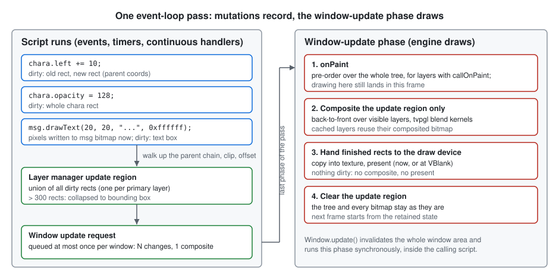

# Rendering Model

This chapter explains how a TJS script gets pixels on screen. Kirikiri Z
renders in **retained mode**: script builds a persistent tree of `Layer`
objects, much like a DOM. It then mutates that tree. The engine decides
when to redraw, and redraws only what changed. There is no per-frame `draw`
callback that script must implement.

The planned Window, Layer and Transitions chapters will specify the
individual classes. This chapter fixes the model they share.

**Sources**

- `krkrz/visual/LayerIntf.cpp`, `krkrz/visual/LayerIntf.h`
- `krkrz/visual/LayerManager.cpp`, `krkrz/visual/LayerManager.h`
- `krkrz/visual/WindowIntf.cpp`, `krkrz/visual/WindowIntf.h`
- `krkrz/visual/win32/DrawDevice.cpp`, `krkrz/visual/win32/DrawDevice.h`,
  `krkrz/visual/win32/BasicDrawDevice.cpp`, `krkrz/visual/win32/WindowImpl.cpp`
- `krkrz/environ/win32/WindowFormUnit.cpp`
- `krkrz/base/EventIntf.cpp`, `krkrz/base/SystemIntf.cpp`

> **About the code samples.** Code blocks marked *pseudo-TJS* illustrate the
> model. They use real class and member names where those exist, but they are
> not guaranteed to compile or to match exact signatures.

## Retained, not immediate

In an immediate-mode engine, script owns the frame:

```javascript
// pseudo-TJS — NOT how Kirikiri Z works
while (running) {
    screen.clear();
    screen.draw(bg);
    screen.draw(chara, x, y, alpha);
    screen.draw(messageBox);
    screen.present();
}
```

In Kirikiri Z, script builds the scene once. Afterwards it only states what
changed:

```javascript
// pseudo-TJS
class GameWindow extends Window {
    var base, bg, chara, msg;

    function GameWindow() {
        super.Window();

        base = new Layer(this, null);     // no parent: becomes the primary layer
        base.setImageSize(800, 600);

        bg = new Layer(this, base);       // child of base
        bg.loadImages("room");            // pixels are kept in bg's own bitmap
        bg.visible = true;

        chara = new Layer(this, base);    // later siblings are drawn on top
        chara.loadImages("hero");
        chara.setPos(400, 120);
        chara.visible = true;

        msg = new Layer(this, base);
        msg.setSize(800, 160);
        msg.top = 440;
        msg.fillRect(0, 0, 800, 160, 0x80000000);
        msg.drawText(20, 20, "Hello.", 0xffffff);
        msg.visible = true;

        // No draw or present call. Once this constructor returns to the
        // event loop, the engine composites the tree and shows it.
    }
}
```

The two models differ as follows:

| | Immediate mode | Kirikiri Z |
|---|---|---|
| Who keeps the scene | Script, in its own variables | The engine, as a `Layer` tree |
| What script does each frame | Redraws everything | Nothing, unless something changes |
| What a property change does | Affects the next `draw` call | Marks screen area as dirty |
| When pixels reach the screen | When script calls `present` | Once per event-loop pass, if anything is dirty |
| Cost of an unchanged frame | Full redraw | Zero: no composite, no present |

## The retained state

### The tree

- A `Layer` constructed with a `null` parent becomes the **primary layer** of
  its window. A new `tTVPLayerManager` is created and attached to it
  (`krkrz/visual/LayerIntf.cpp` — `tTJSNI_BaseLayer::Construct`, `:461-473`).
  Every other layer joins an existing parent and shares that parent's manager
  (`:452-459`).
- A layer cannot move under a different primary layer
  (`tTJSNI_BaseLayer::Join`, `TVPCannotMoveToUnderOtherPrimaryLayer`). Each
  window therefore holds one closed tree.
- Siblings are drawn back to front in child order. `order` and `absolute`
  change this order (`LayerIntf.cpp:8536-8574`,
  `tTJSNI_BaseLayer::ChildChangeOrder`).
- New layers start hidden (`Visible = false`, `LayerIntf.cpp:323`). The
  primary layer is forced visible with opacity 255 when attached
  (`krkrz/visual/LayerManager.cpp:134-136`). A primary layer cannot be hidden,
  made translucent, or moved (`SetVisible`, `SetOpacity`, `SetLeft`).

### What each layer keeps

Each layer keeps two kinds of state. The engine reads both at composite time.

- **Node state:** position and size, `visible`, `opacity`, display `type`
  (blend mode), order among siblings, and `imageLeft`/`imageTop`.
- **Pixel state:** the layer's own main image (32-bit ARGB) and an optional
  province image (`MainImage`, `ProvinceImage`). These hold only what was
  drawn *into this layer*. Children are not part of them.

The composited picture is **not** kept per layer, unless the layer is cached
(see [Caching](#caching-a-subtree)). The final window image is the only
composite that always persists, and it lives in the draw device.

## Mutations invalidate; they never draw to the screen

Every native setter and drawing method updates the retained state first. It
then calls `tTJSNI_BaseLayer::Update` to declare which area of the screen is
now stale. None of them composites or presents.

| TJS operation | Area marked dirty | Source (`LayerIntf.cpp`) |
|---|---|---|
| `visible = false` / `true` | Whole layer, while it is still visible: before hiding, after showing | `SetVisible` |
| `opacity` | Whole layer | `SetOpacity` |
| `left`, `top`, `setPos` | Whole layer at the old position and again at the new one, in parent coordinates | `SetLeft`, `SetTop`, `SetPosition`, `ParentUpdate` |
| `width`, `height`, `setSize` | Whole layer before and after the resize | `InternalSetSize`, `SetWidth`, `SetHeight` |
| `type` | Whole layer | `SetType` |
| `imageLeft`, `imageTop` | Whole layer | `SetImageLeft`, `SetImageTop`, `SetImagePosition` |
| `order`, `absolute` | Only where the moved layer overlaps each sibling it passes | `ChildChangeOrder` |
| Leaving a parent (`parent =`, `invalidate`) | Whole layer at its old place | `Part` |
| `loadImages`, `assignImages` | Whole layer | `LoadImages`, `AssignImages` |
| `fillRect`, `colorRect`, `drawText`, `copyRect`, `stretchCopy`, `affineCopy`, `operateRect`, `piledCopy`, … | The clipped destination rectangle | `FillRect`, `DrawText`, `CopyRect`, … |
| `setMainPixel`, `setMaskPixel` | One pixel | `SetMainPixel`, `SetMaskPixel` |
| `adjustGamma`, `doGrayScale`, `flipLR`, `flipUD` | Whole layer | `AdjustGamma`, `DoGrayScale`, `LRFlip`, `UDFlip` |
| `update()`, `update(l, t, w, h)` | The given area (default: whole layer); also sets `callOnPaint` | `UpdateByScript` (`LayerIntf.h:864-865`) |
| Writes through `mainImageBufferForWrite` | **Nothing** (see the Quirk below) | `GetMainImagePixelBufferForWrite` |

Drawing methods are **immediate on the layer's bitmap**. After
`msg.drawText(...)` returns, the glyphs are in `msg`'s main image and can be
read back with `getMainPixel`. The *screen* still shows the old picture until
the next composite.

### Many changes, one composite

```javascript
// pseudo-TJS: inside one event handler
chara.left += 10;              // dirty: chara's old and new rectangles
chara.opacity = 128;           // dirty: chara's rectangle
msg.drawText(20, 60, "...");   // msg's bitmap changes now; dirty: the text box

// The screen has not changed yet. When this handler returns, the loop pass
// finishes. Its window-update phase then composites the union of the three
// areas, once.
```

> **Quirk — raw pixel writes do not invalidate.** Reading
> `mainImageBufferForWrite` (or `provinceImageBufferForWrite`) only sets the
> internal `ImageModified` flag (`LayerIntf.cpp:2671-2695`). No region becomes
> dirty. A script or plugin that writes pixels through the raw pointer must
> call `update()` itself, or the change appears only when something else
> repaints that area. A reimplementation **MUST NOT** add automatic
> invalidation here. Doing so changes when `onPaint` fires and which frames
> show partly written data.
>
> ```javascript
> // pseudo-TJS
> var p = layer.mainImageBufferForWrite;
> SomePlugin.writePixels(p, layer.mainImageBufferPitch);
> layer.update();   // required; without it the screen keeps the old pixels
> ```

> **Quirk — re-parenting does not invalidate the new location.** Setting
> `parent` calls `Join` → `Part` → `AddChild` (`LayerIntf.cpp:578-618`).
> `Part` invalidates the layer's old area. `AddChild` does not invalidate
> anything, so a visible layer moved under a new parent is not drawn there
> until some other change dirties that area. **Unverified:** whether any shipped game
> depends on this. Most scripts set `parent` while the layer is still
> hidden, which avoids the problem.
>
> **Open question:** assigning a non-object (e.g. `null`) to `parent` passes an
> uninitialized local pointer to `SetParent` (`LayerIntf.cpp:8504-8513`), so
> the behavior is undefined. No rule here depends on it; the Layer chapter
> has to decide what a reimplementation does.

## How dirtiness propagates

1. `Update(rect)` clips the rectangle to the layer's own bounds
   (`tTJSNI_BaseLayer::InternalUpdate`, `Update`; `LayerIntf.cpp:4909-4983`).
2. The rectangle is passed to the parent, which offsets it into its own
   coordinates and clips it again. This repeats up to the primary layer
   (`UpdateChildRegion`, `:4869-4907`). Each cached ancestor on the way also
   records the area for recomputation.
3. At the top, the area is added to the manager's `UpdateRegion`
   (`tTVPLayerManager::AddUpdateRegion`, `LayerManager.cpp:1043-1056`) **only
   if the originating layer is node-visible**. A layer is node-visible when it
   and all of its ancestors are visible (`GetNodeVisible`,
   `LayerIntf.h:308`). Opacity is ignored here, so an `opacity = 0` layer still
   produces dirty areas.
4. `UpdateRegion` is a union of rectangles. Once it holds more than 300
   rectangles (`TVP_UPDATE_UNITE_LIMIT`, `LayerIntf.h:144`), it collapses to
   their bounding box.
5. Each addition calls `NotifyLayerImageChange` on the draw device. For the
   window's primary manager, that becomes `Window::RequestUpdate`
   (`win32/DrawDevice.cpp:191-196`, `WindowIntf.cpp:672-678`).

Script changes inside a hidden subtree therefore cost nothing on screen.
Making the subtree visible dirties its whole area once.

## When the composite happens



`RequestUpdate` does not draw. It queues the window in a dedicated queue
(`TVPPostWindowUpdate`, `krkrz/base/EventIntf.cpp:662-702`):

- While updates are not being delivered, a window already in the queue is not
  added again. Any number of changes between two composites produce one entry.
- While updates *are* being delivered, a window may be queued at most twice.
  Changes made during delivery can therefore queue a second entry. Because
  the delivery loop re-checks the queue size, that entry is delivered in the
  same pass (`TVPDeliverWindowUpdateEvents`, `:733-754`).

The queue is drained in the **last phase** of an event-loop pass. That phase
runs after the input, normal and idle events and after the continuous handlers
(`TVPDeliverAllEvents`, `EventIntf.cpp:608-643`; see the event-loop section of
the [Architecture Overview](../architecture.md)). Any script that runs during a
pass can therefore still affect that pass's frame.

For each queued window, `tTJSNI_BaseWindow::UpdateContent`
(`WindowIntf.cpp:627-637`) does the following:

1. **`onPaint`.** `tTJSNI_BaseLayer::BeforeCompletion` walks the *whole* tree
   in pre-order (`LayerIntf.cpp:5031-5088`). For each layer whose
   `callOnPaint` flag is set, it clears the flag and calls `onPaint`
   synchronously (`TVP_EPT_IMMEDIATE`). The same walk advances active
   transitions.
2. **Fix the region.** `CompleteForWindow` takes the manager's `UpdateRegion`
   only *after* the `onPaint` walk (`LayerIntf.cpp:6079-6102`). Drawing done
   inside `onPaint` is therefore included in this frame.
3. **Composite.** `InternalComplete2` draws only the dirty rectangles,
   recursing back to front through visible layers (`Draw`, `:5529`). It then
   clears the region (`:6062`).
4. **Present.** The draw device receives the finished rectangles, uploads
   them, and presents. With `Window.waitVSync` set, the present is deferred
   to the VSync thread (`WindowIntf.cpp:633`, `DeliverDrawDeviceShow`).

If nothing is dirty, nothing is queued. No composite or present happens, and
when no continuous handlers are registered the main loop sleeps.

### Animation is just repeated mutation

Script that needs per-frame motion registers a continuous handler. The
handler receives the current tick (`_TVPDeliverContinuousEvent`,
`EventIntf.cpp:948-997`) and mutates the tree. Rendering still goes through
the same invalidate-then-composite path:

```javascript
// pseudo-TJS
var start = System.getTickCount();

function onTick(tick) {
    // Runs once per loop pass. It only changes state; the window-update phase
    // later in the same pass draws the result.
    chara.left = 100 + ((tick - start) \ 4) % 600;
}

System.addContinuousHandler(onTick);
// ... later
System.removeContinuousHandler(onTick);
```

Registering a handler also stops the loop from sleeping
(`TVPAddContinuousHandler` → `TVPBeginContinuousEvent`, `EventIntf.cpp:1078-1089`).
That is the only sense in which the engine "renders every frame". Even then,
a pass that changes nothing composites nothing.

## `onPaint`: deferred drawing

`update()` both dirties an area and sets `callOnPaint`. Script can also set
the flag directly through the `callOnPaint` property
(`LayerIntf.cpp:9418-9436`). The flag is a one-shot request: "call me back just
before the next composite". This lets a layer redraw from its model
once, however often the model changed:

```javascript
// pseudo-TJS
class Gauge extends Layer {
    var value = 0;

    function Gauge(win, parent) {
        super.Layer(win, parent);
        setSize(200, 16);
        visible = true;
    }

    function set(v) {
        value = v;
        update();          // cheap: dirty area + callOnPaint, no pixels touched
    }

    function onPaint() {   // runs once, during the window-update phase
        fillRect(0, 0, width, height, 0xff202020);
        fillRect(0, 0, width * value \ 100, height, 0xff40c040);
        // These fillRects dirty more area; it joins the current frame.
    }
}

gauge.set(10);
gauge.set(20);
gauge.set(30);   // one composite, one onPaint, drawn with value == 30
```

The native `Layer.onPaint` forwards to the action owner, which is the first
constructor argument (`LayerIntf.cpp:8444-8456`). A subclass that overrides
`onPaint` receives the call directly.

> **Quirk — `onPaint` on a hidden layer is delayed, not dropped.** The
> `BeforeCompletion` walk visits every layer, hidden or not. A hidden layer's
> `update()`, however, does not dirty the window (step 3 of
> [propagation](#how-dirtiness-propagates)). Its `onPaint` therefore runs at
> the next composite triggered by *something else*, which may be much later.
> A reimplementation **MUST** keep both halves: the walk ignores visibility,
> and hidden layers do not trigger a composite.

## Forcing a synchronous composite: `Window.update`

`Window.update()` is the only way for script to make the frame appear
**before** the current script returns. On Win32 it invalidates the whole
window area and then drains the window-update queue immediately
(`TTVPWindowForm::UpdateWindow`, `krkrz/environ/win32/WindowFormUnit.cpp:931-941`).
If update delivery is already in progress, the drain returns without doing
anything (`EventIntf.cpp:735`).

```javascript
// pseudo-TJS
loadingLayer.visible = true;
window.update();          // composite and present now
doLongBlockingWork();     // the loading layer stays visible during this call
```

With `waitVSync` enabled, `Present` is left to the VSync thread
(`WindowIntf.cpp:633`). Its message cannot be handled while
`doLongBlockingWork` blocks the main thread, so the frame is composited but
**Inferred:** not shown until the main thread returns to the loop.

> **Quirk — the `type` argument is effectively ignored.** The native method
> checks `param[1]` and then reads `param[0]` (`WindowIntf.cpp:794-796`), so
> passing one argument always yields `utNormal`. In any case, the Win32
> backend ignores `type` and always invalidates the whole window. A
> reimplementation **SHOULD** treat `update()` as "invalidate everything,
> composite now", whatever argument is passed.

## Caching a subtree

Setting `cached = true` gives a layer a second bitmap. That bitmap holds the
composite of the layer and all of its descendants (`SetCached`,
`IncCacheEnabledCount`; `LayerIntf.cpp:3669-3700`). Dirty areas inside the
subtree are recorded in the layer's `CacheRecalcRegion` (`:4884-4892`). At
composite time, only those areas are recomputed. Everything else is
copied from the cache (`Draw`, `:5558-5636`). `piledCopy` enables the cache
temporarily on its source layer (`:4117-4129`).

Caching is purely a performance tool. It does not change which areas are
dirty on screen or when `onPaint` runs.

## Transitions

A running transition is driven by the engine, not by script mutations. It
registers a continuous-event hook (`StartTransition`, `LayerIntf.cpp:6307`).
On each tick, `InvokeTransition` dirties the destination with
`tempupdate = true` (`:6455-6481`). That marks the area for compositing but does not mark
caches for recomputation, because the layers' own pixels have not changed.
The planned Transitions chapter will specify the details.

## Requirements for a reimplementation

A reimplementation **MUST**:

- keep the `Layer` tree and per-layer bitmaps as the only rendering input
  that script sees. There is no script-visible frame callback other than
  `onPaint` and continuous handlers;
- apply drawing methods to the layer's bitmap synchronously, so that pixel
  reads in the same script turn see the result;
- never composite or present synchronously from a setter or drawing method.
  `Window.update` is the only synchronous path;
- merge all invalidations between two composites into one composite per
  window, and run it after the continuous handlers of the same loop pass;
- fire `onPaint` in pre-order over the whole tree before the update region
  is fixed, so that drawing inside `onPaint` reaches the same frame;
- suppress window invalidation from layers that are not node-visible;
- skip compositing and presenting entirely when nothing is dirty.

A reimplementation **MAY** composite a larger area than the exact dirty
region. For example, it may redraw the whole window on the GPU every time it
composites. **Inferred:** re-blending an area whose layer state has not
changed gives the same pixels, and the original already enlarges regions
whenever it collapses them to a bounding box. The behavior above is what
script can observe: which callbacks run, when they run, and which pixels can
be read back.

**Open question:** whether the second queue entry allowed during delivery
(see [When the composite happens](#when-the-composite-happens)) ever does
work in practice, or always finds an empty region. That depends on whether
any path adds dirty area after `CompleteForWindow` has taken the region, which
has not been traced.
